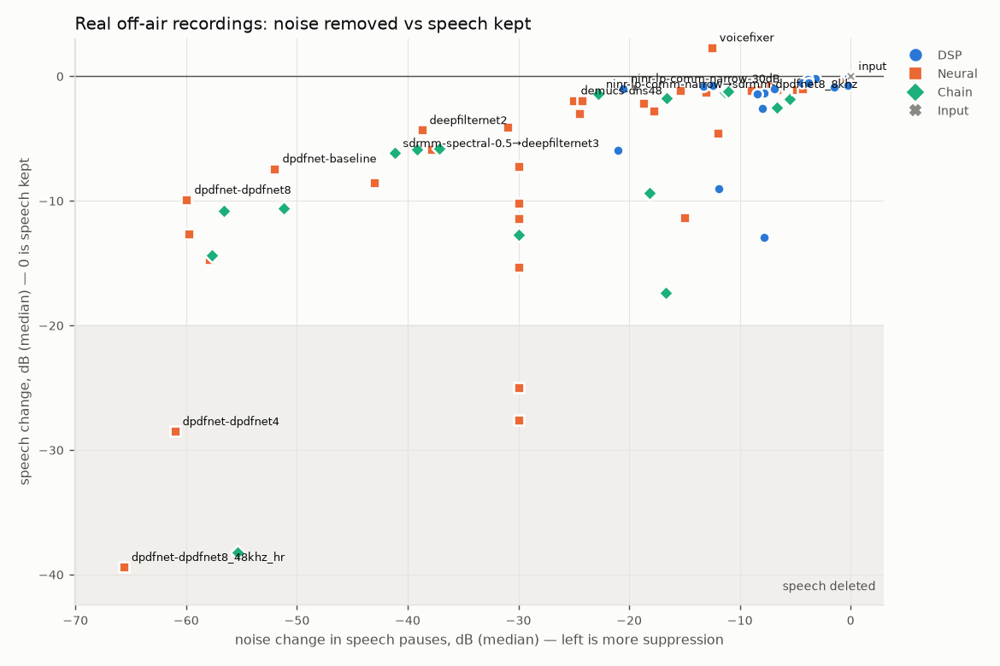
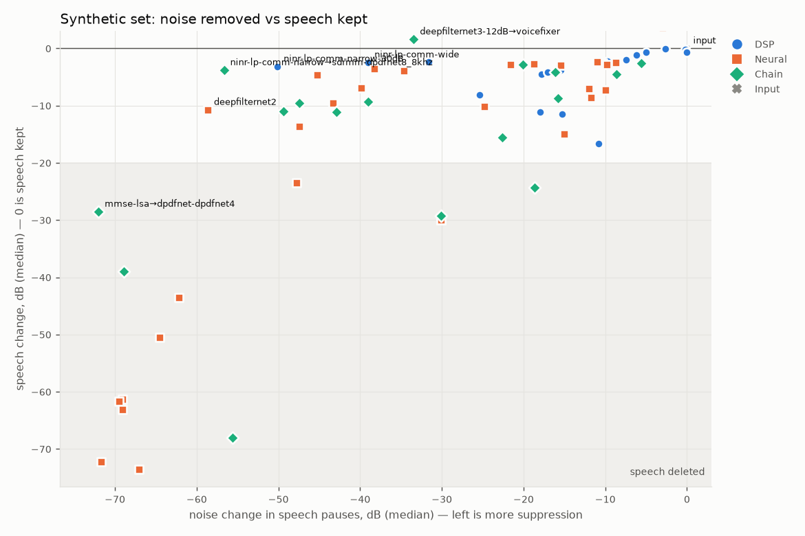
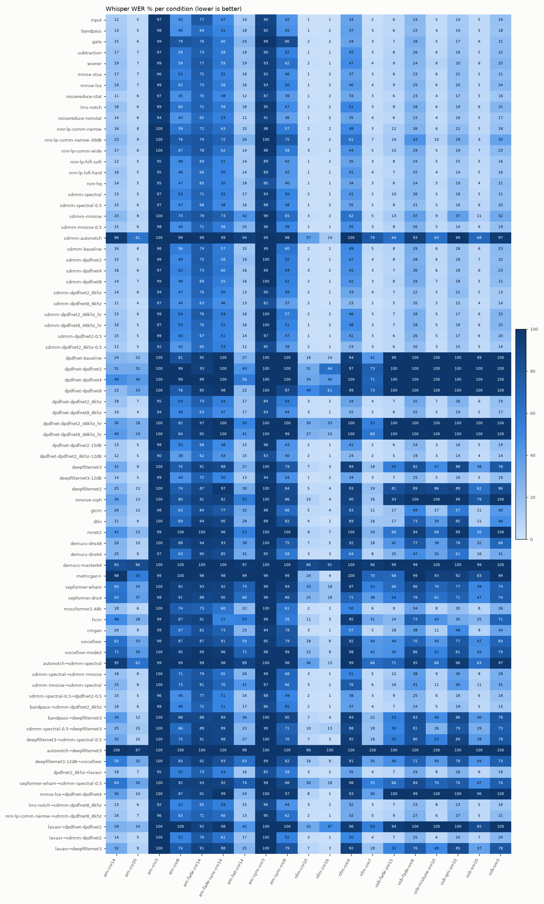

# Speech-over-Radio Benchmark

How well do speech denoisers — classic DSP, small real-time networks, large
enhancement models, generative restorers and **chains of them** — clean up speech that
arrived over a radio link? Radio noise is not the café noise these models are trained
on: FM threshold clicks, AM hiss that pumps with the AGC, SSB band noise, QRN crashes,
heterodyne whistles, selective fading, all squeezed into 300–3000 Hz.

This repository measures that, end to end, on two test sets:

* **Synthetic** — 228 LibriSpeech sentences sent through 19 simulated links
  (NFM, AM envelope/synchronous, SSB; AWGN, Watterson fading, QRN, heterodyne, mistuning),
  48 min. Every clip has a clean-channel reference and a transcript, so PESQ,
  ESTOI, SI-SDR and **Whisper WER** are exact.
* **Real** — 286 real clips (70 min):
  * off-air recordings — repeaters, CB, airband ATC/ATIS, shortwave broadcast, HF
    amateur/aero/maritime SSB, satellites, plus HF IQ recordings demodulated here. No
    reference exists, so they are scored the way a listener judges a denoiser: how much the
    pauses are quieted, how much the speech is changed, and DNSMOS;
  * 120 real VHF airband ATC utterances with human transcripts (real-world WER);
  * 96 LibriSpeech utterances actually transmitted over HF SSB and received by KiwiSDRs
    across Europe (Zenodo 5927810) — real channel *and* a clean reference, half of them with
    the receiver 300 Hz off.

77 methods, 18 of them combined chains. Last run: **2026-10-03** on arm64 / Darwin 27.0.0
(Apple Silicon, 16 cores, 48 GB), code at commit `0fbcb34`.

> **The README is generated.** `uv run sorb all` re-runs everything that is not cached
> and rewrites this file from `results/*.csv`; `uv run sorb report` only rewrites it.
> Nothing below is typed by hand except the prose templates in `sorb/report.py`.

## Headline findings

_Generated from the data on every run._

- **Most intelligible (synthetic, Whisper WER):** `dpdfnet-dpdfnet2_8khz-12dB` at 25.1 % vs 28.3 % for the untouched input.
- **68 of 76 methods make speech *harder* for ASR than doing nothing** (higher WER than the input), worst: `autonotch→deepfilternet3`, `demucs-master64`, `dpdfnet-dpdfnet4`, `metricgan+`, `dpdfnet-dpdfnet2`.
- Best on **NFM** by WER: `sdrmm-dpdfnet8_8khz` (7.2 %).
- Best on **AM** by WER: `sdrmm-dpdfnet8_8khz` (43.1 %).
- Best on **SSB** by WER: `dpdfnet-dpdfnet2_8khz-12dB` (10.0 %).
- **Best quality (PESQ-NB):** `sdrmm-dpdfnet8_8khz` at 2.36 (input 1.75); best ESTOI: `dpdfnet-dpdfnet8_8khz` (0.583).
- **DPDFNet's wideband models delete radio speech; its 8 kHz models do not.** Upstream DPDFNet (16/48 kHz) changes speech by −50 to −74 dB on the synthetic set, the 8 kHz variants by −2.9 dB. It is not the SDR-- port (same behaviour upstream), not fixed by bandwidth extension first, and only partly by input level — see below.
- **SDR-- neural denoisers are 40–44 ms later than their `latency()` reports** (measured on every clip, constant per model). The benchmark compensates it (`sorb realign`); SDR-- itself should add the model's look-ahead and resampler delay to `latency()`.
- **The SDR-- auto-notch removes speech, not just tones:** speech −16.6 dB, WER 81.9 % (input 28.3 %). Its 4-sample (83 µs) decorrelation delay makes voiced speech predictable. The same LMS idea with a 2 ms delay at 8 kHz (`lms-notch`) keeps speech (−0.7 dB, WER 32.8 %).
- **On fading AM the detector matters more than any denoiser:** synchronous detection alone takes WER from 76.9 % to 46.5 %.
- **Real recordings, best SNR gain while keeping speech (speech change > −3 dB):** `ninr-lp-comm-narrow→sdrmm-dpdfnet8_8khz`: +20.2 dB, noise −22.8 dB, speech −1.44 dB.
- **Speech deleted on real radio audio (median speech change < −20 dB or mute):** `autonotch→deepfilternet3`, `dpdfnet-dpdfnet4`, `dpdfnet-dpdfnet8_48khz_hr`, `sdrmm-dpdfnet4`, `sdrmm-dpdfnet8_48khz_hr`.

## Real off-air recordings

Speech/non-speech frames come from Silero VAD on the received audio. Per clip:
**noise suppression** = level change in the non-speech frames, **speech change** = level
change in the speech frames (0 dB = speech kept; it also falls a little because the noise
under the speech goes too), **SNR gain** = speech change − noise change. Medians across
clips, means in brackets. A method whose median speech change is below −20 dB is marked
*speech deleted* and gets no SNR gain; one whose output sits below −60 dBFS is a *complete
mute*. **Bold** = best among methods that keep the speech.



### At a glance

| engine | NFM: noise suppression, median (mean) | NFM: speech change | NFM: SNR gain | AM: noise suppression, median (mean) | AM: speech change | AM: SNR gain | SSB: noise suppression, median (mean) | SSB: speech change | SSB: SNR gain | Real HF SSB: noise suppression, median (mean) | Real HF SSB: speech change | Real HF SSB: SNR gain |
| :-- | --: | --: | --: | --: | --: | --: | --: | --: | --: | --: | --: | --: |
| `bandpass` | −2.0 (−5.4) dB | −1.51 dB | +0.6 dB | −1.7 (−2.8) dB | −0.87 dB | +0.1 dB | −0.4 (−0.7) dB | −0.35 dB | +0.1 dB | −1.5 (−1.8) dB | −1.88 dB | −0.3 dB |
| `gate` | −0.0 (−2.2) dB | **−0.04 dB** | +0.0 dB | −0.1 (−0.7) dB | **−0.01 dB** | +0.1 dB | −0.3 (−1.5) dB | **−0.04 dB** | +0.3 dB | −8.3 (−9.6) dB | −0.34 dB | +5.6 dB |
| `subtraction` | −6.2 (−6.4) dB | −1.74 dB | +3.9 dB | −3.9 (−4.6) dB | −1.25 dB | +2.4 dB | −6.5 (−7.2) dB | −2.44 dB | +4.4 dB | −13.6 (−13.0) dB | −2.98 dB | +7.8 dB |
| `wiener` | −6.3 (−6.5) dB | −2.09 dB | +4.8 dB | −5.0 (−5.7) dB | −1.73 dB | +2.3 dB | −7.8 (−8.5) dB | −3.47 dB | +5.2 dB | −16.5 (−15.1) dB | −4.03 dB | +9.1 dB |
| `mmse-stsa` | −5.3 (−7.1) dB | −2.78 dB | +2.9 dB | −5.3 (−6.2) dB | −2.30 dB | +3.5 dB | −7.7 (−8.1) dB | −3.05 dB | +4.8 dB | −14.0 (−12.9) dB | −3.47 dB | +7.3 dB |
| `mmse-lsa` | −5.2 (−6.2) dB | −2.07 dB | +4.2 dB | −4.8 (−5.1) dB | −1.65 dB | +2.4 dB | −7.4 (−8.2) dB | −3.26 dB | +4.9 dB | −15.6 (−14.4) dB | −3.80 dB | +8.7 dB |
| `noisereduce-stat` | −9.5 (−10.7) dB | −10.74 dB | −0.9 dB | −13.7 (−13.6) dB | −11.04 dB | +2.0 dB | −12.4 (−12.6) dB | −10.20 dB | +1.9 dB | −15.9 (−15.6) dB | −12.59 dB | +2.9 dB |
| `lms-notch` | −0.3 (−3.6) dB | −0.64 dB | −0.2 dB | −0.5 (−1.2) dB | −0.96 dB | −0.4 dB | −0.2 (−0.5) dB | −0.67 dB | −0.4 dB | −0.0 (−0.2) dB | −0.59 dB | −0.5 dB |
| `noisereduce-nonstat` | −11.9 (−12.2) dB | −9.18 dB | +1.6 dB | −12.2 (−12.3) dB | −10.41 dB | +2.0 dB | −13.2 (−13.5) dB | −11.13 dB | +1.4 dB | −12.7 (−12.0) dB | −11.80 dB | −0.2 dB |
| `ninr-lp-comm-narrow` | −5.7 (−8.7) dB | −1.43 dB | +5.0 dB | −4.6 (−11.2) dB | −0.26 dB | +4.8 dB | −8.0 (−9.6) dB | −1.52 dB | +8.6 dB | −25.1 (−33.9) dB | −2.93 dB | +21.0 dB |
| `ninr-lp-comm-narrow-30dB` | −6.5 (−9.2) dB | −1.53 dB | +5.7 dB | −4.7 (−12.2) dB | −0.37 dB | +4.9 dB | −9.7 (−11.7) dB | −1.88 dB | +10.5 dB | −36.5 (−41.7) dB | −4.14 dB | +31.8 dB |
| `ninr-lp-comm-wide` | −5.1 (−8.2) dB | −1.05 dB | +4.3 dB | −5.2 (−15.2) dB | −0.24 dB | +6.7 dB | −8.1 (−9.5) dB | −1.49 dB | +8.5 dB | −27.1 (−34.9) dB | −2.49 dB | +21.6 dB |
| `ninr-lp-hifi-soft` | −0.5 (−0.8) dB | −0.08 dB | +0.0 dB | −0.2 (−0.6) dB | −0.02 dB | +0.1 dB | −1.0 (−1.5) dB | −0.39 dB | +0.8 dB | −5.1 (−5.0) dB | −1.10 dB | +3.2 dB |
| `ninr-lp-lofi-hard` | −0.8 (−1.1) dB | −0.12 dB | −0.0 dB | −0.3 (−1.0) dB | −0.03 dB | +0.2 dB | −1.8 (−2.4) dB | −0.62 dB | +1.1 dB | −7.5 (−7.1) dB | −1.61 dB | +4.5 dB |
| `ninr-hq` | −10.3 (−11.4) dB | −11.29 dB | +2.1 dB | −15.3 (−15.1) dB | −6.17 dB | +8.5 dB | −15.1 (−15.6) dB | −8.82 dB | +8.4 dB | −25.7 (−24.3) dB | −7.57 dB | +14.9 dB |
| `sdrmm-spectral` | −2.4 (−3.9) dB | −1.20 dB | +0.2 dB | −1.6 (−2.6) dB | −0.44 dB | +1.1 dB | −4.1 (−5.3) dB | −1.74 dB | +2.8 dB | −10.8 (−10.8) dB | −2.19 dB | +6.8 dB |
| `sdrmm-spectral-0.5` | −2.1 (−3.0) dB | −1.07 dB | +0.2 dB | −1.5 (−2.2) dB | −0.42 dB | +1.0 dB | −3.6 (−4.2) dB | −1.59 dB | +2.4 dB | −7.8 (−7.6) dB | −1.97 dB | +5.2 dB |
| `sdrmm-rnnoise` | −14.4 (−13.2) dB | −2.92 dB | +11.7 dB | −6.8 (−7.1) dB | −1.25 dB | +3.5 dB | −10.9 (−11.7) dB | −2.70 dB | +5.7 dB | −3.4 (−4.7) dB | −1.78 dB | +0.8 dB |
| `sdrmm-rnnoise-0.5` | −11.3 (−9.4) dB | −2.68 dB | +8.3 dB | −6.0 (−5.7) dB | −1.12 dB | +3.1 dB | −9.2 (−8.8) dB | −2.42 dB | +4.4 dB | −3.2 (−4.1) dB | −1.62 dB | +0.8 dB |
| `sdrmm-autonotch` | −11.1 (−14.2) dB | −13.29 dB | −2.1 dB | −13.6 (−13.5) dB | −16.00 dB | −4.1 dB | −13.4 (−13.9) dB | −18.97 dB | −3.7 dB | −7.6 (−7.7) dB | −13.25 dB | −5.4 dB |
| `sdrmm-baseline` | −30.0 (−29.8) dB | −25.84 dB, speech deleted | — | −28.4 (−24.9) dB | −5.24 dB | +14.5 dB | −29.4 (−24.7) dB | −8.89 dB | +10.4 dB | −30.0 (−27.2) dB | −3.04 dB | +23.5 dB |
| `sdrmm-dpdfnet2` | −30.0 (−29.8) dB | −27.23 dB, speech deleted | — | −30.0 (−27.2) dB | −11.19 dB | +15.9 dB | −29.9 (−26.4) dB | −22.65 dB, speech deleted | — | −30.0 (−27.9) dB | −4.40 dB | +22.1 dB |
| `sdrmm-dpdfnet4` | −30.0 (−29.3) dB | −26.60 dB, speech deleted | — | −30.0 (−29.0) dB | −15.61 dB | +10.1 dB | −29.9 (−27.7) dB | −28.71 dB, speech deleted | — | −30.0 (−27.9) dB | −7.05 dB | +18.3 dB |
| `sdrmm-dpdfnet8` | −29.9 (−28.8) dB | −14.74 dB | +15.8 dB | −30.0 (−26.9) dB | −9.77 dB | +13.9 dB | −30.0 (−27.5) dB | −28.84 dB, speech deleted | — | −30.0 (−27.7) dB | −4.86 dB | +22.0 dB |
| `sdrmm-dpdfnet2_8khz` | −19.4 (−18.0) dB | −3.67 dB | +15.4 dB | −12.7 (−14.4) dB | −1.20 dB | +10.9 dB | −10.1 (−12.3) dB | −2.14 dB | +7.7 dB | −9.7 (−9.5) dB | −1.89 dB | +6.4 dB |
| `sdrmm-dpdfnet8_8khz` | −18.7 (−17.6) dB | −3.07 dB | +15.2 dB | −11.2 (−12.6) dB | −0.94 dB | +9.5 dB | −9.4 (−10.2) dB | −2.12 dB | +7.0 dB | −5.0 (−6.4) dB | −1.93 dB | +2.0 dB |
| `sdrmm-dpdfnet2_48khz_hr` | −29.3 (−27.8) dB | −11.30 dB | +17.9 dB | −29.4 (−27.1) dB | −5.52 dB | +21.4 dB | −29.8 (−25.2) dB | −6.21 dB | +12.1 dB | −30.0 (−28.1) dB | −6.57 dB | +20.8 dB |
| `sdrmm-dpdfnet8_48khz_hr` | −30.0 (−28.4) dB | −13.28 dB | +13.8 dB | −30.0 (−27.7) dB | −19.92 dB | +9.3 dB | −30.0 (−27.5) dB | −28.30 dB, speech deleted | — | −30.1 (−29.0) dB | −6.18 dB | +21.4 dB |
| `sdrmm-dpdfnet2-0.5` | −15.0 (−15.0) dB | −14.75 dB | +0.2 dB | −15.0 (−14.6) dB | −9.36 dB | +4.6 dB | −15.0 (−14.3) dB | −14.17 dB | +0.6 dB | −15.1 (−14.6) dB | −3.91 dB | +10.3 dB |
| `sdrmm-dpdfnet2_8khz-0.5` | −13.9 (−11.7) dB | −3.44 dB | +9.6 dB | −10.2 (−9.9) dB | −1.08 dB | +8.4 dB | −8.7 (−9.2) dB | −1.92 dB | +6.6 dB | −8.1 (−7.8) dB | −1.75 dB | +5.1 dB |
| `dpdfnet-baseline` | complete mute (−58.9) | −27.13 dB, speech deleted | — | −34.1 (−40.0) dB | −5.71 dB | +27.2 dB | −48.7 (−41.2) dB | −8.34 dB | +14.0 dB | −50.4 (−46.8) dB | −3.07 dB | +41.7 dB |
| `dpdfnet-dpdfnet2` | −64.0 (−60.5) dB | −31.45 dB, speech deleted | — | −57.8 (−48.3) dB | −10.86 dB | +34.2 dB | −51.1 (−47.5) dB | −23.52 dB, speech deleted | — | −58.2 (−51.0) dB | −4.01 dB | +40.1 dB |
| `dpdfnet-dpdfnet4` | complete mute (−58.4) | −37.46 dB, speech deleted | — | **−59.4 (−52.0) dB** | −15.78 dB | +30.9 dB | complete mute (−52.1) | −36.07 dB, speech deleted | — | −58.0 (−51.9) dB | −6.51 dB | +37.4 dB |
| `dpdfnet-dpdfnet8` | −50.9 (−51.4) dB | −15.07 dB | +27.6 dB | −54.7 (−47.2) dB | −8.80 dB | +21.8 dB | complete mute (−53.5) | −37.91 dB, speech deleted | — | −53.2 (−49.8) dB | −4.92 dB | +39.3 dB |
| `dpdfnet-dpdfnet2_8khz` | −19.5 (−19.3) dB | −3.69 dB | +15.4 dB | −14.3 (−18.8) dB | −1.31 dB | +11.4 dB | −10.8 (−12.7) dB | −2.12 dB | +7.9 dB | −12.5 (−13.1) dB | −1.88 dB | +9.6 dB |
| `dpdfnet-dpdfnet8_8khz` | −19.0 (−18.7) dB | −3.10 dB | +15.5 dB | −10.7 (−12.8) dB | −0.91 dB | +8.2 dB | −9.1 (−10.4) dB | −2.19 dB | +6.7 dB | −8.5 (−9.8) dB | −1.99 dB | +5.0 dB |
| `dpdfnet-dpdfnet2_48khz_hr` | −39.2 (−43.1) dB | −11.84 dB | **+32.2 dB** | −42.5 (−44.8) dB | −6.17 dB | +28.9 dB | **−59.6 (−50.2) dB** | −9.67 dB | **+32.4 dB** | −63.8 (−55.4) dB | −6.53 dB | +44.2 dB |
| `dpdfnet-dpdfnet8_48khz_hr` | −66.8 (−57.0) dB | −13.59 dB | +31.5 dB | −59.2 (−52.3) dB | −22.32 dB, speech deleted | — | complete mute (−57.0) | −40.12 dB, speech deleted | — | **−68.0 (−61.2) dB** | −6.46 dB | **+45.4 dB** |
| `dpdfnet-dpdfnet2-15dB` | −15.0 (−15.0) dB | −14.78 dB | +0.2 dB | −15.0 (−14.7) dB | −9.16 dB | +5.5 dB | −15.0 (−14.3) dB | −14.01 dB | +1.0 dB | −15.0 (−14.6) dB | −3.65 dB | +10.2 dB |
| `dpdfnet-dpdfnet2_8khz-12dB` | −11.4 (−9.6) dB | −3.25 dB | +7.6 dB | −9.7 (−8.7) dB | −1.07 dB | +7.3 dB | −8.1 (−8.0) dB | −1.78 dB | +5.8 dB | −8.1 (−8.2) dB | −1.65 dB | +6.2 dB |
| `deepfilternet3` | −25.7 (−29.2) dB | −13.17 dB | +14.6 dB | −29.5 (−28.1) dB | −5.75 dB | +16.0 dB | −26.6 (−30.2) dB | −7.11 dB | +15.2 dB | −50.1 (−45.1) dB | −5.12 dB | +41.3 dB |
| `deepfilternet3-12dB` | −11.6 (−10.8) dB | −9.13 dB | +2.2 dB | −11.7 (−10.4) dB | −4.66 dB | +6.1 dB | −11.8 (−10.9) dB | −5.57 dB | +4.9 dB | −12.0 (−11.7) dB | −4.02 dB | +7.4 dB |
| `deepfilternet2` | −24.1 (−28.4) dB | −4.97 dB | +19.8 dB | −28.2 (−27.1) dB | −3.19 dB | +23.4 dB | −26.5 (−29.1) dB | −4.78 dB | +17.4 dB | −50.0 (−46.3) dB | −2.96 dB | +42.4 dB |
| `rnnoise-xiph` | −24.8 (−23.9) dB | −5.75 dB | +14.2 dB | −21.2 (−21.3) dB | −2.80 dB | +15.9 dB | −22.5 (−23.9) dB | −9.55 dB | +9.2 dB | −30.4 (−29.0) dB | −2.33 dB | +26.2 dB |
| `gtcrn` | −20.6 (−19.7) dB | −6.46 dB | +14.8 dB | −12.0 (−13.2) dB | −3.72 dB | +7.0 dB | −18.4 (−17.2) dB | −6.65 dB | +10.2 dB | −30.5 (−28.5) dB | −4.87 dB | +21.4 dB |
| `dtln` | −19.6 (−17.1) dB | −4.44 dB | +11.8 dB | −12.1 (−14.1) dB | −1.87 dB | +8.2 dB | −15.3 (−15.9) dB | −4.08 dB | +9.9 dB | −26.2 (−25.1) dB | −2.00 dB | +22.0 dB |
| `nsnet2` | −24.0 (−24.1) dB | −5.22 dB | +19.3 dB | −21.2 (−23.7) dB | −4.08 dB | +17.0 dB | −20.9 (−22.9) dB | −6.29 dB | +14.0 dB | −36.7 (−34.6) dB | −4.51 dB | +27.4 dB |
| `demucs-dns48` | −19.4 (−17.8) dB | −4.57 dB | +7.5 dB | −20.7 (−24.4) dB | −1.77 dB | +13.6 dB | −15.1 (−20.0) dB | −2.88 dB | +10.2 dB | −38.3 (−35.5) dB | −2.18 dB | +33.5 dB |
| `demucs-dns64` | −24.2 (−21.7) dB | −5.23 dB | +16.5 dB | −21.4 (−21.0) dB | −2.30 dB | +15.1 dB | −14.0 (−15.3) dB | −2.59 dB | +9.8 dB | −35.2 (−35.6) dB | −2.07 dB | +30.8 dB |
| `demucs-master64` | −24.0 (−24.3) dB | −14.52 dB | +6.9 dB | −27.0 (−30.5) dB | −9.61 dB | +10.5 dB | −32.6 (−35.0) dB | −18.58 dB | +7.7 dB | −44.5 (−41.1) dB | −4.22 dB | +32.9 dB |
| `metricgan+` | 2.9 (1.7) dB | 7.06 dB | +2.7 dB | 2.1 (0.9) dB | 6.73 dB | +4.9 dB | −2.1 (−3.5) dB | 3.89 dB | +6.9 dB | −6.4 (−4.8) dB | 8.03 dB | +12.9 dB |
| `sepformer-wham` | 6.7 (6.4) dB | 14.09 dB | +4.4 dB | 13.9 (13.4) dB | 19.40 dB | +3.5 dB | 4.6 (3.9) dB | 13.89 dB | +8.4 dB | 4.5 (5.2) dB | 18.94 dB | +12.1 dB |
| `sepformer-dns4` | 21.9 (22.7) dB | 25.26 dB | +2.0 dB | 27.7 (28.1) dB | 24.51 dB | −3.7 dB | 24.1 (23.8) dB | 24.28 dB | +0.0 dB | 19.8 (19.8) dB | 23.62 dB | +3.7 dB |
| `mossformer2-48k` | −17.5 (−16.2) dB | −2.86 dB | +13.1 dB | −6.9 (−9.1) dB | −1.19 dB | +4.7 dB | −10.2 (−13.3) dB | −2.25 dB | +7.5 dB | −31.4 (−30.8) dB | −2.39 dB | +27.5 dB |
| `frcrn` | −12.9 (−14.2) dB | −3.49 dB | +0.7 dB | −8.9 (−13.6) dB | −1.57 dB | +6.2 dB | −22.9 (−24.5) dB | −5.43 dB | +7.8 dB | −0.3 (−0.9) dB | **−0.17 dB** | +0.0 dB |
| `cmgan` | −12.7 (−12.0) dB | −2.82 dB | +8.6 dB | −4.9 (−5.9) dB | −1.16 dB | +3.5 dB | −9.3 (−8.8) dB | −1.91 dB | +6.6 dB | −19.2 (−18.1) dB | −2.26 dB | +13.1 dB |
| `voicefixer` | −7.9 (−6.3) dB | 5.78 dB | +11.9 dB | −5.3 (−7.7) dB | 3.30 dB | +7.9 dB | −5.5 (−5.5) dB | 4.21 dB | +7.5 dB | −21.8 (−22.1) dB | −2.62 dB | +19.3 dB |
| `voicefixer-mode2` | −6.0 (−6.9) dB | 5.73 dB | +12.1 dB | −6.3 (−9.4) dB | 4.82 dB | +10.2 dB | −2.8 (−3.5) dB | 4.74 dB | +8.2 dB | −9.6 (−12.4) dB | 6.26 dB | +15.8 dB |
| `autonotch→sdrmm-spectral` | −14.9 (−17.8) dB | −15.60 dB | −1.3 dB | −16.4 (−16.6) dB | −17.54 dB | −2.4 dB | −20.5 (−20.6) dB | −23.02 dB, speech deleted | — | −17.6 (−17.6) dB | −25.01 dB, speech deleted | — |
| `sdrmm-spectral→sdrmm-rnnoise` | −17.3 (−14.6) dB | −3.41 dB | +12.7 dB | −6.0 (−6.5) dB | −1.03 dB | +4.5 dB | −9.9 (−10.3) dB | −2.56 dB | +7.6 dB | −15.9 (−15.7) dB | −2.37 dB | +10.4 dB |
| `sdrmm-rnnoise→sdrmm-spectral` | −14.7 (−14.0) dB | −2.95 dB | +11.9 dB | −7.1 (−7.8) dB | −1.30 dB | +5.2 dB | −12.0 (−13.8) dB | −2.79 dB | +7.9 dB | −14.5 (−13.7) dB | −2.73 dB | +9.6 dB |
| `sdrmm-spectral-0.5→dpdfnet2-0.5` | −17.0 (−17.6) dB | −14.11 dB | +4.1 dB | −15.9 (−16.3) dB | −9.04 dB | +7.3 dB | −18.2 (−18.2) dB | −11.02 dB | +7.4 dB | −22.7 (−21.6) dB | −3.59 dB | +16.4 dB |
| `bandpass→sdrmm-dpdfnet2_8khz` | −20.6 (−19.3) dB | −3.93 dB | +16.1 dB | −13.1 (−13.3) dB | −2.20 dB | +8.8 dB | −9.7 (−10.7) dB | −2.39 dB | +6.4 dB | −4.6 (−4.8) dB | −4.24 dB | −0.2 dB |
| `bandpass→deepfilternet3` | −38.8 (−41.0) dB | −14.07 dB | +23.9 dB | −52.3 (−47.5) dB | −10.66 dB | +33.3 dB | −45.5 (−40.9) dB | −13.23 dB | +22.0 dB | −58.4 (−54.2) dB | −13.17 dB | +40.2 dB |
| `sdrmm-spectral-0.5→deepfilternet3` | −31.1 (−30.3) dB | −13.22 dB | +17.2 dB | −29.7 (−27.9) dB | −7.14 dB | +14.3 dB | −39.2 (−35.8) dB | −10.39 dB | +14.6 dB | −53.0 (−48.8) dB | −6.70 dB | +43.8 dB |
| `deepfilternet3→sdrmm-spectral-0.5` | −25.7 (−29.9) dB | −13.20 dB | +14.7 dB | −30.2 (−29.1) dB | −5.78 dB | +17.8 dB | −27.2 (−31.4) dB | −7.12 dB | +15.2 dB | −52.0 (−46.9) dB | −5.13 dB | +43.0 dB |
| `autonotch→deepfilternet3` | complete mute (−52.9) | −56.59 dB, speech deleted | — | complete mute (−50.1) | −42.42 dB, speech deleted | — | complete mute (−54.7) | −58.97 dB, speech deleted | — | −58.1 (−56.7) dB | −32.89 dB, speech deleted | — |
| `deepfilternet3-12dB→voicefixer` | −9.3 (−11.5) dB | 0.53 dB | +10.4 dB | −9.6 (−12.9) dB | −0.16 dB | +9.3 dB | −6.9 (−8.3) dB | 1.78 dB | +8.6 dB | −25.5 (−24.0) dB | −2.51 dB | +23.8 dB |
| `dpdfnet2_8khz→lavasr` | −19.5 (−18.9) dB | −3.68 dB | +15.4 dB | −14.2 (−15.9) dB | −1.30 dB | +11.3 dB | −10.8 (−12.7) dB | −2.11 dB | +7.9 dB | −12.4 (−13.1) dB | −1.87 dB | +9.6 dB |
| `sepformer-wham→sdrmm-spectral-0.5` | 6.2 (5.7) dB | 14.02 dB | +4.8 dB | 13.8 (12.4) dB | 19.07 dB | +4.5 dB | 4.1 (3.1) dB | 13.87 dB | +8.5 dB | 2.4 (3.4) dB | 18.84 dB | +14.1 dB |
| `mmse-lsa→dpdfnet-dpdfnet4` | **−69.3 (−53.5) dB** | −18.02 dB | +24.4 dB | −40.5 (−42.0) dB | −12.35 dB | +23.6 dB | −50.7 (−48.3) dB | −25.12 dB, speech deleted | — | −58.4 (−54.2) dB | −6.85 dB | +41.0 dB |
| `lms-notch→sdrmm-dpdfnet8_8khz` | −19.2 (−18.1) dB | −3.23 dB | +15.0 dB | −11.7 (−12.9) dB | −2.36 dB | +9.2 dB | −10.2 (−11.2) dB | −3.60 dB | +6.0 dB | −5.2 (−6.8) dB | −4.79 dB | +0.7 dB |
| `ninr-lp-comm-narrow→sdrmm-dpdfnet8_8khz` | −19.6 (−20.2) dB | −2.99 dB | +16.1 dB | −15.6 (−20.6) dB | −0.95 dB | +15.9 dB | −15.6 (−15.1) dB | −2.26 dB | +10.4 dB | −32.9 (−40.3) dB | −3.24 dB | +27.9 dB |
| `lavasr→dpdfnet-dpdfnet2` | −60.8 (−59.4) dB | −32.12 dB, speech deleted | — | −56.9 (−47.4) dB | −10.26 dB | **+34.9 dB** | −51.3 (−47.2) dB | −19.76 dB | +24.5 dB | −51.6 (−48.0) dB | −3.49 dB | +39.8 dB |
| `lavasr→sdrmm-dpdfnet2` | −29.9 (−29.8) dB | −26.86 dB, speech deleted | — | −29.9 (−27.1) dB | −10.68 dB | +16.0 dB | −29.9 (−26.4) dB | −18.39 dB | +8.3 dB | −30.0 (−27.4) dB | −3.71 dB | +22.4 dB |
| `lavasr→deepfilternet3` | −25.7 (−29.0) dB | −13.09 dB | +14.0 dB | −29.1 (−27.6) dB | −5.73 dB | +15.4 dB | −26.5 (−29.8) dB | −7.07 dB | +16.1 dB | −44.4 (−41.4) dB | −4.98 dB | +37.7 dB |

<details><summary><b>Real HF SSB over KiwiSDRs, receiver tuned (Zenodo 5927810)</b> — all metrics</summary>

48 clips, 5.8 min.

| engine | noise suppression, median (mean) | speech change (median) | SNR gain (median) | WER % | PESQ-NB | ESTOI | DNSMOS OVRL | clips with speech deleted |
| :-- | --: | --: | --: | --: | --: | --: | --: | --: |
| `input` (as received) | — | — | — | 40.9 | 1.82 | 0.351 | 1.78 |  |
| `bandpass` | −1.5 (−1.8) dB | −1.88 dB | −0.3 dB | 51.6 | 1.88 | 0.265 | 1.73 | 0 % |
| `gate` | −8.3 (−9.6) dB | −0.34 dB | +5.6 dB | 48.3 | 1.75 | 0.323 | 2.12 | 0 % |
| `subtraction` | −13.6 (−13.0) dB | −2.98 dB | +7.8 dB | 45.8 | 1.76 | 0.346 | 2.11 | 0 % |
| `wiener` | −16.5 (−15.1) dB | −4.03 dB | +9.1 dB | 47.6 | 1.72 | 0.343 | 2.18 | 0 % |
| `mmse-stsa` | −14.0 (−12.9) dB | −3.47 dB | +7.3 dB | 48.1 | 1.76 | 0.361 | 2.34 | 0 % |
| `mmse-lsa` | −15.6 (−14.4) dB | −3.80 dB | +8.7 dB | 49.0 | 1.78 | 0.354 | 2.28 | 0 % |
| `noisereduce-stat` | −15.9 (−15.6) dB | −12.59 dB | +2.9 dB | 44.8 | 1.87 | 0.368 | 2.26 | 0 % |
| `lms-notch` | −0.0 (−0.2) dB | −0.59 dB | −0.5 dB | 47.4 | 1.75 | 0.327 | 1.72 | 0 % |
| `noisereduce-nonstat` | −12.7 (−12.0) dB | −11.80 dB | −0.2 dB | 44.5 | 1.88 | 0.369 | 2.24 | 0 % |
| `ninr-lp-comm-narrow` | −25.1 (−33.9) dB | −2.93 dB | +21.0 dB | 47.0 | 1.72 | 0.301 | 2.55 | 4 % |
| `ninr-lp-comm-narrow-30dB` | −36.5 (−41.7) dB | −4.14 dB | +31.8 dB | 54.8 | 1.58 | 0.287 | 2.36 | 12 % |
| `ninr-lp-comm-wide` | −27.1 (−34.9) dB | −2.49 dB | +21.6 dB | 47.7 | 1.68 | 0.320 | 2.56 | 4 % |
| `ninr-lp-hifi-soft` | −5.1 (−5.0) dB | −1.10 dB | +3.2 dB | 43.8 | 1.87 | 0.369 | 1.94 | 0 % |
| `ninr-lp-lofi-hard` | −7.5 (−7.1) dB | −1.61 dB | +4.5 dB | 43.7 | 1.91 | 0.369 | 2.08 | 0 % |
| `ninr-hq` | −25.7 (−24.3) dB | −7.57 dB | +14.9 dB | 42.6 | 1.56 | 0.347 | 2.09 | 15 % |
| `sdrmm-spectral` | −10.8 (−10.8) dB | −2.19 dB | +6.8 dB | 45.4 | 1.82 | 0.365 | 2.18 | 0 % |
| `sdrmm-spectral-0.5` | −7.8 (−7.6) dB | −1.97 dB | +5.2 dB | 43.7 | 1.87 | 0.360 | 2.07 | 0 % |
| `sdrmm-rnnoise` | −3.4 (−4.7) dB | −1.78 dB | +0.8 dB | 47.4 | 2.01 | 0.371 | 2.31 | 2 % |
| `sdrmm-rnnoise-0.5` | −3.2 (−4.1) dB | −1.62 dB | +0.8 dB | 42.6 | 1.98 | 0.370 | 2.23 | 0 % |
| `sdrmm-autonotch` | −7.6 (−7.7) dB | −13.25 dB | −5.4 dB | 78.8 | 1.91 | 0.168 | 1.46 | 8 % |
| `sdrmm-baseline` | −30.0 (−27.2) dB | −3.04 dB | +23.5 dB | 45.1 | 1.89 | 0.389 | 2.70 | 10 % |
| `sdrmm-dpdfnet2` | −30.0 (−27.9) dB | −4.40 dB | +22.1 dB | 44.9 | 1.77 | 0.386 | 2.62 | 15 % |
| `sdrmm-dpdfnet4` | −30.0 (−27.9) dB | −7.05 dB | +18.3 dB | 43.4 | 1.78 | 0.379 | 2.54 | 29 % |
| `sdrmm-dpdfnet8` | −30.0 (−27.7) dB | −4.86 dB | +22.0 dB | 43.6 | 1.85 | 0.401 | 2.68 | 19 % |
| `sdrmm-dpdfnet2_8khz` | −9.7 (−9.5) dB | −1.89 dB | +6.4 dB | 43.0 | 2.21 | 0.438 | 2.68 | 0 % |
| `sdrmm-dpdfnet8_8khz` | −5.0 (−6.4) dB | −1.93 dB | +2.0 dB | 39.9 | 2.21 | 0.424 | 2.73 | 0 % |
| `sdrmm-dpdfnet2_48khz_hr` | −30.0 (−28.1) dB | −6.57 dB | +20.8 dB | 42.3 | 1.74 | 0.378 | 2.58 | 15 % |
| `sdrmm-dpdfnet8_48khz_hr` | −30.1 (−29.0) dB | −6.18 dB | +21.4 dB | 44.7 | 1.81 | 0.386 | 2.61 | 29 % |
| `sdrmm-dpdfnet2-0.5` | −15.1 (−14.6) dB | −3.91 dB | +10.3 dB | 42.0 | 1.88 | 0.382 | 2.51 | 0 % |
| `sdrmm-dpdfnet2_8khz-0.5` | −8.1 (−7.8) dB | −1.75 dB | +5.1 dB | 41.1 | 2.08 | 0.411 | 2.49 | 0 % |
| `dpdfnet-baseline` | −50.4 (−46.8) dB | −3.07 dB | +41.7 dB | 47.9 | 1.84 | 0.375 | 2.64 | 10 % |
| `dpdfnet-dpdfnet2` | −58.2 (−51.0) dB | −4.01 dB | +40.1 dB | 49.0 | 1.59 | 0.347 | 2.53 | 17 % |
| `dpdfnet-dpdfnet4` | −58.0 (−51.9) dB | −6.51 dB | +37.4 dB | 56.7 | 1.52 | 0.319 | 2.34 | 29 % |
| `dpdfnet-dpdfnet8` | −53.2 (−49.8) dB | −4.92 dB | +39.3 dB | 55.2 | 1.64 | 0.345 | 2.51 | 19 % |
| `dpdfnet-dpdfnet2_8khz` | −12.5 (−13.1) dB | −1.88 dB | +9.6 dB | 49.8 | 2.13 | 0.455 | 2.78 | 0 % |
| `dpdfnet-dpdfnet8_8khz` | −8.5 (−9.8) dB | −1.99 dB | +5.0 dB | 44.1 | 1.95 | 0.460 | 2.80 | 0 % |
| `dpdfnet-dpdfnet2_48khz_hr` | −63.8 (−55.4) dB | −6.53 dB | +44.2 dB | 51.2 | 1.49 | 0.323 | 2.35 | 17 % |
| `dpdfnet-dpdfnet8_48khz_hr` | **−68.0 (−61.2) dB** | −6.46 dB | **+45.4 dB** | 52.7 | 1.37 | 0.322 | 2.40 | 31 % |
| `dpdfnet-dpdfnet2-15dB` | −15.0 (−14.6) dB | −3.65 dB | +10.2 dB | **38.7** | 1.88 | 0.382 | 2.46 | 0 % |
| `dpdfnet-dpdfnet2_8khz-12dB` | −8.1 (−8.2) dB | −1.65 dB | +6.2 dB | 41.6 | 2.00 | 0.405 | 2.42 | 0 % |
| `deepfilternet3` | −50.1 (−45.1) dB | −5.12 dB | +41.3 dB | 50.2 | 1.82 | 0.370 | 2.64 | 6 % |
| `deepfilternet3-12dB` | −12.0 (−11.7) dB | −4.02 dB | +7.4 dB | 42.6 | 1.89 | 0.377 | 2.44 | 0 % |
| `deepfilternet2` | −50.0 (−46.3) dB | −2.96 dB | +42.4 dB | 53.3 | 1.70 | 0.366 | 2.59 | 10 % |
| `rnnoise-xiph` | −30.4 (−29.0) dB | −2.33 dB | +26.2 dB | 53.0 | 1.85 | 0.419 | 2.56 | 2 % |
| `gtcrn` | −30.5 (−28.5) dB | −4.87 dB | +21.4 dB | 49.8 | 1.90 | 0.362 | 2.41 | 8 % |
| `dtln` | −26.2 (−25.1) dB | −2.00 dB | +22.0 dB | 52.8 | 2.01 | 0.379 | 2.43 | 2 % |
| `nsnet2` | −36.7 (−34.6) dB | −4.51 dB | +27.4 dB | 58.0 | 1.68 | 0.337 | 2.24 | 12 % |
| `demucs-dns48` | −38.3 (−35.5) dB | −2.18 dB | +33.5 dB | 53.5 | 1.69 | 0.355 | 2.58 | 4 % |
| `demucs-dns64` | −35.2 (−35.6) dB | −2.07 dB | +30.8 dB | 50.1 | 1.69 | 0.367 | 2.62 | 2 % |
| `demucs-master64` | −44.5 (−41.1) dB | −4.22 dB | +32.9 dB | 65.3 | 1.57 | 0.306 | 2.52 | 8 % |
| `metricgan+` | −6.4 (−4.8) dB | 8.03 dB | +12.9 dB | 64.9 | 1.96 | 0.307 | 2.05 | 0 % |
| `sepformer-wham` | 4.5 (5.2) dB | 18.94 dB | +12.1 dB | 70.2 | 1.36 | 0.270 | 1.99 | 0 % |
| `sepformer-dns4` | 19.8 (19.8) dB | 23.62 dB | +3.7 dB | 75.6 | 1.34 | 0.187 | 1.66 | 0 % |
| `mossformer2-48k` | −31.4 (−30.8) dB | −2.39 dB | +27.5 dB | 48.4 | **2.23** | **0.473** | 2.74 | 2 % |
| `frcrn` | −0.3 (−0.9) dB | −0.17 dB | +0.0 dB | 44.0 | 1.85 | 0.363 | 1.89 | 0 % |
| `cmgan` | −19.2 (−18.1) dB | −2.26 dB | +13.1 dB | 51.9 | 1.89 | 0.409 | 2.85 | 0 % |
| `voicefixer` | −21.8 (−22.1) dB | −2.62 dB | +19.3 dB | 66.0 | 1.81 | 0.406 | 2.88 | 0 % |
| `voicefixer-mode2` | −9.6 (−12.4) dB | 6.26 dB | +15.8 dB | 69.8 | 1.56 | 0.340 | 2.38 | 0 % |
| `autonotch→sdrmm-spectral` | −17.6 (−17.6) dB | −25.01 dB, speech deleted | — | 81.8 | 1.47 | 0.169 | 1.68 | 88 % |
| `sdrmm-spectral→sdrmm-rnnoise` | −15.9 (−15.7) dB | −2.37 dB | +10.4 dB | 49.4 | 1.83 | 0.370 | 2.23 | 2 % |
| `sdrmm-rnnoise→sdrmm-spectral` | −14.5 (−13.7) dB | −2.73 dB | +9.6 dB | 49.9 | 1.87 | 0.380 | 2.28 | 4 % |
| `sdrmm-spectral-0.5→dpdfnet2-0.5` | −22.7 (−21.6) dB | −3.59 dB | +16.4 dB | 43.7 | 1.92 | 0.387 | 2.50 | 4 % |
| `bandpass→sdrmm-dpdfnet2_8khz` | −4.6 (−4.8) dB | −4.24 dB | −0.2 dB | 49.4 | 2.20 | 0.314 | 2.39 | 0 % |
| `bandpass→deepfilternet3` | −58.4 (−54.2) dB | −13.17 dB | +40.2 dB | 63.2 | 1.63 | 0.202 | 2.20 | 29 % |
| `sdrmm-spectral-0.5→deepfilternet3` | −53.0 (−48.8) dB | −6.70 dB | +43.8 dB | 46.3 | 1.73 | 0.349 | 2.46 | 12 % |
| `deepfilternet3→sdrmm-spectral-0.5` | −52.0 (−46.9) dB | −5.13 dB | +43.0 dB | 48.5 | 1.79 | 0.368 | 2.65 | 6 % |
| `autonotch→deepfilternet3` | −58.1 (−56.7) dB | −32.89 dB, speech deleted | — | 96.8 | 1.27 | 0.126 | 2.12 | 100 % |
| `deepfilternet3-12dB→voicefixer` | −25.5 (−24.0) dB | −2.51 dB | +23.8 dB | 64.6 | 1.80 | 0.399 | **2.90** | 0 % |
| `dpdfnet2_8khz→lavasr` | −12.4 (−13.1) dB | −1.87 dB | +9.6 dB | 48.1 | 2.13 | 0.454 | 2.78 | 0 % |
| `sepformer-wham→sdrmm-spectral-0.5` | 2.4 (3.4) dB | 18.84 dB | +14.1 dB | 71.7 | 1.32 | 0.268 | 2.09 | 0 % |
| `mmse-lsa→dpdfnet-dpdfnet4` | −58.4 (−54.2) dB | −6.85 dB | +41.0 dB | 51.0 | 1.59 | 0.320 | 2.28 | 19 % |
| `lms-notch→sdrmm-dpdfnet8_8khz` | −5.2 (−6.8) dB | −4.79 dB | +0.7 dB | 41.3 | 2.10 | 0.403 | 2.70 | 0 % |
| `ninr-lp-comm-narrow→sdrmm-dpdfnet8_8khz` | −32.9 (−40.3) dB | −3.24 dB | +27.9 dB | 43.6 | 1.93 | 0.343 | 2.61 | 6 % |
| `lavasr→dpdfnet-dpdfnet2` | −51.6 (−48.0) dB | −3.49 dB | +39.8 dB | 45.6 | 1.66 | 0.369 | 2.61 | 12 % |
| `lavasr→sdrmm-dpdfnet2` | −30.0 (−27.4) dB | −3.71 dB | +22.4 dB | 41.9 | 1.79 | 0.395 | 2.66 | 12 % |
| `lavasr→deepfilternet3` | −44.4 (−41.4) dB | −4.98 dB | +37.7 dB | 50.1 | 1.82 | 0.370 | 2.64 | 6 % |

</details>

<details><summary><b>Real HF SSB over KiwiSDRs, receiver 300 Hz off</b> — all metrics</summary>

48 clips, 6.2 min.

| engine | noise suppression, median (mean) | speech change (median) | SNR gain (median) | WER % | DNSMOS OVRL | clips with speech deleted |
| :-- | --: | --: | --: | --: | --: | --: |
| `input` (as received) | — | — | — | 55.0 | 1.80 |  |
| `bandpass` | −1.4 (−1.1) dB | −0.39 dB | +0.6 dB | 55.9 | 1.87 | 0 % |
| `gate` | −7.3 (−8.8) dB | −0.36 dB | +6.2 dB | 58.1 | 2.12 | 0 % |
| `subtraction` | −14.7 (−13.6) dB | −2.85 dB | +9.3 dB | 59.1 | 2.15 | 0 % |
| `wiener` | −17.0 (−15.6) dB | −3.42 dB | +11.3 dB | 60.1 | 2.29 | 0 % |
| `mmse-stsa` | −14.6 (−13.6) dB | −3.04 dB | +9.1 dB | 58.0 | 2.49 | 0 % |
| `mmse-lsa` | −16.2 (−14.8) dB | −3.28 dB | +10.7 dB | 58.0 | 2.41 | 0 % |
| `noisereduce-stat` | −16.4 (−15.9) dB | −11.53 dB | +3.8 dB | 53.1 | 2.33 | 0 % |
| `lms-notch` | 0.0 (−0.2) dB | −0.67 dB | −0.6 dB | 55.0 | 1.71 | 0 % |
| `noisereduce-nonstat` | −12.1 (−12.1) dB | −10.86 dB | +0.9 dB | 54.3 | 2.28 | 0 % |
| `ninr-lp-comm-narrow` | −22.8 (−31.2) dB | −2.76 dB | +15.7 dB | 58.1 | 2.46 | 2 % |
| `ninr-lp-comm-narrow-30dB` | −41.7 (−39.8) dB | −3.79 dB | +26.8 dB | 64.8 | 2.35 | 6 % |
| `ninr-lp-comm-wide` | −23.6 (−32.3) dB | −2.33 dB | +18.1 dB | 57.5 | 2.51 | 2 % |
| `ninr-lp-hifi-soft` | −5.5 (−5.2) dB | −0.93 dB | +3.4 dB | 54.1 | 2.02 | 0 % |
| `ninr-lp-lofi-hard` | −7.6 (−7.3) dB | −1.55 dB | +5.2 dB | 57.0 | 2.11 | 0 % |
| `ninr-hq` | −27.5 (−24.9) dB | −8.35 dB | +15.5 dB | 61.8 | 2.21 | 2 % |
| `sdrmm-spectral` | −12.0 (−11.2) dB | −2.07 dB | +7.9 dB | 55.8 | 2.21 | 0 % |
| `sdrmm-spectral-0.5` | −8.3 (−7.8) dB | −1.89 dB | +5.4 dB | 55.0 | 2.10 | 0 % |
| `sdrmm-rnnoise` | −3.4 (−5.1) dB | −2.51 dB | +0.6 dB | 61.2 | 2.03 | 2 % |
| `sdrmm-rnnoise-0.5` | −3.2 (−4.5) dB | −2.28 dB | +0.6 dB | 55.1 | 2.04 | 0 % |
| `sdrmm-autonotch` | −7.5 (−7.5) dB | −13.36 dB | −6.2 dB | 79.9 | 1.53 | 2 % |
| `sdrmm-baseline` | −30.1 (−30.0) dB | −29.74 dB, speech deleted | — | 56.8 | 2.13 | 96 % |
| `sdrmm-dpdfnet2` | −30.1 (−30.0) dB | −29.94 dB, speech deleted | — | 56.7 | 2.13 | 100 % |
| `sdrmm-dpdfnet4` | −30.1 (−30.1) dB | −29.94 dB, speech deleted | — | 57.6 | 2.13 | 100 % |
| `sdrmm-dpdfnet8` | −30.1 (−30.1) dB | −29.98 dB, speech deleted | — | 58.3 | 2.14 | 98 % |
| `sdrmm-dpdfnet2_8khz` | −8.6 (−7.1) dB | −2.17 dB | +4.0 dB | 53.9 | 2.51 | 0 % |
| `sdrmm-dpdfnet8_8khz` | −4.1 (−4.1) dB | −2.36 dB | +0.3 dB | 52.8 | 2.48 | 0 % |
| `sdrmm-dpdfnet2_48khz_hr` | −30.1 (−30.0) dB | −29.97 dB, speech deleted | — | 56.6 | 2.17 | 92 % |
| `sdrmm-dpdfnet8_48khz_hr` | −30.1 (−30.1) dB | −30.00 dB, speech deleted | — | 56.8 | 2.13 | 100 % |
| `sdrmm-dpdfnet2-0.5` | −15.1 (−15.1) dB | −14.99 dB | +0.1 dB | 58.0 | 2.05 | 0 % |
| `sdrmm-dpdfnet2_8khz-0.5` | −7.2 (−5.9) dB | −1.92 dB | +3.4 dB | 52.4 | 2.32 | 0 % |
| `dpdfnet-baseline` | complete mute (−65.0) | −50.64 dB, speech deleted | — | 99.5 | 1.79 | 98 % |
| `dpdfnet-dpdfnet2` | complete mute (−66.4) | −59.84 dB, speech deleted | — | 99.6 | 1.97 | 98 % |
| `dpdfnet-dpdfnet4` | complete mute (−67.9) | −65.10 dB, speech deleted | — | 99.7 | 2.03 | 100 % |
| `dpdfnet-dpdfnet8` | complete mute (−67.6) | −70.03 dB, speech deleted | — | 99.5 | 2.08 | 98 % |
| `dpdfnet-dpdfnet2_8khz` | −10.8 (−9.3) dB | −2.20 dB | +6.1 dB | 56.6 | 2.59 | 0 % |
| `dpdfnet-dpdfnet8_8khz` | −6.9 (−6.6) dB | −2.48 dB | +2.5 dB | **50.1** | 2.54 | 0 % |
| `dpdfnet-dpdfnet2_48khz_hr` | complete mute (−69.8) | −71.06 dB, speech deleted | — | 98.4 | 1.92 | 94 % |
| `dpdfnet-dpdfnet8_48khz_hr` | complete mute (−70.4) | −74.27 dB, speech deleted | — | 99.6 | 2.06 | 100 % |
| `dpdfnet-dpdfnet2-15dB` | −15.0 (−15.0) dB | −14.99 dB | +0.1 dB | 55.4 | 1.94 | 0 % |
| `dpdfnet-dpdfnet2_8khz-12dB` | −7.5 (−6.3) dB | −1.86 dB | +3.9 dB | 51.4 | 2.26 | 0 % |
| `deepfilternet3` | −48.1 (−43.8) dB | −8.72 dB | +33.9 dB | 72.0 | 2.22 | 15 % |
| `deepfilternet3-12dB` | −12.0 (−11.8) dB | −6.06 dB | +5.5 dB | 53.8 | 2.20 | 0 % |
| `deepfilternet2` | −48.3 (−46.7) dB | −8.85 dB | +34.0 dB | 86.7 | 2.16 | 23 % |
| `rnnoise-xiph` | −29.3 (−27.8) dB | −9.92 dB | +13.5 dB | 93.6 | 2.01 | 27 % |
| `gtcrn` | −29.9 (−28.6) dB | −5.18 dB | +20.4 dB | 63.9 | 2.30 | 4 % |
| `dtln` | −28.5 (−27.1) dB | −22.87 dB, speech deleted | — | 95.8 | 1.58 | 58 % |
| `nsnet2` | −34.7 (−33.2) dB | −8.37 dB | +23.0 dB | 89.1 | 1.92 | 10 % |
| `demucs-dns48` | −37.4 (−34.7) dB | −5.12 dB | +28.2 dB | 91.1 | 2.10 | 8 % |
| `demucs-dns64` | −38.3 (−38.5) dB | −12.46 dB | +21.3 dB | 99.7 | 1.64 | 31 % |
| `demucs-master64` | complete mute (−52.9) | −39.48 dB, speech deleted | — | 99.7 | 1.87 | 90 % |
| `metricgan+` | 3.6 (0.3) dB | 5.77 dB | +2.0 dB | 81.2 | 1.46 | 0 % |
| `sepformer-wham` | 3.6 (3.9) dB | 11.56 dB | +5.2 dB | 97.8 | 1.34 | 0 % |
| `sepformer-dns4` | 22.3 (22.1) dB | 23.60 dB | +0.5 dB | 94.9 | 1.53 | 0 % |
| `mossformer2-48k` | −29.0 (−27.8) dB | −2.70 dB | +23.5 dB | 57.3 | 2.49 | 4 % |
| `frcrn` | −0.1 (−0.2) dB | −0.09 dB | +0.0 dB | 54.2 | 1.81 | 0 % |
| `cmgan` | −19.9 (−18.3) dB | −2.12 dB | +14.3 dB | 57.2 | **2.67** | 0 % |
| `voicefixer` | −23.0 (−21.8) dB | 1.65 dB | +22.4 dB | 73.0 | 2.51 | 0 % |
| `voicefixer-mode2` | −17.3 (−13.5) dB | 10.42 dB | +27.7 dB | 84.4 | 1.80 | 0 % |
| `autonotch→sdrmm-spectral` | −17.4 (−17.4) dB | −23.83 dB, speech deleted | — | 82.0 | 1.71 | 79 % |
| `sdrmm-spectral→sdrmm-rnnoise` | −15.8 (−14.7) dB | −2.74 dB | +9.8 dB | 60.6 | 2.13 | 0 % |
| `sdrmm-rnnoise→sdrmm-spectral` | −14.4 (−13.2) dB | −4.19 dB | +8.1 dB | 64.2 | 2.08 | 4 % |
| `sdrmm-spectral-0.5→dpdfnet2-0.5` | −23.4 (−22.8) dB | −16.29 dB | +5.9 dB | 55.2 | 2.32 | 19 % |
| `bandpass→sdrmm-dpdfnet2_8khz` | −4.5 (−3.6) dB | −2.18 dB | +0.6 dB | 54.6 | 2.47 | 0 % |
| `bandpass→deepfilternet3` | −51.1 (−45.9) dB | −10.22 dB | +33.0 dB | 74.8 | 2.17 | 27 % |
| `sdrmm-spectral-0.5→deepfilternet3` | **−53.1 (−47.5) dB** | −9.31 dB | **+36.5 dB** | 75.3 | 2.12 | 17 % |
| `deepfilternet3→sdrmm-spectral-0.5` | −49.0 (−45.9) dB | −8.74 dB | +36.3 dB | 71.1 | 2.23 | 15 % |
| `autonotch→deepfilternet3` | complete mute (−57.6) | −58.13 dB, speech deleted | — | 99.6 | 2.03 | 100 % |
| `deepfilternet3-12dB→voicefixer` | −26.6 (−25.6) dB | −0.77 dB | +24.4 dB | 75.2 | 2.50 | 0 % |
| `dpdfnet2_8khz→lavasr` | −10.8 (−9.3) dB | −2.19 dB | +6.1 dB | 57.0 | 2.59 | 0 % |
| `sepformer-wham→sdrmm-spectral-0.5` | 2.0 (2.6) dB | 11.39 dB | +6.1 dB | 97.8 | 1.37 | 0 % |
| `mmse-lsa→dpdfnet-dpdfnet4` | complete mute (−70.3) | −65.88 dB, speech deleted | — | 99.6 | 1.94 | 100 % |
| `lms-notch→sdrmm-dpdfnet8_8khz` | −4.5 (−4.5) dB | −4.00 dB | +0.0 dB | 51.8 | 2.45 | 0 % |
| `ninr-lp-comm-narrow→sdrmm-dpdfnet8_8khz` | −38.2 (−41.2) dB | −3.59 dB | +25.8 dB | 56.4 | 2.46 | 2 % |
| `lavasr→dpdfnet-dpdfnet2` | complete mute (−65.7) | −47.73 dB, speech deleted | — | 98.8 | 1.87 | 92 % |
| `lavasr→sdrmm-dpdfnet2` | −30.1 (−29.9) dB | −29.77 dB, speech deleted | — | 57.2 | 2.14 | 92 % |
| `lavasr→deepfilternet3` | −44.7 (−40.4) dB | −8.59 dB | +31.4 dB | 73.0 | 2.23 | 15 % |

</details>

<details><summary><b>Real VHF airband ATC with transcripts (ATCO2, UWB-ATCC)</b> — all metrics</summary>

120 clips, 9.9 min.

| engine | noise suppression, median (mean) | speech change (median) | SNR gain (median) | WER % | DNSMOS OVRL | clips with speech deleted |
| :-- | --: | --: | --: | --: | --: | --: |
| `input` (as received) | — | — | — | 42.4 | 2.39 |  |
| `bandpass` | −2.4 (−6.7) dB | −0.83 dB | +1.6 dB | 43.0 | 2.36 | 0 % |
| `gate` | −0.0 (−1.4) dB | −0.00 dB | +0.0 dB | 43.0 | 2.42 | 0 % |
| `subtraction` | −0.5 (−2.7) dB | −0.38 dB | −0.0 dB | 46.4 | 2.33 | 0 % |
| `wiener` | −0.9 (−3.5) dB | −0.56 dB | +0.0 dB | 50.2 | 2.41 | 0 % |
| `mmse-stsa` | −5.2 (−5.6) dB | −2.25 dB | +2.7 dB | 46.0 | 2.53 | 0 % |
| `mmse-lsa` | −0.9 (−3.3) dB | −0.53 dB | +0.0 dB | 47.6 | 2.49 | 0 % |
| `noisereduce-stat` | −13.1 (−14.3) dB | −10.92 dB | +1.9 dB | 44.0 | 2.30 | 0 % |
| `lms-notch` | −0.5 (−1.2) dB | −0.75 dB | +0.0 dB | 43.1 | 2.32 | 0 % |
| `noisereduce-nonstat` | −8.4 (−11.7) dB | −7.71 dB | +1.6 dB | 43.1 | 2.43 | 0 % |
| `ninr-lp-comm-narrow` | −10.8 (−18.0) dB | −0.29 dB | +10.0 dB | 45.9 | 2.63 | 0 % |
| `ninr-lp-comm-narrow-30dB` | −18.0 (−23.2) dB | −0.34 dB | +15.7 dB | 47.5 | 2.56 | 0 % |
| `ninr-lp-comm-wide` | −9.2 (−16.1) dB | −0.18 dB | +8.8 dB | 44.3 | 2.62 | 0 % |
| `ninr-lp-hifi-soft` | −2.2 (−2.6) dB | −0.01 dB | +2.1 dB | 43.4 | 2.43 | 0 % |
| `ninr-lp-lofi-hard` | −2.0 (−2.6) dB | −0.04 dB | +1.8 dB | 41.7 | 2.49 | 0 % |
| `ninr-hq` | −10.8 (−14.6) dB | −5.29 dB | +3.8 dB | 51.8 | 1.81 | 1 % |
| `sdrmm-spectral` | −1.0 (−2.1) dB | −0.08 dB | +0.6 dB | 45.3 | 2.52 | 0 % |
| `sdrmm-spectral-0.5` | −0.9 (−1.7) dB | −0.08 dB | +0.5 dB | 44.6 | 2.49 | 0 % |
| `sdrmm-rnnoise` | −3.2 (−6.2) dB | −0.32 dB | +2.7 dB | 45.2 | 2.64 | 0 % |
| `sdrmm-rnnoise-0.5` | −2.9 (−5.1) dB | −0.29 dB | +2.5 dB | 43.6 | 2.61 | 0 % |
| `sdrmm-autonotch` | −7.5 (−9.0) dB | −12.18 dB | −3.7 dB | 77.4 | 1.56 | 0 % |
| `sdrmm-baseline` | −29.8 (−27.1) dB | −3.40 dB | +20.2 dB | 45.4 | 2.60 | 22 % |
| `sdrmm-dpdfnet2` | −29.9 (−27.2) dB | −7.04 dB | +14.3 dB | 43.4 | 2.50 | 32 % |
| `sdrmm-dpdfnet4` | −30.0 (−27.4) dB | −8.12 dB | +14.7 dB | 43.4 | 2.49 | 38 % |
| `sdrmm-dpdfnet8` | −30.0 (−28.0) dB | −4.32 dB | +23.3 dB | 44.4 | 2.58 | 25 % |
| `sdrmm-dpdfnet2_8khz` | −20.4 (−18.3) dB | −0.62 dB | +19.1 dB | 44.4 | 2.94 | 0 % |
| `sdrmm-dpdfnet8_8khz` | −9.2 (−11.6) dB | −0.39 dB | +8.8 dB | 44.1 | 2.91 | 0 % |
| `sdrmm-dpdfnet2_48khz_hr` | −30.0 (−28.3) dB | −7.96 dB | +17.5 dB | 44.8 | 2.44 | 31 % |
| `sdrmm-dpdfnet8_48khz_hr` | −30.0 (−27.0) dB | −23.19 dB, speech deleted | — | 42.9 | 2.47 | 51 % |
| `sdrmm-dpdfnet2-0.5` | −15.0 (−14.5) dB | −6.00 dB | +7.0 dB | **40.3** | 2.63 | 0 % |
| `sdrmm-dpdfnet2_8khz-0.5` | −13.7 (−11.1) dB | −0.56 dB | +12.6 dB | 42.6 | 2.85 | 0 % |
| `dpdfnet-baseline` | −45.3 (−45.4) dB | −3.85 dB | +31.5 dB | 61.8 | 2.57 | 24 % |
| `dpdfnet-dpdfnet2` | −47.2 (−46.2) dB | −6.46 dB | +24.0 dB | 66.3 | 2.41 | 32 % |
| `dpdfnet-dpdfnet4` | −49.7 (−47.7) dB | −7.35 dB | +19.1 dB | 69.4 | 2.36 | 38 % |
| `dpdfnet-dpdfnet8` | −49.0 (−49.4) dB | −4.18 dB | **+38.2 dB** | 66.8 | 2.59 | 25 % |
| `dpdfnet-dpdfnet2_8khz` | −17.8 (−24.5) dB | −0.60 dB | +17.4 dB | 44.0 | 2.97 | 0 % |
| `dpdfnet-dpdfnet8_8khz` | −9.2 (−14.5) dB | −0.37 dB | +9.1 dB | 43.0 | 2.93 | 0 % |
| `dpdfnet-dpdfnet2_48khz_hr` | **−50.7 (−51.2) dB** | −8.73 dB | +28.7 dB | 67.6 | 2.29 | 32 % |
| `dpdfnet-dpdfnet8_48khz_hr` | −50.7 (−49.6) dB | −29.12 dB, speech deleted | — | 68.5 | 2.31 | 53 % |
| `dpdfnet-dpdfnet2-15dB` | −15.0 (−14.2) dB | −5.44 dB | +6.9 dB | 41.6 | 2.61 | 0 % |
| `dpdfnet-dpdfnet2_8khz-12dB` | −10.9 (−8.8) dB | −0.51 dB | +9.7 dB | 42.5 | 2.80 | 0 % |
| `deepfilternet3` | −34.7 (−32.4) dB | −3.50 dB | +28.4 dB | 65.8 | 2.53 | 8 % |
| `deepfilternet3-12dB` | −11.9 (−11.0) dB | −2.77 dB | +8.2 dB | 41.9 | 2.65 | 0 % |
| `deepfilternet2` | −29.7 (−33.2) dB | −3.12 dB | +24.1 dB | 65.2 | 2.58 | 13 % |
| `rnnoise-xiph` | −19.0 (−22.0) dB | −1.40 dB | +16.0 dB | 59.3 | 2.71 | 4 % |
| `gtcrn` | −12.0 (−12.5) dB | −1.33 dB | +9.4 dB | 50.9 | 2.70 | 0 % |
| `dtln` | −13.2 (−13.4) dB | −0.84 dB | +11.4 dB | 55.7 | 2.63 | 2 % |
| `nsnet2` | −29.1 (−29.0) dB | −2.73 dB | +25.0 dB | 55.5 | 2.48 | 1 % |
| `demucs-dns48` | −18.9 (−22.2) dB | −0.81 dB | +18.3 dB | 54.9 | 2.86 | 1 % |
| `demucs-dns64` | −16.7 (−21.6) dB | −0.47 dB | +15.4 dB | 52.9 | 2.83 | 2 % |
| `demucs-master64` | −40.2 (−40.0) dB | −2.07 dB | +31.2 dB | 72.1 | 2.63 | 20 % |
| `metricgan+` | −3.7 (−4.5) dB | 8.44 dB | +12.1 dB | 55.5 | 2.42 | 0 % |
| `sepformer-wham` | 18.7 (18.2) dB | 21.40 dB | +2.7 dB | 66.8 | 2.22 | 0 % |
| `sepformer-dns4` | 23.9 (27.0) dB | 24.44 dB | −1.7 dB | 80.9 | 1.56 | 0 % |
| `mossformer2-48k` | −8.6 (−12.9) dB | −0.50 dB | +8.2 dB | 44.0 | 2.80 | 0 % |
| `frcrn` | −0.2 (−9.9) dB | −0.03 dB | +0.2 dB | 44.3 | 2.76 | 0 % |
| `cmgan` | −1.5 (−3.5) dB | −0.41 dB | +0.8 dB | 47.5 | 2.82 | 0 % |
| `voicefixer` | −8.4 (−11.3) dB | 2.78 dB | +12.1 dB | 68.5 | **3.07** | 0 % |
| `voicefixer-mode2` | −9.8 (−11.3) dB | 3.02 dB | +13.0 dB | 71.6 | 2.69 | 0 % |
| `autonotch→sdrmm-spectral` | −11.1 (−11.7) dB | −12.81 dB | −1.9 dB | 81.1 | 1.85 | 0 % |
| `sdrmm-spectral→sdrmm-rnnoise` | −6.0 (−7.4) dB | −0.47 dB | +5.9 dB | 46.5 | 2.60 | 0 % |
| `sdrmm-rnnoise→sdrmm-spectral` | −6.0 (−7.5) dB | −0.42 dB | +5.6 dB | 48.9 | 2.65 | 0 % |
| `sdrmm-spectral-0.5→dpdfnet2-0.5` | −15.6 (−16.0) dB | −4.99 dB | +10.3 dB | 42.4 | 2.62 | 0 % |
| `bandpass→sdrmm-dpdfnet2_8khz` | −7.1 (−10.6) dB | −1.16 dB | +6.0 dB | 44.7 | 2.64 | 0 % |
| `bandpass→deepfilternet3` | −50.3 (−49.8) dB | −9.15 dB | +37.2 dB | 78.2 | 2.10 | 19 % |
| `sdrmm-spectral-0.5→deepfilternet3` | −37.6 (−34.5) dB | −3.67 dB | +31.7 dB | 64.7 | 2.46 | 8 % |
| `deepfilternet3→sdrmm-spectral-0.5` | −36.6 (−34.0) dB | −3.52 dB | +29.9 dB | 65.1 | 2.53 | 8 % |
| `autonotch→deepfilternet3` | −50.1 (−49.0) dB | −30.50 dB, speech deleted | — | 98.1 | 1.87 | 91 % |
| `deepfilternet3-12dB→voicefixer` | −13.4 (−16.3) dB | −2.83 dB | +10.6 dB | 71.1 | 2.90 | 0 % |
| `dpdfnet2_8khz→lavasr` | −9.5 (−13.3) dB | −0.59 dB | +8.8 dB | 45.4 | 2.92 | 0 % |
| `sepformer-wham→sdrmm-spectral-0.5` | 17.7 (16.4) dB | 21.22 dB | +3.6 dB | 67.1 | 2.31 | 0 % |
| `mmse-lsa→dpdfnet-dpdfnet4` | −47.0 (−45.5) dB | −5.76 dB | +26.0 dB | 65.9 | 2.27 | 28 % |
| `lms-notch→sdrmm-dpdfnet8_8khz` | −7.4 (−10.3) dB | −1.39 dB | +6.4 dB | 44.8 | 2.84 | 0 % |
| `ninr-lp-comm-narrow→sdrmm-dpdfnet8_8khz` | −20.1 (−25.7) dB | −0.60 dB | +18.7 dB | 46.1 | 2.80 | 0 % |
| `lavasr→dpdfnet-dpdfnet2` | −46.2 (−44.8) dB | −5.36 dB | +29.9 dB | 65.6 | 2.46 | 26 % |
| `lavasr→sdrmm-dpdfnet2` | −29.9 (−27.1) dB | −6.29 dB | +15.9 dB | 44.9 | 2.51 | 26 % |
| `lavasr→deepfilternet3` | −35.0 (−31.7) dB | −3.35 dB | +29.2 dB | 64.5 | 2.53 | 8 % |

</details>

<details><summary><b>NFM (repeaters, simplex, CB, scanner)</b> — all metrics</summary>

11 clips, 7.6 min.

| engine | noise suppression, median (mean) | speech change (median) | SNR gain (median) | DNSMOS OVRL | clips with speech deleted |
| :-- | --: | --: | --: | --: | --: |
| `input` (as received) | — | — | — | 1.62 |  |
| `bandpass` | −2.0 (−5.4) dB | −1.51 dB | +0.6 dB | 2.04 | 0 % |
| `gate` | −0.0 (−2.2) dB | −0.04 dB | +0.0 dB | 1.94 | 0 % |
| `subtraction` | −6.2 (−6.4) dB | −1.74 dB | +3.9 dB | 1.94 | 0 % |
| `wiener` | −6.3 (−6.5) dB | −2.09 dB | +4.8 dB | 2.01 | 0 % |
| `mmse-stsa` | −5.3 (−7.1) dB | −2.78 dB | +2.9 dB | 2.10 | 0 % |
| `mmse-lsa` | −5.2 (−6.2) dB | −2.07 dB | +4.2 dB | 2.07 | 0 % |
| `noisereduce-stat` | −9.5 (−10.7) dB | −10.74 dB | −0.9 dB | 1.97 | 9 % |
| `lms-notch` | −0.3 (−3.6) dB | −0.64 dB | −0.2 dB | 1.90 | 0 % |
| `noisereduce-nonstat` | −11.9 (−12.2) dB | −9.18 dB | +1.6 dB | 1.94 | 0 % |
| `ninr-lp-comm-narrow` | −5.7 (−8.7) dB | −1.43 dB | +5.0 dB | 2.21 | 0 % |
| `ninr-lp-comm-narrow-30dB` | −6.5 (−9.2) dB | −1.53 dB | +5.7 dB | 2.19 | 0 % |
| `ninr-lp-comm-wide` | −5.1 (−8.2) dB | −1.05 dB | +4.3 dB | 2.26 | 0 % |
| `ninr-lp-hifi-soft` | −0.5 (−0.8) dB | −0.08 dB | +0.0 dB | 1.65 | 0 % |
| `ninr-lp-lofi-hard` | −0.8 (−1.1) dB | −0.12 dB | −0.0 dB | 1.69 | 0 % |
| `ninr-hq` | −10.3 (−11.4) dB | −11.29 dB | +2.1 dB | 1.70 | 0 % |
| `sdrmm-spectral` | −2.4 (−3.9) dB | −1.20 dB | +0.2 dB | 2.06 | 0 % |
| `sdrmm-spectral-0.5` | −2.1 (−3.0) dB | −1.07 dB | +0.2 dB | 1.84 | 0 % |
| `sdrmm-rnnoise` | −14.4 (−13.2) dB | −2.92 dB | +11.7 dB | 2.31 | 0 % |
| `sdrmm-rnnoise-0.5` | −11.3 (−9.4) dB | −2.68 dB | +8.3 dB | 2.07 | 0 % |
| `sdrmm-autonotch` | −11.1 (−14.2) dB | −13.29 dB | −2.1 dB | 1.60 | 9 % |
| `sdrmm-baseline` | −30.0 (−29.8) dB | −25.84 dB, speech deleted | — | 2.13 | 55 % |
| `sdrmm-dpdfnet2` | −30.0 (−29.8) dB | −27.23 dB, speech deleted | — | 1.90 | 73 % |
| `sdrmm-dpdfnet4` | −30.0 (−29.3) dB | −26.60 dB, speech deleted | — | 1.84 | 64 % |
| `sdrmm-dpdfnet8` | −29.9 (−28.8) dB | −14.74 dB | +15.8 dB | 2.05 | 36 % |
| `sdrmm-dpdfnet2_8khz` | −19.4 (−18.0) dB | −3.67 dB | +15.4 dB | 2.60 | 0 % |
| `sdrmm-dpdfnet8_8khz` | −18.7 (−17.6) dB | −3.07 dB | +15.2 dB | 2.60 | 0 % |
| `sdrmm-dpdfnet2_48khz_hr` | −29.3 (−27.8) dB | −11.30 dB | +17.9 dB | 2.26 | 18 % |
| `sdrmm-dpdfnet8_48khz_hr` | −30.0 (−28.4) dB | −13.28 dB | +13.8 dB | 2.14 | 36 % |
| `sdrmm-dpdfnet2-0.5` | −15.0 (−15.0) dB | −14.75 dB | +0.2 dB | 1.89 | 0 % |
| `sdrmm-dpdfnet2_8khz-0.5` | −13.9 (−11.7) dB | −3.44 dB | +9.6 dB | 2.34 | 0 % |
| `dpdfnet-baseline` | complete mute (−58.9) | −27.13 dB, speech deleted | — | 2.21 | 55 % |
| `dpdfnet-dpdfnet2` | −64.0 (−60.5) dB | −31.45 dB, speech deleted | — | 1.88 | 64 % |
| `dpdfnet-dpdfnet4` | complete mute (−58.4) | −37.46 dB, speech deleted | — | 1.87 | 73 % |
| `dpdfnet-dpdfnet8` | −50.9 (−51.4) dB | −15.07 dB | +27.6 dB | 2.16 | 45 % |
| `dpdfnet-dpdfnet2_8khz` | −19.5 (−19.3) dB | −3.69 dB | +15.4 dB | 2.63 | 0 % |
| `dpdfnet-dpdfnet8_8khz` | −19.0 (−18.7) dB | −3.10 dB | +15.5 dB | 2.61 | 0 % |
| `dpdfnet-dpdfnet2_48khz_hr` | −39.2 (−43.1) dB | −11.84 dB | **+32.2 dB** | 2.16 | 18 % |
| `dpdfnet-dpdfnet8_48khz_hr` | −66.8 (−57.0) dB | −13.59 dB | +31.5 dB | 2.19 | 36 % |
| `dpdfnet-dpdfnet2-15dB` | −15.0 (−15.0) dB | −14.78 dB | +0.2 dB | 1.87 | 0 % |
| `dpdfnet-dpdfnet2_8khz-12dB` | −11.4 (−9.6) dB | −3.25 dB | +7.6 dB | 2.22 | 0 % |
| `deepfilternet3` | −25.7 (−29.2) dB | −13.17 dB | +14.6 dB | 2.13 | 0 % |
| `deepfilternet3-12dB` | −11.6 (−10.8) dB | −9.13 dB | +2.2 dB | 2.03 | 0 % |
| `deepfilternet2` | −24.1 (−28.4) dB | −4.97 dB | +19.8 dB | 2.53 | 0 % |
| `rnnoise-xiph` | −24.8 (−23.9) dB | −5.75 dB | +14.2 dB | 2.27 | 9 % |
| `gtcrn` | −20.6 (−19.7) dB | −6.46 dB | +14.8 dB | 2.40 | 0 % |
| `dtln` | −19.6 (−17.1) dB | −4.44 dB | +11.8 dB | 2.07 | 0 % |
| `nsnet2` | −24.0 (−24.1) dB | −5.22 dB | +19.3 dB | 2.24 | 0 % |
| `demucs-dns48` | −19.4 (−17.8) dB | −4.57 dB | +7.5 dB | 2.34 | 9 % |
| `demucs-dns64` | −24.2 (−21.7) dB | −5.23 dB | +16.5 dB | 2.27 | 0 % |
| `demucs-master64` | −24.0 (−24.3) dB | −14.52 dB | +6.9 dB | 1.93 | 36 % |
| `metricgan+` | 2.9 (1.7) dB | 7.06 dB | +2.7 dB | 1.74 | 0 % |
| `sepformer-wham` | 6.7 (6.4) dB | 14.09 dB | +4.4 dB | 1.55 | 0 % |
| `sepformer-dns4` | 21.9 (22.7) dB | 25.26 dB | +2.0 dB | 1.60 | 0 % |
| `mossformer2-48k` | −17.5 (−16.2) dB | −2.86 dB | +13.1 dB | 2.54 | 0 % |
| `frcrn` | −12.9 (−14.2) dB | −3.49 dB | +0.7 dB | 1.99 | 18 % |
| `cmgan` | −12.7 (−12.0) dB | −2.82 dB | +8.6 dB | 2.46 | 0 % |
| `voicefixer` | −7.9 (−6.3) dB | 5.78 dB | +11.9 dB | 2.64 | 0 % |
| `voicefixer-mode2` | −6.0 (−6.9) dB | 5.73 dB | +12.1 dB | 2.21 | 0 % |
| `autonotch→sdrmm-spectral` | −14.9 (−17.8) dB | −15.60 dB | −1.3 dB | 1.86 | 18 % |
| `sdrmm-spectral→sdrmm-rnnoise` | −17.3 (−14.6) dB | −3.41 dB | +12.7 dB | 2.26 | 0 % |
| `sdrmm-rnnoise→sdrmm-spectral` | −14.7 (−14.0) dB | −2.95 dB | +11.9 dB | 2.39 | 0 % |
| `sdrmm-spectral-0.5→dpdfnet2-0.5` | −17.0 (−17.6) dB | −14.11 dB | +4.1 dB | 2.11 | 0 % |
| `bandpass→sdrmm-dpdfnet2_8khz` | −20.6 (−19.3) dB | −3.93 dB | +16.1 dB | 2.59 | 0 % |
| `bandpass→deepfilternet3` | −38.8 (−41.0) dB | −14.07 dB | +23.9 dB | 2.11 | 18 % |
| `sdrmm-spectral-0.5→deepfilternet3` | −31.1 (−30.3) dB | −13.22 dB | +17.2 dB | 2.01 | 0 % |
| `deepfilternet3→sdrmm-spectral-0.5` | −25.7 (−29.9) dB | −13.20 dB | +14.7 dB | 2.13 | 0 % |
| `autonotch→deepfilternet3` | complete mute (−52.9) | −56.59 dB, speech deleted | — | 2.10 | 100 % |
| `deepfilternet3-12dB→voicefixer` | −9.3 (−11.5) dB | 0.53 dB | +10.4 dB | 2.58 | 0 % |
| `dpdfnet2_8khz→lavasr` | −19.5 (−18.9) dB | −3.68 dB | +15.4 dB | **2.64** | 0 % |
| `sepformer-wham→sdrmm-spectral-0.5` | 6.2 (5.7) dB | 14.02 dB | +4.8 dB | 1.62 | 0 % |
| `mmse-lsa→dpdfnet-dpdfnet4` | **−69.3 (−53.5) dB** | −18.02 dB | +24.4 dB | 1.80 | 45 % |
| `lms-notch→sdrmm-dpdfnet8_8khz` | −19.2 (−18.1) dB | −3.23 dB | +15.0 dB | 2.52 | 0 % |
| `ninr-lp-comm-narrow→sdrmm-dpdfnet8_8khz` | −19.6 (−20.2) dB | −2.99 dB | +16.1 dB | 2.50 | 0 % |
| `lavasr→dpdfnet-dpdfnet2` | −60.8 (−59.4) dB | −32.12 dB, speech deleted | — | 1.89 | 64 % |
| `lavasr→sdrmm-dpdfnet2` | −29.9 (−29.8) dB | −26.86 dB, speech deleted | — | 1.90 | 64 % |
| `lavasr→deepfilternet3` | −25.7 (−29.0) dB | −13.09 dB | +14.0 dB | 2.13 | 0 % |

</details>

<details><summary><b>AM (airband, CB, shortwave/LW broadcast, HF AM)</b> — all metrics</summary>

22 clips, 14.9 min.

| engine | noise suppression, median (mean) | speech change (median) | SNR gain (median) | DNSMOS OVRL | clips with speech deleted |
| :-- | --: | --: | --: | --: | --: |
| `input` (as received) | — | — | — | 2.00 |  |
| `bandpass` | −1.7 (−2.8) dB | −0.87 dB | +0.1 dB | 2.14 | 0 % |
| `gate` | −0.1 (−0.7) dB | −0.01 dB | +0.1 dB | 2.12 | 0 % |
| `subtraction` | −3.9 (−4.6) dB | −1.25 dB | +2.4 dB | 2.10 | 0 % |
| `wiener` | −5.0 (−5.7) dB | −1.73 dB | +2.3 dB | 2.21 | 0 % |
| `mmse-stsa` | −5.3 (−6.2) dB | −2.30 dB | +3.5 dB | 2.33 | 0 % |
| `mmse-lsa` | −4.8 (−5.1) dB | −1.65 dB | +2.4 dB | 2.29 | 0 % |
| `noisereduce-stat` | −13.7 (−13.6) dB | −11.04 dB | +2.0 dB | 2.21 | 0 % |
| `lms-notch` | −0.5 (−1.2) dB | −0.96 dB | −0.4 dB | 2.01 | 0 % |
| `noisereduce-nonstat` | −12.2 (−12.3) dB | −10.41 dB | +2.0 dB | 2.23 | 0 % |
| `ninr-lp-comm-narrow` | −4.6 (−11.2) dB | −0.26 dB | +4.8 dB | 2.38 | 0 % |
| `ninr-lp-comm-narrow-30dB` | −4.7 (−12.2) dB | −0.37 dB | +4.9 dB | 2.37 | 0 % |
| `ninr-lp-comm-wide` | −5.2 (−15.2) dB | −0.24 dB | +6.7 dB | 2.40 | 0 % |
| `ninr-lp-hifi-soft` | −0.2 (−0.6) dB | −0.02 dB | +0.1 dB | 2.04 | 0 % |
| `ninr-lp-lofi-hard` | −0.3 (−1.0) dB | −0.03 dB | +0.2 dB | 2.05 | 0 % |
| `ninr-hq` | −15.3 (−15.1) dB | −6.17 dB | +8.5 dB | 1.90 | 0 % |
| `sdrmm-spectral` | −1.6 (−2.6) dB | −0.44 dB | +1.1 dB | 2.23 | 0 % |
| `sdrmm-spectral-0.5` | −1.5 (−2.2) dB | −0.42 dB | +1.0 dB | 2.13 | 0 % |
| `sdrmm-rnnoise` | −6.8 (−7.1) dB | −1.25 dB | +3.5 dB | 2.43 | 0 % |
| `sdrmm-rnnoise-0.5` | −6.0 (−5.7) dB | −1.12 dB | +3.1 dB | 2.30 | 0 % |
| `sdrmm-autonotch` | −13.6 (−13.5) dB | −16.00 dB | −4.1 dB | 1.61 | 18 % |
| `sdrmm-baseline` | −28.4 (−24.9) dB | −5.24 dB | +14.5 dB | 2.44 | 23 % |
| `sdrmm-dpdfnet2` | −30.0 (−27.2) dB | −11.19 dB | +15.9 dB | 2.28 | 36 % |
| `sdrmm-dpdfnet4` | −30.0 (−29.0) dB | −15.61 dB | +10.1 dB | 2.24 | 41 % |
| `sdrmm-dpdfnet8` | −30.0 (−26.9) dB | −9.77 dB | +13.9 dB | 2.36 | 32 % |
| `sdrmm-dpdfnet2_8khz` | −12.7 (−14.4) dB | −1.20 dB | +10.9 dB | 2.80 | 0 % |
| `sdrmm-dpdfnet8_8khz` | −11.2 (−12.6) dB | −0.94 dB | +9.5 dB | 2.75 | 0 % |
| `sdrmm-dpdfnet2_48khz_hr` | −29.4 (−27.1) dB | −5.52 dB | +21.4 dB | 2.48 | 5 % |
| `sdrmm-dpdfnet8_48khz_hr` | −30.0 (−27.7) dB | −19.92 dB | +9.3 dB | 2.24 | 45 % |
| `sdrmm-dpdfnet2-0.5` | −15.0 (−14.6) dB | −9.36 dB | +4.6 dB | 2.29 | 0 % |
| `sdrmm-dpdfnet2_8khz-0.5` | −10.2 (−9.9) dB | −1.08 dB | +8.4 dB | 2.57 | 0 % |
| `dpdfnet-baseline` | −34.1 (−40.0) dB | −5.71 dB | +27.2 dB | 2.44 | 23 % |
| `dpdfnet-dpdfnet2` | −57.8 (−48.3) dB | −10.86 dB | +34.2 dB | 2.21 | 41 % |
| `dpdfnet-dpdfnet4` | **−59.4 (−52.0) dB** | −15.78 dB | +30.9 dB | 2.18 | 45 % |
| `dpdfnet-dpdfnet8` | −54.7 (−47.2) dB | −8.80 dB | +21.8 dB | 2.38 | 36 % |
| `dpdfnet-dpdfnet2_8khz` | −14.3 (−18.8) dB | −1.31 dB | +11.4 dB | 2.83 | 0 % |
| `dpdfnet-dpdfnet8_8khz` | −10.7 (−12.8) dB | −0.91 dB | +8.2 dB | 2.83 | 0 % |
| `dpdfnet-dpdfnet2_48khz_hr` | −42.5 (−44.8) dB | −6.17 dB | +28.9 dB | 2.44 | 14 % |
| `dpdfnet-dpdfnet8_48khz_hr` | −59.2 (−52.3) dB | −22.32 dB, speech deleted | — | 2.20 | 55 % |
| `dpdfnet-dpdfnet2-15dB` | −15.0 (−14.7) dB | −9.16 dB | +5.5 dB | 2.29 | 0 % |
| `dpdfnet-dpdfnet2_8khz-12dB` | −9.7 (−8.7) dB | −1.07 dB | +7.3 dB | 2.50 | 0 % |
| `deepfilternet3` | −29.5 (−28.1) dB | −5.75 dB | +16.0 dB | 2.39 | 9 % |
| `deepfilternet3-12dB` | −11.7 (−10.4) dB | −4.66 dB | +6.1 dB | 2.36 | 0 % |
| `deepfilternet2` | −28.2 (−27.1) dB | −3.19 dB | +23.4 dB | 2.75 | 5 % |
| `rnnoise-xiph` | −21.2 (−21.3) dB | −2.80 dB | +15.9 dB | 2.54 | 5 % |
| `gtcrn` | −12.0 (−13.2) dB | −3.72 dB | +7.0 dB | 2.50 | 0 % |
| `dtln` | −12.1 (−14.1) dB | −1.87 dB | +8.2 dB | 2.42 | 0 % |
| `nsnet2` | −21.2 (−23.7) dB | −4.08 dB | +17.0 dB | 2.32 | 0 % |
| `demucs-dns48` | −20.7 (−24.4) dB | −1.77 dB | +13.6 dB | 2.66 | 0 % |
| `demucs-dns64` | −21.4 (−21.0) dB | −2.30 dB | +15.1 dB | 2.57 | 0 % |
| `demucs-master64` | −27.0 (−30.5) dB | −9.61 dB | +10.5 dB | 2.26 | 27 % |
| `metricgan+` | 2.1 (0.9) dB | 6.73 dB | +4.9 dB | 2.07 | 0 % |
| `sepformer-wham` | 13.9 (13.4) dB | 19.40 dB | +3.5 dB | 1.92 | 0 % |
| `sepformer-dns4` | 27.7 (28.1) dB | 24.51 dB | −3.7 dB | 1.63 | 0 % |
| `mossformer2-48k` | −6.9 (−9.1) dB | −1.19 dB | +4.7 dB | 2.56 | 5 % |
| `frcrn` | −8.9 (−13.6) dB | −1.57 dB | +6.2 dB | 2.55 | 9 % |
| `cmgan` | −4.9 (−5.9) dB | −1.16 dB | +3.5 dB | 2.75 | 0 % |
| `voicefixer` | −5.3 (−7.7) dB | 3.30 dB | +7.9 dB | **2.86** | 0 % |
| `voicefixer-mode2` | −6.3 (−9.4) dB | 4.82 dB | +10.2 dB | 2.52 | 0 % |
| `autonotch→sdrmm-spectral` | −16.4 (−16.6) dB | −17.54 dB | −2.4 dB | 1.81 | 32 % |
| `sdrmm-spectral→sdrmm-rnnoise` | −6.0 (−6.5) dB | −1.03 dB | +4.5 dB | 2.33 | 0 % |
| `sdrmm-rnnoise→sdrmm-spectral` | −7.1 (−7.8) dB | −1.30 dB | +5.2 dB | 2.43 | 0 % |
| `sdrmm-spectral-0.5→dpdfnet2-0.5` | −15.9 (−16.3) dB | −9.04 dB | +7.3 dB | 2.35 | 0 % |
| `bandpass→sdrmm-dpdfnet2_8khz` | −13.1 (−13.3) dB | −2.20 dB | +8.8 dB | 2.67 | 0 % |
| `bandpass→deepfilternet3` | −52.3 (−47.5) dB | −10.66 dB | +33.3 dB | 2.14 | 27 % |
| `sdrmm-spectral-0.5→deepfilternet3` | −29.7 (−27.9) dB | −7.14 dB | +14.3 dB | 2.26 | 14 % |
| `deepfilternet3→sdrmm-spectral-0.5` | −30.2 (−29.1) dB | −5.78 dB | +17.8 dB | 2.41 | 9 % |
| `autonotch→deepfilternet3` | complete mute (−50.1) | −42.42 dB, speech deleted | — | 2.04 | 100 % |
| `deepfilternet3-12dB→voicefixer` | −9.6 (−12.9) dB | −0.16 dB | +9.3 dB | 2.85 | 0 % |
| `dpdfnet2_8khz→lavasr` | −14.2 (−15.9) dB | −1.30 dB | +11.3 dB | 2.83 | 0 % |
| `sepformer-wham→sdrmm-spectral-0.5` | 13.8 (12.4) dB | 19.07 dB | +4.5 dB | 1.95 | 0 % |
| `mmse-lsa→dpdfnet-dpdfnet4` | −40.5 (−42.0) dB | −12.35 dB | +23.6 dB | 2.10 | 41 % |
| `lms-notch→sdrmm-dpdfnet8_8khz` | −11.7 (−12.9) dB | −2.36 dB | +9.2 dB | 2.74 | 0 % |
| `ninr-lp-comm-narrow→sdrmm-dpdfnet8_8khz` | −15.6 (−20.6) dB | −0.95 dB | +15.9 dB | 2.67 | 0 % |
| `lavasr→dpdfnet-dpdfnet2` | −56.9 (−47.4) dB | −10.26 dB | **+34.9 dB** | 2.19 | 36 % |
| `lavasr→sdrmm-dpdfnet2` | −29.9 (−27.1) dB | −10.68 dB | +16.0 dB | 2.28 | 36 % |
| `lavasr→deepfilternet3` | −29.1 (−27.6) dB | −5.73 dB | +15.4 dB | 2.39 | 9 % |

</details>

<details><summary><b>SSB (HF amateur, aero/marine VOLMET & HF, CB, satellite)</b> — all metrics</summary>

30 clips, 20.2 min.

| engine | noise suppression, median (mean) | speech change (median) | SNR gain (median) | DNSMOS OVRL | clips with speech deleted |
| :-- | --: | --: | --: | --: | --: |
| `input` (as received) | — | — | — | 1.72 |  |
| `bandpass` | −0.4 (−0.7) dB | −0.35 dB | +0.1 dB | 1.71 | 0 % |
| `gate` | −0.3 (−1.5) dB | −0.04 dB | +0.3 dB | 1.89 | 0 % |
| `subtraction` | −6.5 (−7.2) dB | −2.44 dB | +4.4 dB | 1.98 | 0 % |
| `wiener` | −7.8 (−8.5) dB | −3.47 dB | +5.2 dB | 2.06 | 0 % |
| `mmse-stsa` | −7.7 (−8.1) dB | −3.05 dB | +4.8 dB | 2.21 | 0 % |
| `mmse-lsa` | −7.4 (−8.2) dB | −3.26 dB | +4.9 dB | 2.17 | 0 % |
| `noisereduce-stat` | −12.4 (−12.6) dB | −10.20 dB | +1.9 dB | 2.13 | 0 % |
| `lms-notch` | −0.2 (−0.5) dB | −0.67 dB | −0.4 dB | 1.63 | 0 % |
| `noisereduce-nonstat` | −13.2 (−13.5) dB | −11.13 dB | +1.4 dB | 2.14 | 0 % |
| `ninr-lp-comm-narrow` | −8.0 (−9.6) dB | −1.52 dB | +8.6 dB | 2.32 | 0 % |
| `ninr-lp-comm-narrow-30dB` | −9.7 (−11.7) dB | −1.88 dB | +10.5 dB | 2.29 | 0 % |
| `ninr-lp-comm-wide` | −8.1 (−9.5) dB | −1.49 dB | +8.5 dB | 2.36 | 0 % |
| `ninr-lp-hifi-soft` | −1.0 (−1.5) dB | −0.39 dB | +0.8 dB | 1.82 | 0 % |
| `ninr-lp-lofi-hard` | −1.8 (−2.4) dB | −0.62 dB | +1.1 dB | 1.90 | 0 % |
| `ninr-hq` | −15.1 (−15.6) dB | −8.82 dB | +8.4 dB | 1.97 | 0 % |
| `sdrmm-spectral` | −4.1 (−5.3) dB | −1.74 dB | +2.8 dB | 2.01 | 0 % |
| `sdrmm-spectral-0.5` | −3.6 (−4.2) dB | −1.59 dB | +2.4 dB | 1.93 | 0 % |
| `sdrmm-rnnoise` | −10.9 (−11.7) dB | −2.70 dB | +5.7 dB | 2.12 | 3 % |
| `sdrmm-rnnoise-0.5` | −9.2 (−8.8) dB | −2.42 dB | +4.4 dB | 2.09 | 0 % |
| `sdrmm-autonotch` | −13.4 (−13.9) dB | −18.97 dB | −3.7 dB | 1.51 | 37 % |
| `sdrmm-baseline` | −29.4 (−24.7) dB | −8.89 dB | +10.4 dB | 2.24 | 23 % |
| `sdrmm-dpdfnet2` | −29.9 (−26.4) dB | −22.65 dB, speech deleted | — | 2.13 | 47 % |
| `sdrmm-dpdfnet4` | −29.9 (−27.7) dB | −28.71 dB, speech deleted | — | 2.07 | 63 % |
| `sdrmm-dpdfnet8` | −30.0 (−27.5) dB | −28.84 dB, speech deleted | — | 2.10 | 50 % |
| `sdrmm-dpdfnet2_8khz` | −10.1 (−12.3) dB | −2.14 dB | +7.7 dB | 2.53 | 0 % |
| `sdrmm-dpdfnet8_8khz` | −9.4 (−10.2) dB | −2.12 dB | +7.0 dB | 2.50 | 0 % |
| `sdrmm-dpdfnet2_48khz_hr` | −29.8 (−25.2) dB | −6.21 dB | +12.1 dB | 2.28 | 23 % |
| `sdrmm-dpdfnet8_48khz_hr` | −30.0 (−27.5) dB | −28.30 dB, speech deleted | — | 2.12 | 53 % |
| `sdrmm-dpdfnet2-0.5` | −15.0 (−14.3) dB | −14.17 dB | +0.6 dB | 2.11 | 0 % |
| `sdrmm-dpdfnet2_8khz-0.5` | −8.7 (−9.2) dB | −1.92 dB | +6.6 dB | 2.36 | 0 % |
| `dpdfnet-baseline` | −48.7 (−41.2) dB | −8.34 dB | +14.0 dB | 2.22 | 37 % |
| `dpdfnet-dpdfnet2` | −51.1 (−47.5) dB | −23.52 dB, speech deleted | — | 2.05 | 57 % |
| `dpdfnet-dpdfnet4` | complete mute (−52.1) | −36.07 dB, speech deleted | — | 2.00 | 77 % |
| `dpdfnet-dpdfnet8` | complete mute (−53.5) | −37.91 dB, speech deleted | — | 2.13 | 63 % |
| `dpdfnet-dpdfnet2_8khz` | −10.8 (−12.7) dB | −2.12 dB | +7.9 dB | **2.59** | 3 % |
| `dpdfnet-dpdfnet8_8khz` | −9.1 (−10.4) dB | −2.19 dB | +6.7 dB | 2.55 | 0 % |
| `dpdfnet-dpdfnet2_48khz_hr` | **−59.6 (−50.2) dB** | −9.67 dB | **+32.4 dB** | 2.19 | 33 % |
| `dpdfnet-dpdfnet8_48khz_hr` | complete mute (−57.0) | −40.12 dB, speech deleted | — | 2.14 | 67 % |
| `dpdfnet-dpdfnet2-15dB` | −15.0 (−14.3) dB | −14.01 dB | +1.0 dB | 2.11 | 0 % |
| `dpdfnet-dpdfnet2_8khz-12dB` | −8.1 (−8.0) dB | −1.78 dB | +5.8 dB | 2.28 | 0 % |
| `deepfilternet3` | −26.6 (−30.2) dB | −7.11 dB | +15.2 dB | 2.22 | 17 % |
| `deepfilternet3-12dB` | −11.8 (−10.9) dB | −5.57 dB | +4.9 dB | 2.10 | 0 % |
| `deepfilternet2` | −26.5 (−29.1) dB | −4.78 dB | +17.4 dB | 2.39 | 10 % |
| `rnnoise-xiph` | −22.5 (−23.9) dB | −9.55 dB | +9.2 dB | 2.14 | 27 % |
| `gtcrn` | −18.4 (−17.2) dB | −6.65 dB | +10.2 dB | 2.25 | 0 % |
| `dtln` | −15.3 (−15.9) dB | −4.08 dB | +9.9 dB | 2.04 | 0 % |
| `nsnet2` | −20.9 (−22.9) dB | −6.29 dB | +14.0 dB | 2.05 | 3 % |
| `demucs-dns48` | −15.1 (−20.0) dB | −2.88 dB | +10.2 dB | 2.32 | 3 % |
| `demucs-dns64` | −14.0 (−15.3) dB | −2.59 dB | +9.8 dB | 2.28 | 0 % |
| `demucs-master64` | −32.6 (−35.0) dB | −18.58 dB | +7.7 dB | 1.84 | 43 % |
| `metricgan+` | −2.1 (−3.5) dB | 3.89 dB | +6.9 dB | 1.60 | 0 % |
| `sepformer-wham` | 4.6 (3.9) dB | 13.89 dB | +8.4 dB | 1.64 | 0 % |
| `sepformer-dns4` | 24.1 (23.8) dB | 24.28 dB | +0.0 dB | 1.49 | 0 % |
| `mossformer2-48k` | −10.2 (−13.3) dB | −2.25 dB | +7.5 dB | 2.51 | 10 % |
| `frcrn` | −22.9 (−24.5) dB | −5.43 dB | +7.8 dB | 2.18 | 27 % |
| `cmgan` | −9.3 (−8.8) dB | −1.91 dB | +6.6 dB | 2.47 | 0 % |
| `voicefixer` | −5.5 (−5.5) dB | 4.21 dB | +7.5 dB | 2.52 | 0 % |
| `voicefixer-mode2` | −2.8 (−3.5) dB | 4.74 dB | +8.2 dB | 2.05 | 0 % |
| `autonotch→sdrmm-spectral` | −20.5 (−20.6) dB | −23.02 dB, speech deleted | — | 1.68 | 70 % |
| `sdrmm-spectral→sdrmm-rnnoise` | −9.9 (−10.3) dB | −2.56 dB | +7.6 dB | 2.03 | 0 % |
| `sdrmm-rnnoise→sdrmm-spectral` | −12.0 (−13.8) dB | −2.79 dB | +7.9 dB | 2.06 | 3 % |
| `sdrmm-spectral-0.5→dpdfnet2-0.5` | −18.2 (−18.2) dB | −11.02 dB | +7.4 dB | 2.14 | 3 % |
| `bandpass→sdrmm-dpdfnet2_8khz` | −9.7 (−10.7) dB | −2.39 dB | +6.4 dB | 2.50 | 3 % |
| `bandpass→deepfilternet3` | −45.5 (−40.9) dB | −13.23 dB | +22.0 dB | 2.06 | 33 % |
| `sdrmm-spectral-0.5→deepfilternet3` | −39.2 (−35.8) dB | −10.39 dB | +14.6 dB | 2.08 | 27 % |
| `deepfilternet3→sdrmm-spectral-0.5` | −27.2 (−31.4) dB | −7.12 dB | +15.2 dB | 2.24 | 17 % |
| `autonotch→deepfilternet3` | complete mute (−54.7) | −58.97 dB, speech deleted | — | 2.13 | 97 % |
| `deepfilternet3-12dB→voicefixer` | −6.9 (−8.3) dB | 1.78 dB | +8.6 dB | 2.50 | 0 % |
| `dpdfnet2_8khz→lavasr` | −10.8 (−12.7) dB | −2.11 dB | +7.9 dB | 2.59 | 3 % |
| `sepformer-wham→sdrmm-spectral-0.5` | 4.1 (3.1) dB | 13.87 dB | +8.5 dB | 1.72 | 0 % |
| `mmse-lsa→dpdfnet-dpdfnet4` | −50.7 (−48.3) dB | −25.12 dB, speech deleted | — | 1.87 | 60 % |
| `lms-notch→sdrmm-dpdfnet8_8khz` | −10.2 (−11.2) dB | −3.60 dB | +6.0 dB | 2.46 | 0 % |
| `ninr-lp-comm-narrow→sdrmm-dpdfnet8_8khz` | −15.6 (−15.1) dB | −2.26 dB | +10.4 dB | 2.42 | 0 % |
| `lavasr→dpdfnet-dpdfnet2` | −51.3 (−47.2) dB | −19.76 dB | +24.5 dB | 2.04 | 53 % |
| `lavasr→sdrmm-dpdfnet2` | −29.9 (−26.4) dB | −18.39 dB | +8.3 dB | 2.12 | 43 % |
| `lavasr→deepfilternet3` | −26.5 (−29.8) dB | −7.07 dB | +16.1 dB | 2.22 | 17 % |

</details>

<details><summary><b>IQ recordings demodulated by this benchmark</b> — all metrics</summary>

3 clips, 3.0 min.

| engine | noise suppression, median (mean) | speech change (median) | SNR gain (median) | DNSMOS OVRL | clips with speech deleted |
| :-- | --: | --: | --: | --: | --: |
| `input` (as received) | — | — | — | 1.82 |  |
| `bandpass` | −0.0 (−0.0) dB | −0.03 dB | +0.0 dB | 1.82 | 0 % |
| `gate` | −0.1 (−0.7) dB | −0.02 dB | +0.0 dB | 2.01 | 0 % |
| `subtraction` | −5.2 (−5.1) dB | −1.45 dB | +3.9 dB | 2.03 | 0 % |
| `wiener` | −6.1 (−5.9) dB | −1.85 dB | +4.5 dB | 2.16 | 0 % |
| `mmse-stsa` | −5.5 (−5.4) dB | −1.89 dB | +3.6 dB | 2.36 | 0 % |
| `mmse-lsa` | −5.9 (−5.7) dB | −1.76 dB | +4.3 dB | 2.27 | 0 % |
| `noisereduce-stat` | −11.4 (−11.5) dB | −10.17 dB | +1.2 dB | 2.13 | 0 % |
| `lms-notch` | −0.6 (−0.6) dB | −1.63 dB | −0.6 dB | 1.67 | 0 % |
| `noisereduce-nonstat` | −12.7 (−13.4) dB | −10.84 dB | +0.6 dB | 2.19 | 0 % |
| `ninr-lp-comm-narrow` | −5.0 (−4.8) dB | −0.81 dB | +4.2 dB | 2.40 | 0 % |
| `ninr-lp-comm-narrow-30dB` | −5.5 (−5.5) dB | −0.99 dB | +4.5 dB | 2.35 | 0 % |
| `ninr-lp-comm-wide` | −5.0 (−4.7) dB | −0.73 dB | +4.3 dB | 2.44 | 0 % |
| `ninr-lp-hifi-soft` | −0.4 (−1.0) dB | −0.12 dB | +0.3 dB | 1.91 | 0 % |
| `ninr-lp-lofi-hard` | −0.6 (−1.7) dB | −0.26 dB | +0.3 dB | 2.01 | 0 % |
| `ninr-hq` | −10.5 (−9.6) dB | −5.48 dB | +6.0 dB | 2.10 | 0 % |
| `sdrmm-spectral` | −2.8 (−3.6) dB | −0.76 dB | +2.1 dB | 2.00 | 0 % |
| `sdrmm-spectral-0.5` | −2.6 (−3.1) dB | −0.72 dB | +1.9 dB | 1.92 | 0 % |
| `sdrmm-rnnoise` | −11.0 (−12.7) dB | −6.49 dB | +3.4 dB | 1.86 | 0 % |
| `sdrmm-rnnoise-0.5` | −9.4 (−9.6) dB | −5.70 dB | +1.5 dB | 2.04 | 0 % |
| `sdrmm-autonotch` | −19.0 (−19.6) dB | −22.47 dB, speech deleted | — | 1.82 | 100 % |
| `sdrmm-baseline` | −30.0 (−30.0) dB | −29.96 dB, speech deleted | — | 2.00 | 100 % |
| `sdrmm-dpdfnet2` | −30.0 (−30.0) dB | −29.99 dB, speech deleted | — | 2.00 | 100 % |
| `sdrmm-dpdfnet4` | −30.0 (−30.0) dB | −29.98 dB, speech deleted | — | 2.01 | 100 % |
| `sdrmm-dpdfnet8` | −30.0 (−30.0) dB | −29.99 dB, speech deleted | — | 2.01 | 100 % |
| `sdrmm-dpdfnet2_8khz` | −6.4 (−6.4) dB | −1.55 dB | +5.1 dB | 2.46 | 0 % |
| `sdrmm-dpdfnet8_8khz` | −5.4 (−5.2) dB | −1.52 dB | +4.4 dB | 2.47 | 0 % |
| `sdrmm-dpdfnet2_48khz_hr` | −30.0 (−30.0) dB | −29.96 dB, speech deleted | — | 1.99 | 100 % |
| `sdrmm-dpdfnet8_48khz_hr` | −30.0 (−30.0) dB | −30.00 dB, speech deleted | — | 2.00 | 100 % |
| `sdrmm-dpdfnet2-0.5` | −15.0 (−15.0) dB | −15.00 dB | +0.0 dB | 2.12 | 0 % |
| `sdrmm-dpdfnet2_8khz-0.5` | −5.8 (−5.7) dB | −1.41 dB | +4.7 dB | 2.32 | 0 % |
| `dpdfnet-baseline` | complete mute (−67.9) | −63.96 dB, speech deleted | — | 2.01 | 100 % |
| `dpdfnet-dpdfnet2` | complete mute (−68.7) | −68.24 dB, speech deleted | — | 2.09 | 100 % |
| `dpdfnet-dpdfnet4` | complete mute (−68.2) | −70.65 dB, speech deleted | — | 2.07 | 100 % |
| `dpdfnet-dpdfnet8` | complete mute (−67.9) | −69.52 dB, speech deleted | — | 2.14 | 100 % |
| `dpdfnet-dpdfnet2_8khz` | −6.6 (−6.5) dB | −1.62 dB | +5.3 dB | 2.47 | 0 % |
| `dpdfnet-dpdfnet8_8khz` | −5.6 (−5.4) dB | −1.56 dB | +4.7 dB | **2.49** | 0 % |
| `dpdfnet-dpdfnet2_48khz_hr` | complete mute (−71.1) | −67.86 dB, speech deleted | — | 2.03 | 100 % |
| `dpdfnet-dpdfnet8_48khz_hr` | complete mute (−69.1) | −73.96 dB, speech deleted | — | 2.12 | 100 % |
| `dpdfnet-dpdfnet2-15dB` | −15.0 (−15.0) dB | −15.00 dB | +0.0 dB | 2.12 | 0 % |
| `dpdfnet-dpdfnet2_8khz-12dB` | −5.4 (−5.2) dB | −1.35 dB | +4.4 dB | 2.25 | 0 % |
| `deepfilternet3` | −49.8 (−46.1) dB | −54.12 dB, speech deleted | — | 1.94 | 67 % |
| `deepfilternet3-12dB` | −12.0 (−12.0) dB | −12.00 dB | −0.0 dB | 2.05 | 0 % |
| `deepfilternet2` | −31.2 (−34.2) dB | −40.14 dB, speech deleted | — | 2.04 | 67 % |
| `rnnoise-xiph` | −20.3 (−24.8) dB | −19.87 dB | +0.5 dB | 1.98 | 33 % |
| `gtcrn` | −11.8 (−11.3) dB | −6.99 dB | +4.3 dB | 2.21 | 0 % |
| `dtln` | −17.1 (−22.3) dB | −12.42 dB | **+8.8 dB** | 1.81 | 0 % |
| `nsnet2` | complete mute (−55.8) | −58.62 dB, speech deleted | — | 1.95 | 67 % |
| `demucs-dns48` | −54.2 (−41.5) dB | −30.53 dB, speech deleted | — | 2.14 | 67 % |
| `demucs-dns64` | **−21.1 (−22.0) dB** | −11.32 dB | +6.1 dB | 1.78 | 0 % |
| `demucs-master64` | complete mute (−57.3) | −68.92 dB, speech deleted | — | 2.17 | 100 % |
| `metricgan+` | −2.8 (−7.7) dB | −4.52 dB | −1.3 dB | 1.41 | 0 % |
| `sepformer-wham` | 6.3 (3.2) dB | 8.26 dB | −0.3 dB | 1.41 | 0 % |
| `sepformer-dns4` | 23.6 (23.0) dB | 23.44 dB | −0.4 dB | 1.55 | 0 % |
| `mossformer2-48k` | −6.3 (−7.8) dB | −2.82 dB | +4.8 dB | 2.39 | 0 % |
| `frcrn` | −18.8 (−23.5) dB | −25.49 dB, speech deleted | — | 2.03 | 67 % |
| `cmgan` | −5.7 (−4.9) dB | −2.04 dB | +4.6 dB | 2.36 | 0 % |
| `voicefixer` | 3.3 (3.7) dB | 6.65 dB | +4.8 dB | 1.96 | 0 % |
| `voicefixer-mode2` | −0.8 (−2.1) dB | 3.81 dB | +7.3 dB | 1.58 | 0 % |
| `autonotch→sdrmm-spectral` | −27.0 (−26.0) dB | −25.92 dB, speech deleted | — | 1.81 | 100 % |
| `sdrmm-spectral→sdrmm-rnnoise` | −9.3 (−8.5) dB | −2.89 dB | +6.0 dB | 1.89 | 0 % |
| `sdrmm-rnnoise→sdrmm-spectral` | −11.6 (−14.0) dB | −6.51 dB | +5.1 dB | 1.79 | 0 % |
| `sdrmm-spectral-0.5→dpdfnet2-0.5` | −17.6 (−18.1) dB | −15.71 dB | +1.9 dB | 2.09 | 0 % |
| `bandpass→sdrmm-dpdfnet2_8khz` | −6.5 (−6.5) dB | −1.56 dB | +5.2 dB | 2.46 | 0 % |
| `bandpass→deepfilternet3` | complete mute (−47.7) | −59.56 dB, speech deleted | — | 1.97 | 67 % |
| `sdrmm-spectral-0.5→deepfilternet3` | complete mute (−50.2) | −46.75 dB, speech deleted | — | 1.89 | 100 % |
| `deepfilternet3→sdrmm-spectral-0.5` | −56.6 (−49.2) dB | −54.26 dB, speech deleted | — | 1.94 | 67 % |
| `autonotch→deepfilternet3` | complete mute (−63.0) | −72.35 dB, speech deleted | — | 2.05 | 100 % |
| `deepfilternet3-12dB→voicefixer` | −6.0 (−5.9) dB | −2.95 dB | +4.4 dB | 1.89 | 0 % |
| `dpdfnet2_8khz→lavasr` | −6.6 (−6.5) dB | −1.60 dB | +5.3 dB | 2.46 | 0 % |
| `sepformer-wham→sdrmm-spectral-0.5` | 6.3 (3.0) dB | 8.20 dB | −0.3 dB | 1.44 | 0 % |
| `mmse-lsa→dpdfnet-dpdfnet4` | complete mute (−58.9) | −54.40 dB, speech deleted | — | 2.04 | 100 % |
| `lms-notch→sdrmm-dpdfnet8_8khz` | −6.5 (−7.6) dB | −3.04 dB | +1.5 dB | 2.37 | 0 % |
| `ninr-lp-comm-narrow→sdrmm-dpdfnet8_8khz` | −6.2 (−6.4) dB | −1.15 dB | +5.2 dB | 2.37 | 0 % |
| `lavasr→dpdfnet-dpdfnet2` | complete mute (−66.9) | −66.64 dB, speech deleted | — | 2.04 | 100 % |
| `lavasr→sdrmm-dpdfnet2` | −30.0 (−30.0) dB | −29.96 dB, speech deleted | — | 2.00 | 100 % |
| `lavasr→deepfilternet3` | −44.8 (−42.7) dB | −52.90 dB, speech deleted | — | 1.96 | 67 % |

</details>

<details><summary><b>Digital voice (decoded DMR / FreeDV) - vocoder audio, for reference</b> — all metrics</summary>

4 clips, 2.3 min.

| engine | noise suppression, median (mean) | speech change (median) | SNR gain (median) | DNSMOS OVRL | clips with speech deleted |
| :-- | --: | --: | --: | --: | --: |
| `input` (as received) | — | — | — | 2.02 |  |
| `bandpass` | −1.4 (−1.8) dB | −3.34 dB | +0.2 dB | 1.98 | 0 % |
| `gate` | −2.5 (−6.3) dB | 0.00 dB | +0.1 dB | 2.31 | 0 % |
| `subtraction` | −9.3 (−9.7) dB | −0.52 dB | +0.8 dB | 2.27 | 0 % |
| `wiener` | −9.9 (−10.1) dB | −0.62 dB | +1.3 dB | 2.35 | 0 % |
| `mmse-stsa` | −11.3 (−11.1) dB | −2.49 dB | +1.3 dB | 2.35 | 0 % |
| `mmse-lsa` | −9.7 (−9.9) dB | −0.58 dB | +1.2 dB | 2.36 | 0 % |
| `noisereduce-stat` | −18.1 (−17.1) dB | −10.49 dB | +5.7 dB | 2.23 | 0 % |
| `lms-notch` | −0.9 (−1.0) dB | −0.25 dB | +1.5 dB | 1.95 | 0 % |
| `noisereduce-nonstat` | −18.4 (−16.3) dB | −8.84 dB | +4.2 dB | 2.26 | 0 % |
| `ninr-lp-comm-narrow` | −9.3 (−8.8) dB | −0.09 dB | +2.0 dB | 2.51 | 0 % |
| `ninr-lp-comm-narrow-30dB` | −10.5 (−12.2) dB | −0.09 dB | +2.0 dB | 2.53 | 0 % |
| `ninr-lp-comm-wide` | −14.5 (−20.1) dB | −0.07 dB | **+25.5 dB** | 2.52 | 0 % |
| `ninr-lp-hifi-soft` | −1.5 (−2.0) dB | −0.00 dB | +0.1 dB | 2.12 | 0 % |
| `ninr-lp-lofi-hard` | −3.2 (−3.5) dB | −0.00 dB | +0.1 dB | 2.16 | 0 % |
| `ninr-hq` | −19.4 (−16.7) dB | −6.20 dB | +7.9 dB | 2.19 | 0 % |
| `sdrmm-spectral` | −7.1 (−6.9) dB | −0.06 dB | +0.6 dB | 2.27 | 0 % |
| `sdrmm-spectral-0.5` | −4.9 (−4.7) dB | −0.06 dB | +0.5 dB | 2.23 | 0 % |
| `sdrmm-rnnoise` | −2.7 (−7.7) dB | −0.15 dB | +2.6 dB | 2.24 | 0 % |
| `sdrmm-rnnoise-0.5` | −2.5 (−4.9) dB | −0.15 dB | +2.3 dB | 2.18 | 0 % |
| `sdrmm-autonotch` | −19.8 (−19.2) dB | −18.09 dB | −1.9 dB | 1.58 | 25 % |
| `sdrmm-baseline` | −30.0 (−22.6) dB | −0.28 dB | +14.9 dB | 2.48 | 0 % |
| `sdrmm-dpdfnet2` | −29.6 (−25.9) dB | −1.04 dB | +20.7 dB | 2.46 | 0 % |
| `sdrmm-dpdfnet4` | −30.0 (−25.2) dB | −0.37 dB | +20.0 dB | 2.51 | 0 % |
| `sdrmm-dpdfnet8` | −30.0 (−22.8) dB | −1.08 dB | +14.6 dB | 2.44 | 0 % |
| `sdrmm-dpdfnet2_8khz` | −20.1 (−17.5) dB | −0.42 dB | +4.9 dB | 2.43 | 0 % |
| `sdrmm-dpdfnet8_8khz` | −14.0 (−14.0) dB | −0.05 dB | +3.0 dB | 2.46 | 0 % |
| `sdrmm-dpdfnet2_48khz_hr` | −28.8 (−21.9) dB | −0.40 dB | +13.5 dB | 2.46 | 0 % |
| `sdrmm-dpdfnet8_48khz_hr` | −30.0 (−22.9) dB | −7.55 dB | +8.2 dB | 2.20 | 0 % |
| `sdrmm-dpdfnet2-0.5` | −15.0 (−13.9) dB | −0.97 dB | +11.9 dB | 2.38 | 0 % |
| `sdrmm-dpdfnet2_8khz-0.5` | −11.8 (−9.7) dB | −0.38 dB | +4.1 dB | 2.41 | 0 % |
| `dpdfnet-baseline` | complete mute (−46.4) | −0.28 dB | — | 2.59 | 50 % |
| `dpdfnet-dpdfnet2` | complete mute (−49.0) | −1.03 dB | — | 2.61 | 50 % |
| `dpdfnet-dpdfnet4` | complete mute (−49.2) | −0.36 dB | — | 2.65 | 50 % |
| `dpdfnet-dpdfnet8` | complete mute (−46.4) | −0.88 dB | — | 2.58 | 50 % |
| `dpdfnet-dpdfnet2_8khz` | −29.5 (−25.9) dB | −0.41 dB | +9.6 dB | 2.47 | 50 % |
| `dpdfnet-dpdfnet8_8khz` | −16.0 (−16.1) dB | −0.05 dB | +4.7 dB | 2.45 | 0 % |
| `dpdfnet-dpdfnet2_48khz_hr` | complete mute (−45.1) | −0.41 dB | — | 2.53 | 50 % |
| `dpdfnet-dpdfnet8_48khz_hr` | complete mute (−49.2) | −7.05 dB | — | 2.27 | 50 % |
| `dpdfnet-dpdfnet2-15dB` | −15.0 (−14.0) dB | −0.94 dB | +12.0 dB | 2.38 | 0 % |
| `dpdfnet-dpdfnet2_8khz-12dB` | −11.3 (−8.7) dB | −0.34 dB | +5.0 dB | 2.39 | 0 % |
| `deepfilternet3` | −32.3 (−32.4) dB | −4.17 dB | +2.0 dB | 2.51 | 50 % |
| `deepfilternet3-12dB` | −8.7 (−8.3) dB | −2.82 dB | +1.8 dB | 2.30 | 0 % |
| `deepfilternet2` | −29.7 (−29.7) dB | −0.77 dB | +7.5 dB | 2.55 | 50 % |
| `rnnoise-xiph` | −40.6 (−33.7) dB | −0.37 dB | +22.6 dB | 2.46 | 50 % |
| `gtcrn` | −14.1 (−18.7) dB | −0.20 dB | +1.9 dB | 2.35 | 25 % |
| `dtln` | −32.5 (−28.7) dB | −0.19 dB | +8.0 dB | 2.52 | 50 % |
| `nsnet2` | −40.2 (−38.0) dB | −2.35 dB | +11.1 dB | 2.52 | 50 % |
| `demucs-dns48` | −39.7 (−35.9) dB | −0.38 dB | +7.7 dB | **2.65** | 50 % |
| `demucs-dns64` | −28.2 (−30.6) dB | −0.15 dB | +5.5 dB | 2.61 | 50 % |
| `demucs-master64` | complete mute (−49.4) | −4.25 dB | — | 2.29 | 50 % |
| `metricgan+` | 8.3 (6.7) dB | 5.60 dB | +5.4 dB | 2.05 | 0 % |
| `sepformer-wham` | 3.7 (4.7) dB | 21.34 dB | −4.2 dB | 1.80 | 0 % |
| `sepformer-dns4` | 19.7 (22.5) dB | 24.40 dB | −8.3 dB | 1.35 | 0 % |
| `mossformer2-48k` | −32.2 (−32.3) dB | −0.36 dB | +1.2 dB | 2.57 | 50 % |
| `frcrn` | −28.6 (−27.4) dB | −0.12 dB | +2.4 dB | 2.62 | 50 % |
| `cmgan` | −7.0 (−8.4) dB | −0.31 dB | +1.3 dB | 2.19 | 0 % |
| `voicefixer` | −9.2 (−8.7) dB | −1.89 dB | +6.4 dB | 2.06 | 0 % |
| `voicefixer-mode2` | −3.0 (−3.6) dB | 1.27 dB | +6.5 dB | 2.07 | 0 % |
| `autonotch→sdrmm-spectral` | −22.3 (−23.1) dB | −18.15 dB | −1.0 dB | 1.70 | 25 % |
| `sdrmm-spectral→sdrmm-rnnoise` | −13.2 (−10.9) dB | −0.18 dB | +6.5 dB | 2.34 | 0 % |
| `sdrmm-rnnoise→sdrmm-spectral` | −9.5 (−12.1) dB | −0.20 dB | +2.8 dB | 2.42 | 0 % |
| `sdrmm-spectral-0.5→dpdfnet2-0.5` | −20.0 (−16.4) dB | −0.58 dB | +8.4 dB | 2.45 | 0 % |
| `bandpass→sdrmm-dpdfnet2_8khz` | −25.0 (−21.0) dB | −3.52 dB | +9.1 dB | 2.31 | 0 % |
| `bandpass→deepfilternet3` | −46.5 (−39.5) dB | −8.25 dB | +13.9 dB | 2.35 | 50 % |
| `sdrmm-spectral-0.5→deepfilternet3` | −30.9 (−31.0) dB | −4.21 dB | +0.7 dB | 2.47 | 50 % |
| `deepfilternet3→sdrmm-spectral-0.5` | −33.8 (−33.5) dB | −4.20 dB | +2.6 dB | 2.51 | 50 % |
| `autonotch→deepfilternet3` | complete mute (−44.1) | −21.33 dB, speech deleted | — | 2.06 | 100 % |
| `deepfilternet3-12dB→voicefixer` | −9.3 (−9.5) dB | −4.06 dB | +5.6 dB | 2.00 | 0 % |
| `dpdfnet2_8khz→lavasr` | −27.7 (−24.9) dB | −0.40 dB | +8.0 dB | 2.48 | 50 % |
| `sepformer-wham→sdrmm-spectral-0.5` | 2.3 (2.3) dB | 21.18 dB | −4.1 dB | 1.92 | 0 % |
| `mmse-lsa→dpdfnet-dpdfnet4` | **−47.8 (−42.5) dB** | −0.92 dB | +24.5 dB | 2.48 | 50 % |
| `lms-notch→sdrmm-dpdfnet8_8khz` | −13.6 (−14.4) dB | −0.20 dB | +3.2 dB | 2.41 | 0 % |
| `ninr-lp-comm-narrow→sdrmm-dpdfnet8_8khz` | −11.4 (−12.9) dB | −0.07 dB | +2.5 dB | 2.53 | 0 % |
| `lavasr→dpdfnet-dpdfnet2` | complete mute (−47.7) | −0.94 dB | — | 2.62 | 50 % |
| `lavasr→sdrmm-dpdfnet2` | −29.6 (−25.1) dB | −0.95 dB | +19.3 dB | 2.47 | 0 % |
| `lavasr→deepfilternet3` | −32.2 (−32.2) dB | −4.15 dB | +2.0 dB | 2.51 | 50 % |

</details>

## Synthetic set: leaderboard

Against the clean-channel reference (same radio, noise switched off). Sorted by the
**mean rank** over four views of "better": PESQ-NB (perceived quality), ESTOI
(intelligibility for a listener), DNSMOS OVRL (reference-free quality) and Whisper
large-v3-turbo WER (intelligibility for a machine). The input is ranked too, so a method
below it is worse than doing nothing. **Bold** = best. RTF = inference time / audio time, each
stage timed alone on six clips with the machine otherwise idle (`sorb speed`), summed
over a chain's stages; model loading is excluded. Lower is faster; 1.0 = real time.

| # | method | mean rank | WER % | PESQ-NB | PESQ-WB | ESTOI | SI-SDR dB | DNSMOS OVRL | noise Δ dB | speech Δ dB | RTF |
| --: | :-- | --: | --: | --: | --: | --: | --: | --: | --: | --: | --: |
|  | `input` | 37.8 | 28.3 | 1.75 | 1.50 | 0.429 | 1.1 | 1.65 | 0.0 | 0.0 |  |
| 1 | `sdrmm-dpdfnet8_8khz` | 2.0 | 25.2 | **2.36** | 1.97 | 0.549 | 8.7 | 2.66 | −9.8 | −2.9 | 0.143 |
| 2 | `dpdfnet-dpdfnet8_8khz` | 5.0 | 27.4 | 1.96 | 1.52 | **0.583** | **9.8** | **2.71** | −15.5 | −2.9 | 0.157 |
| 3 | `sdrmm-dpdfnet2_8khz` | 6.6 | 28.8 | 2.33 | 1.97 | 0.541 | 8.5 | 2.59 | −10.4 | −2.6 | 0.058 |
| 4 | `sdrmm-dpdfnet2_8khz-0.5` | 6.8 | 26.1 | 2.20 | 1.95 | 0.509 | 7.8 | 2.38 | −8.7 | −2.4 | 0.057 |
| 5 | `lms-notch→sdrmm-dpdfnet8_8khz` | 7.4 | 28.8 | 2.19 | 1.80 | 0.510 | 2.9 | 2.65 | −8.7 | −4.5 | 0.157 |
| 6 | `dpdfnet-dpdfnet2_8khz-12dB` | 8.5 | **25.1** | 2.12 | 1.86 | 0.499 | 7.4 | 2.31 | −11.0 | −2.4 | 0.064 |
| 7 | `bandpass→sdrmm-dpdfnet2_8khz` | 8.8 | 30.1 | 2.35 | **1.98** | 0.534 | 7.0 | 2.47 | −5.6 | −2.6 | 0.058 |
| 8 | `dpdfnet-dpdfnet2_8khz` | 9.5 | 31.4 | 2.08 | 1.68 | 0.553 | 8.6 | 2.66 | −21.6 | −2.8 | 0.064 |
| 9 | `dpdfnet2_8khz→lavasr` | 9.8 | 31.2 | 2.08 | 1.67 | 0.541 | 8.6 | 2.65 | −20.1 | −2.8 | 0.082 |
| 10 | `mossformer2-48k` | 15.8 | 35.8 | 2.14 | 1.68 | 0.495 | 7.2 | 2.52 | −38.3 | −3.5 | 0.034 |
| 11 | `mmse-stsa` | 16.0 | 30.7 | 1.97 | 1.67 | 0.443 | 4.6 | 2.40 | −15.4 | −3.8 | 0.037 |
| 12 | `noisereduce-stat` | 17.1 | 27.7 | 1.93 | 1.66 | 0.451 | 2.2 | 2.20 | −18.0 | −11.1 | 0.013 |
| 13 | `noisereduce-nonstat` | 17.4 | 27.7 | 1.93 | 1.67 | 0.445 | 1.4 | 2.20 | −15.2 | −11.5 | 0.002 |
| 14 | `ninr-lp-comm-narrow→sdrmm-dpdfnet8_8khz` | 19.5 | 32.9 | 1.86 | 1.54 | 0.487 | 6.5 | 2.40 | −56.7 | −3.8 | 0.154 |
| 15 | `sdrmm-spectral-0.5→dpdfnet2-0.5` | 23.0 | 30.0 | 1.98 | 1.69 | 0.426 | 3.3 | 2.17 | −22.6 | −15.6 | 0.060 |
| 16 | `mmse-lsa` | 23.2 | 32.3 | 1.90 | 1.60 | 0.434 | 4.5 | 2.31 | −17.0 | −4.2 | 0.037 |
| 17 | `ninr-lp-lofi-hard` | 23.5 | 28.4 | 2.04 | 1.77 | 0.468 | 4.6 | 1.98 | −6.2 | −1.2 | 0.013 |
| 18 | `sdrmm-spectral` | 25.0 | 30.7 | 2.00 | 1.65 | 0.418 | 5.1 | 2.17 | −9.7 | −2.2 | 0.004 |
| 19 | `deepfilternet3-12dB` | 25.2 | 29.0 | 1.85 | 1.58 | 0.438 | 3.3 | 2.15 | −12.0 | −7.1 | 0.020 |
| 20 | `ninr-lp-hifi-soft` | 27.0 | 28.3 | 1.91 | 1.67 | 0.466 | 3.5 | 1.85 | −5.0 | −0.7 | 0.022 |
| 21 | `sdrmm-dpdfnet8` | 27.2 | 31.5 | 1.81 | 1.53 | 0.459 | 1.0 | 2.12 | −30.1 | −29.9 | 0.150 |
| 22 | `cmgan` | 28.2 | 40.5 | 1.70 | 1.39 | 0.447 | 7.5 | 2.47 | −18.7 | −2.7 | 0.413 |
| 23 | `dpdfnet-dpdfnet2-15dB` | 28.8 | 29.4 | 1.82 | 1.56 | 0.441 | 1.4 | 2.05 | −15.0 | −15.0 | 0.064 |
| 24 | `sdrmm-dpdfnet2-0.5` | 30.8 | 30.0 | 1.80 | 1.55 | 0.440 | 1.3 | 2.05 | −15.1 | −15.0 | 0.057 |
| 25 | `sdrmm-spectral-0.5` | 31.0 | 28.8 | 1.94 | 1.67 | 0.415 | 4.4 | 2.01 | −7.5 | −2.0 | 0.004 |
| 26 | `sdrmm-dpdfnet8_48khz_hr` | 31.2 | 31.8 | 1.81 | 1.54 | 0.451 | 0.4 | 2.03 | −30.1 | −30.0 | 0.258 |
| 27 | `subtraction` | 31.2 | 32.0 | 1.86 | 1.54 | 0.439 | 5.5 | 2.04 | −15.7 | −3.3 | 0.035 |
| 28 | `sdrmm-baseline` | 31.2 | 33.1 | 1.82 | 1.53 | 0.445 | 1.0 | 2.09 | −30.1 | −29.6 | 0.027 |
| 29 | `gtcrn` | 31.8 | 44.8 | 1.89 | 1.53 | 0.406 | 6.2 | 2.24 | −39.9 | −6.9 | 0.033 |
| 30 | `ninr-hq` | 32.2 | 28.2 | 1.85 | 1.54 | 0.425 | 2.0 | 1.92 | −25.4 | −8.1 | 0.032 |
| 31 | `wiener` | 32.2 | 33.8 | 1.83 | 1.52 | 0.420 | 4.0 | 2.17 | −17.8 | −4.5 | 0.036 |
| 32 | `bandpass` | 32.2 | 28.6 | 1.78 | 1.55 | 0.457 | 1.1 | 1.65 | −0.2 | −0.2 | 0.001 |
| 33 | `sdrmm-rnnoise-0.5` | 33.5 | 31.1 | 1.83 | 1.59 | 0.404 | 1.1 | 2.06 | −10.0 | −7.3 | 0.006 |
| 34 | `ninr-lp-comm-narrow` | 36.0 | 33.2 | 1.61 | 1.42 | 0.410 | 4.7 | 2.27 | −31.6 | −2.4 | 0.011 |
| 35 | `sdrmm-dpdfnet2` | 36.5 | 32.5 | 1.78 | 1.50 | 0.440 | 0.2 | 1.99 | −30.1 | −30.0 | 0.056 |
| 36 | `sdrmm-dpdfnet2_48khz_hr` | 37.0 | 32.6 | 1.77 | 1.50 | 0.438 | 0.1 | 2.03 | −30.1 | −30.0 | 0.114 |
| 37 | `demucs-dns64` | 38.0 | 44.5 | 1.61 | 1.25 | 0.385 | 7.1 | 2.38 | −38.2 | −3.6 | 0.016 |
| 38 | `ninr-lp-comm-wide` | 38.2 | 34.3 | 1.59 | 1.40 | 0.402 | 4.9 | 2.29 | −39.0 | −2.4 | 0.013 |
| 39 | `sdrmm-dpdfnet4` | 39.2 | 32.5 | 1.72 | 1.46 | 0.439 | −0.3 | 1.97 | −30.1 | −29.9 | 0.086 |
| 40 | `voicefixer` | 39.5 | 62.4 | 1.74 | 1.19 | 0.366 | −28.5 | 2.34 | −21.9 | 6.2 | 0.126 |
| 41 | `lavasr→sdrmm-dpdfnet2` | 39.8 | 32.8 | 1.75 | 1.48 | 0.438 | −0.2 | 1.99 | −30.1 | −29.3 | 0.074 |
| 42 | `frcrn` | 40.2 | 53.6 | 1.71 | 1.44 | 0.383 | −2.1 | 2.20 | −47.5 | −13.6 | 0.069 |
| 43 | `deepfilternet3-12dB→voicefixer` | 42.5 | 62.7 | 1.71 | 1.16 | 0.352 | −29.3 | 2.26 | −33.4 | 1.6 | 0.146 |
| 44 | `ninr-lp-comm-narrow-30dB` | 42.5 | 40.7 | 1.63 | 1.33 | 0.397 | 3.6 | 2.13 | −50.1 | −3.2 | 0.011 |
| 45 | `lavasr→deepfilternet3` | 43.5 | 57.4 | 1.66 | 1.34 | 0.344 | −1.1 | 2.23 | −39.0 | −9.3 | 0.038 |
| 46 | `sdrmm-spectral→sdrmm-rnnoise` | 44.8 | 38.2 | 1.75 | 1.39 | 0.375 | 4.4 | 2.03 | −16.2 | −4.1 | 0.010 |
| 47 | `deepfilternet3` | 45.0 | 58.3 | 1.63 | 1.35 | 0.337 | −1.4 | 2.22 | −43.3 | −9.6 | 0.020 |
| 48 | `deepfilternet3→sdrmm-spectral-0.5` | 46.5 | 58.7 | 1.60 | 1.33 | 0.340 | −1.3 | 2.23 | −47.4 | −9.6 | 0.024 |
| 49 | `gate` | 47.5 | 35.2 | 1.70 | 1.46 | 0.384 | 1.6 | 1.93 | −2.6 | −0.1 | 0.000 |
| 50 | `dtln` | 47.8 | 51.2 | 1.68 | 1.26 | 0.359 | 5.3 | 2.07 | −34.6 | −3.9 | 0.012 |
| 51 | `sdrmm-rnnoise` | 48.0 | 40.8 | 1.76 | 1.50 | 0.360 | −1.5 | 1.96 | −11.7 | −8.6 | 0.006 |
| 52 | `demucs-dns48` | 48.5 | 57.0 | 1.40 | 1.19 | 0.305 | 1.6 | 2.34 | −45.2 | −4.6 | 0.010 |
| 53 | `bandpass→deepfilternet3` | 48.8 | 60.8 | 1.60 | 1.32 | 0.313 | −4.3 | 2.18 | −42.9 | −11.1 | 0.021 |
| 54 | `lms-notch` | 49.0 | 32.8 | 1.68 | 1.42 | 0.383 | −2.2 | 1.58 | −0.0 | −0.7 | 0.014 |
| 55 | `sdrmm-spectral-0.5→deepfilternet3` | 50.2 | 55.0 | 1.60 | 1.31 | 0.321 | −0.9 | 2.10 | −49.4 | −11.0 | 0.024 |
| 56 | `deepfilternet2` | 51.2 | 64.3 | 1.51 | 1.28 | 0.308 | −1.3 | 2.21 | −58.6 | −10.7 | 0.020 |
| 57 | `sdrmm-rnnoise→sdrmm-spectral` | 53.8 | 42.1 | 1.60 | 1.33 | 0.368 | −1.4 | 1.89 | −15.8 | −8.7 | 0.010 |
| 58 | `dpdfnet-dpdfnet8` | 55.8 | 79.7 | 1.43 | 1.25 | 0.242 | −8.3 | 2.25 | −69.1 | −63.1 | 0.165 |
| 59 | `dpdfnet-dpdfnet8_48khz_hr` | 56.0 | 78.8 | 1.58 | 1.42 | 0.253 | −19.6 | 2.13 | −67.0 | −73.6 | 0.246 |
| 60 | `rnnoise-xiph` | 56.0 | 70.8 | 1.55 | 1.39 | 0.238 | −5.6 | 2.13 | −24.8 | −10.2 | 0.046 |
| 61 | `mmse-lsa→dpdfnet-dpdfnet4` | 56.5 | 72.8 | 1.62 | 1.36 | 0.291 | −5.5 | 2.04 | −72.0 | −28.5 | 0.135 |
| 62 | `dpdfnet-baseline` | 58.8 | 74.2 | 1.53 | 1.28 | 0.240 | −7.0 | 2.10 | −64.5 | −50.5 | 0.035 |
| 63 | `sepformer-wham→sdrmm-spectral-0.5` | 62.0 | 71.1 | 1.20 | 1.09 | 0.206 | −3.9 | 2.13 | −20.6 | 17.4 | 0.180 |
| 64 | `sepformer-wham` | 62.0 | 71.5 | 1.22 | 1.08 | 0.207 | −3.9 | 2.12 | −15.7 | 17.6 | 0.176 |
| 65 | `nsnet2` | 63.2 | 70.0 | 1.51 | 1.26 | 0.271 | −3.3 | 1.86 | −47.8 | −23.5 | 0.005 |
| 66 | `autonotch→deepfilternet3` | 63.2 | 99.5 | 1.56 | 1.35 | 0.038 | −32.2 | 2.12 | −55.6 | −68.1 | 0.026 |
| 67 | `dpdfnet-dpdfnet2` | 64.0 | 82.2 | 1.43 | 1.22 | 0.221 | −13.1 | 2.07 | −69.1 | −61.3 | 0.065 |
| 68 | `voicefixer-mode2` | 64.2 | 69.9 | 1.45 | 1.16 | 0.289 | −34.4 | 1.81 | −6.8 | 8.9 | 0.130 |
| 69 | `dpdfnet-dpdfnet2_48khz_hr` | 64.5 | 79.4 | 1.38 | 1.21 | 0.204 | −12.7 | 2.09 | −71.7 | −72.2 | 0.092 |
| 70 | `lavasr→dpdfnet-dpdfnet2` | 64.5 | 78.6 | 1.41 | 1.22 | 0.249 | −10.1 | 2.03 | −68.9 | −38.9 | 0.083 |
| 71 | `dpdfnet-dpdfnet4` | 65.2 | 83.4 | 1.46 | 1.24 | 0.225 | −6.0 | 2.04 | −69.5 | −61.7 | 0.098 |
| 72 | `sepformer-dns4` | 70.2 | 66.2 | 1.34 | 1.05 | 0.198 | −3.0 | 1.51 | 21.7 | 24.0 | 0.326 |
| 73 | `sdrmm-autonotch` | 70.5 | 81.9 | 1.55 | 1.42 | 0.145 | −20.6 | 1.53 | −10.8 | −16.6 | 0.006 |
| 74 | `demucs-master64` | 71.2 | 96.7 | 1.33 | 1.24 | 0.020 | −25.3 | 2.03 | −62.2 | −43.5 | 0.017 |
| 75 | `metricgan+` | 72.2 | 83.1 | 1.51 | 1.26 | 0.184 | −6.5 | 1.39 | −3.0 | 3.6 | 0.003 |
| 76 | `autonotch→sdrmm-spectral` | 72.2 | 81.0 | 1.39 | 1.21 | 0.161 | −21.1 | 1.65 | −18.6 | −24.4 | 0.010 |



### Per condition



<details><summary>PESQ-NB per condition (table)</summary>

| method | am-cnr14 | am-cnr20 | am-cnr3 | am-cnr8 | am-fade-cnr14 | am-fade-sync-cnr14 | am-het-cnr14 | am-sync-cnr3 | am-sync-cnr8 | nfm-cnr10 | nfm-cnr16 | nfm-cnr4 | nfm-cnr7 | usb-fade-snr15 | usb-fade-snr6 | usb-mistune-snr10 | usb-qrn-snr10 | usb-snr10 | usb-snr3 |
| :-- | --: | --: | --: | --: | --: | --: | --: | --: | --: | --: | --: | --: | --: | --: | --: | --: | --: | --: | --: |
| `input` | 1.58 | 1.90 | 1.67 | 1.40 | 1.52 | 1.49 | 1.67 | 1.32 | 1.41 | 2.13 | 2.79 | 1.35 | 1.74 | 2.21 | 1.68 | 2.11 | 1.51 | 2.10 | 1.59 |
| `bandpass` | 1.62 | 1.95 | 1.54 | 1.43 | 1.55 | 1.52 | 1.72 | 1.34 | 1.43 | 2.25 | 2.95 | 1.38 | 1.81 | 2.21 | 1.67 | 2.13 | 1.53 | 2.11 | 1.59 |
| `gate` | 1.53 | 1.87 | 1.81 | 1.34 | 1.50 | 1.46 | 1.56 | 1.31 | 1.34 | 2.08 | 2.78 | 1.35 | 1.69 | 2.18 | 1.52 | 2.03 | 1.50 | 2.03 | 1.50 |
| `subtraction` | 1.84 | 2.24 | 1.29 | 1.45 | 1.56 | 1.61 | 1.85 | 1.32 | 1.48 | 2.48 | 3.02 | 1.48 | 1.94 | 2.42 | 1.81 | 2.30 | 1.31 | 2.27 | 1.78 |
| `wiener` | 1.76 | 2.16 | 1.33 | 1.38 | 1.49 | 1.59 | 1.79 | 1.34 | 1.41 | 2.40 | 2.97 | 1.41 | 2.02 | 2.41 | 1.74 | 2.25 | 1.32 | 2.22 | 1.69 |
| `mmse-stsa` | 1.93 | 2.36 | 1.32 | 1.49 | 1.61 | 1.64 | 1.93 | 1.36 | 1.53 | 2.64 | 3.13 | 1.53 | 2.22 | 2.59 | 1.91 | 2.48 | 1.38 | 2.45 | 1.86 |
| `mmse-lsa` | 1.84 | 2.26 | 1.30 | 1.43 | 1.55 | 1.62 | 1.86 | 1.38 | 1.46 | 2.54 | 3.09 | 1.48 | 2.13 | 2.52 | 1.83 | 2.38 | 1.35 | 2.35 | 1.78 |
| `noisereduce-stat` | 1.87 | 2.24 | 1.36 | 1.53 | 1.64 | 1.52 | 1.92 | 1.38 | 1.54 | 2.51 | 3.02 | 1.49 | 2.04 | 2.46 | 1.87 | 2.46 | 1.52 | 2.46 | 1.90 |
| `lms-notch` | 1.54 | 1.81 | 1.78 | 1.38 | 1.51 | 1.47 | 1.53 | 1.32 | 1.40 | 1.98 | 2.55 | 1.33 | 1.64 | 2.06 | 1.71 | 1.92 | 1.50 | 1.97 | 1.59 |
| `noisereduce-nonstat` | 1.81 | 2.21 | 1.42 | 1.51 | 1.67 | 1.53 | 1.85 | 1.38 | 1.52 | 2.48 | 3.02 | 1.48 | 2.02 | 2.54 | 1.89 | 2.49 | 1.55 | 2.49 | 1.90 |
| `ninr-lp-comm-narrow` | 1.62 | 2.01 | 1.13 | 1.29 | 1.32 | 1.36 | 2.03 | 1.15 | 1.30 | 2.17 | 2.66 | 1.32 | 1.79 | 1.84 | 1.41 | 1.72 | 1.31 | 1.72 | 1.37 |
| `ninr-lp-comm-narrow-30dB` | 1.74 | 2.08 | 1.14 | 1.41 | 1.33 | 1.34 | 1.93 | 1.17 | 1.46 | 2.11 | 2.48 | 1.44 | 1.80 | 1.78 | 1.45 | 1.75 | 1.29 | 1.72 | 1.50 |
| `ninr-lp-comm-wide` | 1.63 | 2.03 | 1.14 | 1.27 | 1.28 | 1.33 | 2.04 | 1.15 | 1.30 | 2.07 | 2.59 | 1.29 | 1.72 | 1.82 | 1.39 | 1.75 | 1.31 | 1.73 | 1.35 |
| `ninr-lp-hifi-soft` | 1.80 | 2.24 | 1.34 | 1.49 | 1.61 | 1.57 | 1.92 | 1.37 | 1.51 | 2.55 | 3.19 | 1.47 | 2.01 | 2.46 | 1.71 | 2.41 | 1.52 | 2.39 | 1.82 |
| `ninr-lp-lofi-hard` | 1.93 | 2.39 | 1.37 | 1.54 | 1.66 | 1.61 | 2.12 | 1.40 | 1.57 | 2.77 | 3.41 | 1.55 | 2.15 | 2.67 | 1.93 | 2.60 | 1.54 | 2.59 | 1.94 |
| `ninr-hq` | 1.86 | 2.08 | 1.39 | 1.54 | 1.57 | 1.64 | 1.99 | 1.41 | 1.58 | 2.21 | 2.57 | 1.67 | 2.02 | 2.17 | 1.80 | 2.17 | 1.53 | 2.14 | 1.81 |
| `sdrmm-spectral` | 1.98 | 2.45 | 1.33 | 1.54 | 1.61 | 1.56 | 1.94 | 1.34 | 1.57 | 2.82 | 3.43 | 1.49 | 2.02 | 2.58 | 1.90 | 2.55 | 1.38 | 2.54 | 1.95 |
| `sdrmm-spectral-0.5` | 1.81 | 2.27 | 1.34 | 1.47 | 1.62 | 1.61 | 1.80 | 1.36 | 1.49 | 2.64 | 3.31 | 1.47 | 2.04 | 2.61 | 1.84 | 2.50 | 1.43 | 2.49 | 1.84 |
| `sdrmm-rnnoise` | 1.87 | 2.23 | 2.14 | 1.47 | 1.59 | 1.60 | 1.79 | 1.67 | 1.51 | 2.25 | 2.58 | 1.23 | 1.51 | 1.95 | 1.58 | 1.81 | 1.37 | 1.78 | 1.59 |
| `sdrmm-rnnoise-0.5` | 1.76 | 2.21 | 1.60 | 1.43 | 1.52 | 1.56 | 1.83 | 1.58 | 1.49 | 2.43 | 3.07 | 1.38 | 1.76 | 2.25 | 1.60 | 2.09 | 1.49 | 2.09 | 1.64 |
| `sdrmm-autonotch` | 1.22 | 1.30 | 2.07 | 1.90 | 1.82 | 1.41 | 1.20 | 2.34 | 2.08 | 1.21 | 1.29 | 1.13 | 1.17 | 1.64 | 1.58 | 1.53 | 1.35 | 1.47 | 1.83 |
| `sdrmm-baseline` | 2.11 | 2.12 | 1.70 | 1.54 | 1.51 | 1.47 | 2.16 | 1.31 | 1.39 | 2.32 | 2.54 | 1.37 | 1.85 | 2.19 | 1.60 | 2.11 | 1.52 | 2.10 | 1.61 |
| `sdrmm-dpdfnet2` | 1.88 | 2.06 | 1.61 | 1.36 | 1.48 | 1.49 | 1.87 | 1.31 | 1.39 | 2.30 | 2.60 | 1.35 | 1.74 | 2.19 | 1.75 | 2.11 | 1.51 | 2.10 | 1.62 |
| `sdrmm-dpdfnet4` | 1.74 | 1.96 | 1.65 | 1.33 | 1.43 | 1.47 | 1.74 | 1.31 | 1.37 | 2.07 | 2.49 | 1.35 | 1.68 | 2.20 | 1.61 | 2.11 | 1.52 | 2.11 | 1.59 |
| `sdrmm-dpdfnet8` | 2.08 | 2.17 | 1.61 | 1.59 | 1.50 | 1.48 | 2.19 | 1.31 | 1.48 | 2.20 | 2.45 | 1.39 | 1.80 | 2.20 | 1.61 | 2.11 | 1.51 | 2.10 | 1.60 |
| `sdrmm-dpdfnet2_8khz` | 2.28 | 2.75 | 1.51 | 1.88 | 1.78 | 1.84 | 2.43 | 1.37 | 1.79 | 3.28 | 3.69 | 1.99 | 2.74 | 2.80 | 2.20 | 2.69 | 2.22 | 2.76 | 2.24 |
| `sdrmm-dpdfnet8_8khz` | 2.25 | 2.68 | 1.55 | 1.86 | 1.82 | 1.96 | 2.36 | 1.65 | 1.88 | 3.17 | 3.61 | 1.98 | 2.68 | 2.95 | 2.28 | 2.69 | 2.28 | 2.88 | 2.28 |
| `sdrmm-dpdfnet2_48khz_hr` | 1.94 | 2.13 | 1.62 | 1.44 | 1.44 | 1.47 | 1.80 | 1.31 | 1.38 | 2.30 | 2.55 | 1.34 | 1.87 | 2.20 | 1.60 | 2.11 | 1.52 | 2.10 | 1.59 |
| `sdrmm-dpdfnet8_48khz_hr` | 1.99 | 2.19 | 1.67 | 1.54 | 1.45 | 1.48 | 1.88 | 1.31 | 1.39 | 2.34 | 2.90 | 1.35 | 1.81 | 2.20 | 1.60 | 2.11 | 1.52 | 2.10 | 1.59 |
| `sdrmm-dpdfnet2-0.5` | 1.85 | 2.14 | 1.62 | 1.38 | 1.53 | 1.48 | 1.86 | 1.31 | 1.39 | 2.48 | 2.84 | 1.35 | 1.78 | 2.20 | 1.68 | 2.11 | 1.51 | 2.10 | 1.60 |
| `sdrmm-dpdfnet2_8khz-0.5` | 2.06 | 2.52 | 1.37 | 1.66 | 1.68 | 1.73 | 2.16 | 1.36 | 1.67 | 3.13 | 3.68 | 1.74 | 2.56 | 2.87 | 2.05 | 2.75 | 1.92 | 2.81 | 2.12 |
| `dpdfnet-baseline` | 2.02 | 1.92 | 1.29 | 1.53 | 1.45 | 1.35 | 1.99 | 1.31 | 1.31 | 1.83 | 1.78 | 1.46 | 1.69 | 1.29 | 1.42 | 1.45 | 1.32 | 1.26 | 1.35 |
| `dpdfnet-dpdfnet2` | 1.76 | 2.01 | 1.22 | 1.30 | 1.37 | 1.30 | 1.72 | 1.25 | 1.25 | 1.92 | 1.43 | 1.28 | 1.46 | 1.35 | 1.26 | 1.36 | 1.36 | 1.34 | 1.27 |
| `dpdfnet-dpdfnet4` | 1.68 | 1.88 | 1.23 | 1.42 | 1.31 | 1.32 | 1.56 | 1.25 | 1.43 | 1.74 | 1.62 | 1.38 | 1.68 | 1.39 | 1.30 | 1.36 | 1.35 | 1.43 | 1.32 |
| `dpdfnet-dpdfnet8` | 1.94 | 1.88 | 1.31 | 1.53 | 1.35 | 1.28 | 1.96 | 1.47 | 1.36 | 1.52 | 1.44 | 1.36 | 1.32 | 1.25 | 1.21 | 1.28 | 1.30 | 1.25 | 1.22 |
| `dpdfnet-dpdfnet2_8khz` | 2.11 | 2.62 | 1.65 | 1.76 | 1.64 | 1.78 | 2.24 | 1.44 | 1.73 | 2.87 | 3.35 | 1.66 | 2.41 | 2.28 | 1.84 | 2.13 | 1.95 | 2.19 | 1.85 |
| `dpdfnet-dpdfnet8_8khz` | 1.90 | 2.31 | 1.69 | 1.78 | 1.56 | 1.75 | 1.96 | 1.64 | 1.74 | 2.57 | 3.15 | 1.47 | 2.09 | 2.32 | 1.68 | 1.97 | 1.84 | 2.10 | 1.66 |
| `dpdfnet-dpdfnet2_48khz_hr` | 1.76 | 1.76 | 1.38 | 1.54 | 1.50 | 1.37 | 1.63 | 1.27 | 1.21 | 1.57 | 1.69 | 1.23 | 1.32 | 1.16 | 1.13 | 1.16 | 1.21 | 1.16 | 1.14 |
| `dpdfnet-dpdfnet8_48khz_hr` | 1.63 | 1.95 | 1.62 | 1.46 | 1.94 | 1.59 | 1.79 | 1.74 | 1.61 | 1.51 | 1.70 | 1.34 | 1.55 | 1.22 | 1.40 | 1.50 | 1.76 | 1.25 | 1.47 |
| `dpdfnet-dpdfnet2-15dB` | 1.87 | 2.17 | 1.70 | 1.38 | 1.54 | 1.48 | 1.87 | 1.31 | 1.40 | 2.53 | 2.87 | 1.35 | 1.80 | 2.21 | 1.68 | 2.11 | 1.51 | 2.10 | 1.60 |
| `dpdfnet-dpdfnet2_8khz-12dB` | 1.97 | 2.43 | 1.36 | 1.60 | 1.65 | 1.69 | 2.03 | 1.36 | 1.61 | 2.97 | 3.57 | 1.64 | 2.41 | 2.77 | 1.96 | 2.64 | 1.83 | 2.69 | 2.02 |
| `deepfilternet3` | 2.03 | 2.15 | 1.51 | 1.87 | 1.51 | 1.54 | 2.03 | 1.40 | 1.84 | 1.92 | 2.08 | 1.33 | 1.65 | 1.46 | 1.25 | 1.42 | 1.37 | 1.40 | 1.28 |
| `deepfilternet3-12dB` | 1.79 | 2.17 | 1.76 | 1.47 | 1.51 | 1.54 | 1.82 | 1.40 | 1.47 | 2.43 | 3.08 | 1.38 | 1.94 | 2.24 | 1.62 | 2.14 | 1.52 | 2.18 | 1.64 |
| `deepfilternet2` | 1.89 | 2.09 | 1.29 | 1.51 | 1.41 | 1.36 | 1.84 | 1.33 | 1.41 | 1.98 | 2.19 | 1.22 | 1.50 | 1.22 | 1.27 | 1.25 | 1.34 | 1.26 | 1.34 |
| `rnnoise-xiph` | 1.70 | 2.06 | 1.39 | 1.57 | 1.39 | 1.39 | 1.60 | 1.33 | 1.52 | 1.91 | 2.33 | 1.22 | 1.53 | 1.48 | 1.45 | 1.46 | 1.40 | 1.22 | 1.57 |
| `gtcrn` | 2.21 | 2.45 | 1.34 | 1.74 | 1.64 | 1.75 | 2.19 | 1.43 | 1.81 | 2.37 | 2.65 | 1.39 | 1.98 | 1.99 | 1.70 | 1.93 | 1.66 | 1.96 | 1.76 |
| `dtln` | 1.89 | 2.25 | 1.33 | 1.74 | 1.52 | 1.56 | 1.99 | 1.37 | 1.71 | 2.16 | 2.56 | 1.23 | 1.53 | 1.71 | 1.41 | 1.50 | 1.35 | 1.63 | 1.46 |
| `nsnet2` | 1.85 | 2.02 | 1.32 | 1.43 | 1.41 | 1.44 | 1.81 | 1.47 | 1.34 | 1.77 | 1.87 | 1.24 | 1.57 | 1.42 | 1.30 | 1.40 | 1.38 | 1.38 | 1.30 |
| `demucs-dns48` | 1.69 | 1.85 | 1.50 | 1.37 | 1.31 | 1.29 | 1.65 | 1.33 | 1.54 | 1.64 | 1.83 | 1.14 | 1.37 | 1.27 | 1.14 | 1.21 | 1.14 | 1.25 | 1.15 |
| `demucs-dns64` | 1.90 | 2.16 | 1.34 | 1.75 | 1.54 | 1.43 | 1.87 | 1.45 | 1.73 | 1.94 | 2.17 | 1.27 | 1.54 | 1.52 | 1.38 | 1.35 | 1.24 | 1.57 | 1.45 |
| `demucs-master64` | 1.39 | 1.25 | 1.63 | 1.45 | 1.32 | 1.23 | 1.33 | 2.17 | 1.23 | 1.36 | 1.12 | 1.55 | 1.12 | 1.15 | 1.27 | 1.13 | 1.25 | 1.13 | 1.15 |
| `metricgan+` | 1.51 | 1.79 | 1.54 | 1.51 | 1.45 | 1.28 | 1.46 | 1.42 | 1.43 | 1.79 | 2.51 | 1.42 | 1.45 | 1.39 | 1.28 | 1.35 | 1.24 | 1.41 | 1.37 |
| `sepformer-wham` | 1.36 | 1.42 | 1.24 | 1.19 | 1.24 | 1.22 | 1.34 | 1.22 | 1.22 | 1.28 | 1.33 | 1.15 | 1.15 | 1.14 | 1.11 | 1.11 | 1.14 | 1.15 | 1.11 |
| `sepformer-dns4` | 1.38 | 1.43 | 1.34 | 1.35 | 1.48 | 1.40 | 1.39 | 1.34 | 1.35 | 1.38 | 1.41 | 1.29 | 1.36 | 1.23 | 1.21 | 1.36 | 1.29 | 1.24 | 1.22 |
| `mossformer2-48k` | 2.00 | 2.49 | 1.46 | 1.78 | 1.64 | 1.85 | 2.08 | 1.43 | 1.80 | 2.79 | 3.42 | 1.54 | 2.21 | 2.91 | 1.96 | 2.59 | 2.19 | 2.67 | 1.91 |
| `frcrn` | 1.98 | 2.17 | 1.34 | 1.34 | 1.39 | 1.51 | 1.98 | 1.33 | 1.44 | 2.17 | 2.95 | 1.30 | 1.92 | 1.95 | 1.34 | 1.60 | 1.63 | 1.83 | 1.35 |
| `cmgan` | 1.84 | 2.27 | 1.35 | 1.60 | 1.45 | 1.48 | 1.84 | 1.37 | 1.59 | 2.24 | 2.81 | 1.18 | 1.49 | 1.83 | 1.48 | 1.81 | 1.33 | 1.80 | 1.48 |
| `voicefixer` | 1.90 | 2.12 | 1.39 | 1.69 | 1.61 | 1.81 | 1.82 | 1.50 | 1.77 | 2.12 | 2.21 | 1.38 | 1.82 | 1.73 | 1.58 | 1.67 | 1.60 | 1.75 | 1.59 |
| `voicefixer-mode2` | 1.63 | 1.83 | 1.19 | 1.25 | 1.33 | 1.33 | 1.48 | 1.14 | 1.30 | 1.71 | 1.95 | 1.24 | 1.49 | 1.54 | 1.35 | 1.45 | 1.42 | 1.52 | 1.47 |
| `autonotch→sdrmm-spectral` | 1.29 | 1.38 | 1.85 | 1.43 | 1.33 | 1.33 | 1.24 | 2.03 | 1.39 | 1.28 | 1.39 | 1.14 | 1.17 | 1.41 | 1.26 | 1.46 | 1.17 | 1.45 | 1.36 |
| `sdrmm-spectral→sdrmm-rnnoise` | 1.98 | 2.30 | 1.58 | 1.55 | 1.55 | 1.60 | 1.90 | 1.33 | 1.58 | 2.17 | 2.64 | 1.28 | 1.55 | 2.00 | 1.59 | 1.82 | 1.26 | 1.91 | 1.64 |
| `sdrmm-rnnoise→sdrmm-spectral` | 1.74 | 2.09 | 2.09 | 1.44 | 1.46 | 1.54 | 1.56 | 1.62 | 1.43 | 1.87 | 2.17 | 1.13 | 1.37 | 1.65 | 1.39 | 1.59 | 1.28 | 1.47 | 1.42 |
| `sdrmm-spectral-0.5→dpdfnet2-0.5` | 2.02 | 2.44 | 1.31 | 1.47 | 1.56 | 1.59 | 2.00 | 1.34 | 1.42 | 2.81 | 3.34 | 1.47 | 2.21 | 2.61 | 1.82 | 2.50 | 1.43 | 2.48 | 1.82 |
| `bandpass→sdrmm-dpdfnet2_8khz` | 2.28 | 2.76 | 2.15 | 1.82 | 1.79 | 1.86 | 2.33 | 1.38 | 1.79 | 3.31 | 3.71 | 1.90 | 2.65 | 2.79 | 2.19 | 2.71 | 2.20 | 2.76 | 2.23 |
| `bandpass→deepfilternet3` | 1.95 | 2.09 | 1.41 | 1.56 | 1.40 | 1.49 | 2.00 | 1.70 | 1.53 | 1.92 | 2.06 | 1.31 | 1.65 | 1.53 | 1.24 | 1.42 | 1.47 | 1.38 | 1.26 |
| `sdrmm-spectral-0.5→deepfilternet3` | 1.92 | 2.08 | 1.71 | 1.84 | 1.37 | 1.48 | 2.06 | 1.45 | 1.81 | 1.88 | 1.93 | 1.35 | 1.58 | 1.35 | 1.26 | 1.44 | 1.29 | 1.40 | 1.28 |
| `deepfilternet3→sdrmm-spectral-0.5` | 1.98 | 2.10 | 1.42 | 1.83 | 1.48 | 1.52 | 1.97 | 1.46 | 1.81 | 1.85 | 2.00 | 1.30 | 1.60 | 1.43 | 1.25 | 1.37 | 1.33 | 1.37 | 1.26 |
| `autonotch→deepfilternet3` | 1.16 | 1.14 | 2.08 | 1.65 | 1.67 | 1.44 | 1.25 | 2.24 | 1.86 | 1.31 | 1.45 | 1.21 | 1.12 | 1.84 | 1.41 | 2.07 | 1.26 | 1.89 | 1.70 |
| `deepfilternet3-12dB→voicefixer` | 1.91 | 2.12 | 1.51 | 1.71 | 1.59 | 1.75 | 1.86 | 1.31 | 1.77 | 1.98 | 2.11 | 1.44 | 1.78 | 1.67 | 1.54 | 1.60 | 1.60 | 1.67 | 1.56 |
| `dpdfnet2_8khz→lavasr` | 2.12 | 2.63 | 1.66 | 1.76 | 1.64 | 1.79 | 2.25 | 1.44 | 1.73 | 2.87 | 3.35 | 1.66 | 2.41 | 2.28 | 1.84 | 2.13 | 1.95 | 2.19 | 1.85 |
| `sepformer-wham→sdrmm-spectral-0.5` | 1.33 | 1.38 | 1.23 | 1.20 | 1.25 | 1.21 | 1.32 | 1.20 | 1.22 | 1.23 | 1.27 | 1.11 | 1.13 | 1.12 | 1.11 | 1.10 | 1.13 | 1.14 | 1.10 |
| `mmse-lsa→dpdfnet-dpdfnet4` | 1.80 | 2.02 | 1.26 | 1.61 | 1.33 | 1.46 | 1.95 | 1.44 | 1.60 | 1.92 | 2.20 | 1.29 | 1.47 | 1.64 | 1.75 | 1.52 | 1.56 | 1.61 | 1.29 |
| `lms-notch→sdrmm-dpdfnet8_8khz` | 2.12 | 2.49 | 1.54 | 1.80 | 1.78 | 1.88 | 2.14 | 1.63 | 1.82 | 2.85 | 3.28 | 1.87 | 2.45 | 2.61 | 2.09 | 2.42 | 2.07 | 2.59 | 2.09 |
| `ninr-lp-comm-narrow→sdrmm-dpdfnet8_8khz` | 2.12 | 2.38 | 1.15 | 1.60 | 1.44 | 1.61 | 2.32 | 1.20 | 1.64 | 2.33 | 2.75 | 1.69 | 2.04 | 2.09 | 1.63 | 1.89 | 1.71 | 2.01 | 1.74 |
| `lavasr→dpdfnet-dpdfnet2` | 1.80 | 1.86 | 1.22 | 1.30 | 1.33 | 1.31 | 1.75 | 1.23 | 1.27 | 1.77 | 1.63 | 1.25 | 1.47 | 1.31 | 1.23 | 1.30 | 1.32 | 1.29 | 1.22 |
| `lavasr→sdrmm-dpdfnet2` | 1.88 | 2.09 | 1.61 | 1.36 | 1.48 | 1.49 | 1.87 | 1.31 | 1.38 | 2.36 | 2.64 | 1.35 | 1.75 | 2.04 | 1.62 | 2.07 | 1.50 | 1.96 | 1.58 |
| `lavasr→deepfilternet3` | 2.03 | 2.15 | 1.51 | 1.87 | 1.51 | 1.55 | 2.03 | 1.71 | 1.86 | 1.92 | 2.08 | 1.32 | 1.65 | 1.38 | 1.28 | 1.44 | 1.46 | 1.42 | 1.29 |

</details>

## SDR-- DPDFNet vs upstream DPDFNet

The same eight DPDFNet weight sets run through two inference stacks: the SDR-- Rust port
(`sdrmm-*`: streaming, its own STFT/resampling, wet/dry floor at 30 dB) and Ceva's
official ONNX pipeline (`dpdfnet-*`, no attenuation limit). Each cell is
**SDR-- / upstream**. SDR-- mixes the dry signal back in at −30 dB (strength 1.0), so an
SDR-- speech change near −30 dB means the model itself removed the speech and only the
floor is left — compare with the upstream column, which has no floor. The
`lavasr→*-dpdfnet2` chains test whether the deletion is a bandwidth problem: they extend
the 300–3000 Hz radio band to wideband first, then denoise.

| model | synthetic WER % | synthetic PESQ-NB | synthetic speech Δ dB | real speech Δ dB | real noise Δ dB | real-HF WER % |
| :-- | --: | --: | --: | --: | --: | --: |
| `baseline` | 33.1 / 74.2 | 1.82 / 1.53 | −29.6 / −50.5 | −7.3 / −7.4 | −30.0 / −52.0 | 45.1 / 47.9 |
| `dpdfnet2` | 32.5 / 82.2 | 1.78 / 1.43 | −30.0 / −61.3 | −15.4 / −14.7 | −30.0 / −57.9 | 44.9 / 49.0 |
| `dpdfnet4` | 32.5 / 83.4 | 1.72 / 1.46 | −29.9 / −61.7 | −25.0 / −28.5 | −30.0 / −61.0 | 43.4 / 56.7 |
| `dpdfnet8` | 31.5 / 79.7 | 1.81 / 1.43 | −29.9 / −63.1 | −10.2 / −9.9 | −30.0 / −60.0 | 43.6 / 55.2 |
| `dpdfnet2_8khz` | 28.8 / 31.4 | 2.33 / 2.08 | −2.6 / −2.8 | −1.2 / −1.3 | −11.0 / −13.0 | 43.0 / 49.8 |
| `dpdfnet8_8khz` | 25.2 / 27.4 | 2.36 / 1.96 | −2.9 / −2.9 | −1.1 / −1.1 | −6.7 / −8.5 | 39.9 / 44.1 |
| `dpdfnet2_48khz_hr` | 32.6 / 79.4 | 1.77 / 1.38 | −30.0 / −72.2 | −11.4 / −12.7 | −30.0 / −59.8 | 42.3 / 51.2 |
| `dpdfnet8_48khz_hr` | 31.8 / 78.8 | 1.81 / 1.58 | −30.0 / −73.6 | −27.6 / −39.4 | −30.0 / −65.6 | 44.7 / 52.7 |

### Is it the input level?

Official DPDFNet on the same synthetic clips (NFM 10/16 dB, AM 14 dB, SSB 10 dB) with the
input scaled to different RMS levels (`sorb level`). Cells are **speech change / noise
change** in dB, median over clips. The corpus itself sits at −26 dBFS.

| model | -38 dBFS | -26 dBFS | -14 dBFS | -6 dBFS |
| :-- | --: | --: | --: | --: |
| `baseline` | −6.8 / −55.9 | −6.7 / −59.5 | −10.1 / −59.9 | −10.4 / −60.0 |
| `dpdfnet2` | −33.6 / −59.5 | −27.7 / −60.6 | −18.6 / −60.0 | −36.0 / −61.6 |
| `dpdfnet2_48khz_hr` | −21.4 / −62.1 | −12.2 / −60.6 | −7.5 / −61.7 | −6.6 / −62.4 |
| `dpdfnet2_8khz` | −0.8 / −43.6 | −0.8 / −39.7 | −0.8 / −25.4 | −0.8 / −19.1 |
| `dpdfnet8` | −40.5 / −60.4 | −8.6 / −59.0 | −4.8 / −59.1 | −11.2 / −61.0 |
| `dpdfnet8_8khz` | −0.8 / −14.3 | −0.8 / −15.1 | −0.8 / −15.4 | −0.7 / −22.0 |

## SDR# NINR vs SDR--

AIRSPY's NINR (SDR# "next", June 2026) is closed source; the benchmark runs it through
SDR#'s own `shark.dll` under a portable Wine (`tools/setup_ninr.sh`, then point
`SORB_SDRSHARP` at your SDR# folder — the DLL is not redistributed here). Like SDR#, the
audio is resampled to 2.4 × the profile bandwidth, fed as complex samples and resampled
back. **LP** is the current engine (`noise_filter_lp_*`) with SDR#'s built-in profiles and
its default 10 dB depth; **HQ** is the classic threshold/slope engine (`noise_filter_*`),
which this SDR# build no longer exposes, so its settings (threshold −30 dB, slope 50,
30 dB depth) are this benchmark's choice.

| method | synthetic WER % | PESQ-NB | ESTOI | DNSMOS OVRL | real noise Δ dB | real speech Δ dB | real SNR gain dB |
| :-- | --: | --: | --: | --: | --: | --: | --: |
| `input` | 28.3 | 1.75 | 0.429 | 1.65 | 0.0 | 0.00 | +0.0 |
| `sdrmm-spectral` | 30.7 | 2.00 | 0.418 | 2.17 | −4.4 | −0.57 | +2.9 |
| `sdrmm-spectral-0.5` | 28.8 | 1.94 | 0.415 | 2.01 | −3.8 | −0.53 | +2.3 |
| `sdrmm-rnnoise` | 40.8 | 1.76 | 0.360 | 1.96 | −4.9 | −1.10 | +2.0 |
| `sdrmm-dpdfnet2` | 32.5 | 1.78 | 0.440 | 1.99 | −30.0 | −15.35 | +9.0 |
| `sdrmm-dpdfnet8_8khz` | 25.2 | 2.36 | 0.549 | 2.66 | −6.7 | −1.09 | +4.4 |
| `mmse-lsa` | 32.3 | 1.90 | 0.434 | 2.31 | −7.8 | −1.35 | +4.6 |
| `ninr-lp-comm-narrow` | 33.2 | 1.61 | 0.410 | 2.27 | −13.3 | −0.84 | +10.9 |
| `ninr-lp-comm-narrow-30dB` | 40.7 | 1.63 | 0.397 | 2.13 | −20.6 | −0.99 | +17.8 |
| `ninr-lp-comm-wide` | 34.3 | 1.59 | 0.402 | 2.29 | −12.4 | −0.72 | +10.8 |
| `ninr-lp-hifi-soft` | 28.3 | 1.91 | 0.466 | 1.85 | −3.2 | −0.20 | +2.2 |
| `ninr-lp-lofi-hard` | 28.4 | 2.04 | 0.468 | 1.98 | −3.9 | −0.26 | +2.7 |
| `ninr-hq` | 28.2 | 1.85 | 0.425 | 1.92 | −21.0 | −5.96 | +12.0 |
| `ninr-lp-comm-narrow→sdrmm-dpdfnet8_8khz` | 32.9 | 1.86 | 0.487 | 2.40 | −22.8 | −1.44 | +20.2 |

## Do combinations help?

Each chain against the best of its own stages run alone. A chain "helps" when it beats
that stage on synthetic WER (PESQ-NB if ASR was not run).

| chain | best single stage | WER % (chain vs stage) | PESQ-NB | real SNR gain | verdict |
| :-- | :-- | --: | --: | --: | :-- |
| `autonotch→sdrmm-spectral` | `sdrmm-spectral` | 81.0 vs 30.7 | 1.39 vs 2.00 | −3.6 vs +2.9 dB | ❌ no gain |
| `sdrmm-spectral→sdrmm-rnnoise` | `sdrmm-spectral` | 38.2 vs 30.7 | 1.75 vs 2.00 | +7.6 vs +2.9 dB | ❌ no gain |
| `sdrmm-rnnoise→sdrmm-spectral` | `sdrmm-spectral` | 42.1 vs 30.7 | 1.60 vs 2.00 | +7.4 vs +2.9 dB | ❌ no gain |
| `sdrmm-spectral-0.5→dpdfnet2-0.5` | `sdrmm-spectral-0.5` | 30.0 vs 28.8 | 1.98 vs 1.94 | +8.1 vs +2.3 dB | ❌ no gain |
| `bandpass→sdrmm-dpdfnet2_8khz` | `bandpass` | 30.1 vs 28.6 | 2.35 vs 1.78 | +2.7 vs +0.3 dB | ❌ no gain |
| `bandpass→deepfilternet3` | `bandpass` | 60.8 vs 28.6 | 1.60 vs 1.78 | +35.5 vs +0.3 dB | ❌ no gain |
| `sdrmm-spectral-0.5→deepfilternet3` | `sdrmm-spectral-0.5` | 55.0 vs 28.8 | 1.60 vs 1.94 | +33.1 vs +2.3 dB | ❌ no gain |
| `deepfilternet3→sdrmm-spectral-0.5` | `sdrmm-spectral-0.5` | 58.7 vs 28.8 | 1.60 vs 1.94 | +31.9 vs +2.3 dB | ❌ no gain |
| `autonotch→deepfilternet3` | `deepfilternet3` | 99.5 vs 58.3 | 1.56 vs 1.63 | +9.3 vs +30.6 dB | ❌ no gain |
| `deepfilternet3-12dB→voicefixer` | `deepfilternet3-12dB` | 62.7 vs 29.0 | 1.71 vs 1.85 | +15.6 vs +6.5 dB | ❌ no gain |
| `dpdfnet2_8khz→lavasr` | `dpdfnet-dpdfnet2_8khz` | 31.2 vs 31.4 | 2.08 vs 2.08 | +8.7 vs +9.9 dB | ✅ chain helps |
| `sepformer-wham→sdrmm-spectral-0.5` | `sdrmm-spectral-0.5` | 71.1 vs 28.8 | 1.20 vs 1.94 | +5.9 vs +2.3 dB | ❌ no gain |
| `mmse-lsa→dpdfnet-dpdfnet4` | `mmse-lsa` | 72.8 vs 32.3 | 1.62 vs 1.90 | +21.6 vs +4.6 dB | ❌ no gain |
| `lms-notch→sdrmm-dpdfnet8_8khz` | `sdrmm-dpdfnet8_8khz` | 28.8 vs 25.2 | 2.19 vs 2.36 | +3.1 vs +4.4 dB | ❌ no gain |
| `ninr-lp-comm-narrow→sdrmm-dpdfnet8_8khz` | `sdrmm-dpdfnet8_8khz` | 32.9 vs 25.2 | 1.86 vs 2.36 | +20.2 vs +4.4 dB | ❌ no gain |
| `lavasr→dpdfnet-dpdfnet2` | `dpdfnet-dpdfnet2` | 78.6 vs 82.2 | 1.41 vs 1.43 | +29.4 vs +24.3 dB | ✅ chain helps |
| `lavasr→sdrmm-dpdfnet2` | `sdrmm-dpdfnet2` | 32.8 vs 32.5 | 1.75 vs 1.78 | +11.8 vs +9.0 dB | ❌ no gain |
| `lavasr→deepfilternet3` | `deepfilternet3` | 57.4 vs 58.3 | 1.66 vs 1.63 | +29.3 vs +30.6 dB | ✅ chain helps |

## Demodulator vs denoiser

The same weak AM signals detected two ways. A synchronous detector only sees the
in-phase noise and has no threshold effect, so it should help most where the envelope
detector breaks down. Shown for the input and the three best methods overall.

| condition | method | envelope WER % | envelope PESQ-NB | sync WER % | sync PESQ-NB |
| :-- | :-- | --: | --: | --: | --: |
| cnr3 | `input` | 97.1 | 1.67 | 90.2 | 1.32 |
| cnr3 | `dpdfnet-dpdfnet2_8khz-12dB` | 90.5 | 1.36 | 82.9 | 1.36 |
| cnr3 | `sdrmm-dpdfnet8_8khz` | 87.3 | 1.55 | 81.8 | 1.65 |
| cnr3 | `sdrmm-dpdfnet2_8khz-0.5` | 91.6 | 1.37 | 85.0 | 1.36 |
| cnr8 | `input` | 42.2 | 1.40 | 42.2 | 1.41 |
| cnr8 | `dpdfnet-dpdfnet2_8khz-12dB` | 38.4 | 1.60 | 39.9 | 1.61 |
| cnr8 | `sdrmm-dpdfnet8_8khz` | 44.2 | 1.86 | 36.7 | 1.88 |
| cnr8 | `sdrmm-dpdfnet2_8khz-0.5` | 41.6 | 1.66 | 38.7 | 1.67 |
| fade cnr14 | `input` | 76.9 | 1.52 | 46.5 | 1.49 |
| fade cnr14 | `dpdfnet-dpdfnet2_8khz-12dB` | 62.4 | 1.65 | 43.1 | 1.69 |
| fade cnr14 | `sdrmm-dpdfnet8_8khz` | 63.3 | 1.82 | 46.0 | 1.96 |
| fade cnr14 | `sdrmm-dpdfnet2_8khz-0.5` | 65.3 | 1.68 | 52.9 | 1.73 |

## Methods

`sdrmm-*` methods run the **actual SDR-- Rust code** (pinned commit, see
`tools/sdrmm-denoise`), not a re-implementation. Classic DSP lives in `sorb/dsp.py`.
Neural engines run in their own uv environments under `engines/` so their dependency
pins never collide. Models whose memory grows with input length (SepFormer, CMGAN) run
on 10 s / 4 s chunks with a short cross-fade.

Installed but not in this run: **MP-SENet** (works via audiosronnx, but RTF ≈ 2.5 on this
CPU), **MossFormerGAN** (RTF ≈ 1.3), and the multi-GB generative restorers (UniPASE,
Resemble-Enhance, AnyEnhance, …) — see the `engines/` notes to add them.

| method | family | what it is | stages | RTF |
| :-- | :-- | :-- | :-- | :-- |
| `input` | reference | Received audio, untouched |  |  |
| `bandpass` | dsp | 300-3000 Hz 6th-order Butterworth band-pass | `dsp:bandpass` | 0.0008 |
| `gate` | dsp | Downward expander / noise gate, 20 dB depth, 150 ms hold | `dsp:gate` | 0.0001 |
| `subtraction` | dsp | Berouti power spectral subtraction, quantile noise tracker | `dsp:subtraction` | 0.0352 |
| `wiener` | dsp | Wiener gain, decision-directed a-priori SNR | `dsp:wiener` | 0.0356 |
| `mmse-stsa` | dsp | Ephraim-Malah MMSE short-time spectral amplitude | `dsp:mmse-stsa` | 0.0373 |
| `mmse-lsa` | dsp | Ephraim-Malah MMSE log-spectral amplitude | `dsp:mmse-lsa` | 0.0366 |
| `noisereduce-stat` | dsp | noisereduce spectral gating, stationary | `dsp:noisereduce-stationary` | 0.0132 |
| `lms-notch` | dsp | Adaptive line enhancer as auto-notch: 8 kHz, 2 ms decorrelation delay, slow NLMS | `dsp:lms-notch` | 0.0140 |
| `noisereduce-nonstat` | dsp | noisereduce spectral gating, non-stationary | `dsp:noisereduce-nonstationary` | 0.0020 |
| `ninr-lp-comm-narrow` | dsp | SDR# NINR (current engine), 'Comm (Narrow)' profile: VAD, 2048 FFT at 7.2 kHz, 10 dB depth | `ninr:lp:comm-narrow` | 0.0111 |
| `ninr-lp-comm-narrow-30dB` | dsp | SDR# NINR, 'Comm (Narrow)' profile at 30 dB depth | `ninr:lp:comm-narrow:30` | 0.0111 |
| `ninr-lp-comm-wide` | dsp | SDR# NINR, 'Comm (Wide)' profile: VAD, 4096 FFT at 12 kHz, 10 dB depth | `ninr:lp:comm-wide` | 0.0131 |
| `ninr-lp-hifi-soft` | dsp | SDR# NINR, 'Hi-Fi Soft' (default) profile, 10 dB depth | `ninr:lp:hifi-soft` | 0.0222 |
| `ninr-lp-lofi-hard` | dsp | SDR# NINR, 'Lo-Fi Hard' profile, 10 dB depth | `ninr:lp:lofi-hard` | 0.0130 |
| `ninr-hq` | dsp | SDR# classic NINR engine (threshold −30 dB, slope 50, 30 dB depth) at 7.2 kHz | `ninr:hq` | 0.0321 |
| `sdrmm-spectral` | sdrmm | SDR-- Spectral: MMSE-LSA + speech presence + minimum statistics, 20 dB floor | `sdrmm:spectral:1.0` | 0.0042 |
| `sdrmm-spectral-0.5` | sdrmm | SDR-- Spectral at strength 0.5 (10 dB floor) | `sdrmm:spectral:0.5` | 0.0040 |
| `sdrmm-rnnoise` | sdrmm | SDR-- RNNoise (nnnoiseless), 30 dB max attenuation | `sdrmm:rnnoise:1.0` | 0.0059 |
| `sdrmm-rnnoise-0.5` | sdrmm | SDR-- RNNoise at strength 0.5 (15 dB floor) | `sdrmm:rnnoise:0.5` | 0.0059 |
| `sdrmm-autonotch` | sdrmm | SDR-- LMS auto-notch (64 taps) | `sdrmm:autonotch` | 0.0057 |
| `sdrmm-baseline` | sdrmm | SDR-- neural: DPDFNet baseline (16 kHz), 30 dB max attenuation | `sdrmm:neural:baseline:1.0` | 0.0274 |
| `sdrmm-dpdfnet2` | sdrmm | SDR-- neural: DPDFNet-2 (16 kHz), the SDR-- default, 30 dB max attenuation | `sdrmm:neural:dpdfnet2:1.0` | 0.0562 |
| `sdrmm-dpdfnet4` | sdrmm | SDR-- neural: DPDFNet-4 (16 kHz), 30 dB max attenuation | `sdrmm:neural:dpdfnet4:1.0` | 0.0862 |
| `sdrmm-dpdfnet8` | sdrmm | SDR-- neural: DPDFNet-8 (16 kHz), 30 dB max attenuation | `sdrmm:neural:dpdfnet8:1.0` | 0.1500 |
| `sdrmm-dpdfnet2_8khz` | sdrmm | SDR-- neural: DPDFNet-2 narrowband (8 kHz), 30 dB max attenuation | `sdrmm:neural:dpdfnet2_8khz:1.0` | 0.0575 |
| `sdrmm-dpdfnet8_8khz` | sdrmm | SDR-- neural: DPDFNet-8 narrowband (8 kHz), 30 dB max attenuation | `sdrmm:neural:dpdfnet8_8khz:1.0` | 0.1431 |
| `sdrmm-dpdfnet2_48khz_hr` | sdrmm | SDR-- neural: DPDFNet-2 fullband (48 kHz HR), 30 dB max attenuation | `sdrmm:neural:dpdfnet2_48khz_hr:1.0` | 0.1140 |
| `sdrmm-dpdfnet8_48khz_hr` | sdrmm | SDR-- neural: DPDFNet-8 fullband (48 kHz HR), 30 dB max attenuation | `sdrmm:neural:dpdfnet8_48khz_hr:1.0` | 0.2579 |
| `sdrmm-dpdfnet2-0.5` | sdrmm | SDR-- DPDFNet-2 at strength 0.5 (15 dB floor) | `sdrmm:neural:dpdfnet2:0.5` | 0.0565 |
| `sdrmm-dpdfnet2_8khz-0.5` | sdrmm | SDR-- DPDFNet-2 8 kHz at strength 0.5 (15 dB floor) | `sdrmm:neural:dpdfnet2_8khz:0.5` | 0.0575 |
| `dpdfnet-baseline` | nn | Official DPDFNet: DPDFNet baseline (16 kHz) | `dpdfnet:baseline` | 0.0351 |
| `dpdfnet-dpdfnet2` | nn | Official DPDFNet: DPDFNet-2 (16 kHz) | `dpdfnet:dpdfnet2` | 0.0645 |
| `dpdfnet-dpdfnet4` | nn | Official DPDFNet: DPDFNet-4 (16 kHz) | `dpdfnet:dpdfnet4` | 0.0983 |
| `dpdfnet-dpdfnet8` | nn | Official DPDFNet: DPDFNet-8 (16 kHz) | `dpdfnet:dpdfnet8` | 0.1654 |
| `dpdfnet-dpdfnet2_8khz` | nn | Official DPDFNet: DPDFNet-2 narrowband (8 kHz) | `dpdfnet:dpdfnet2_8khz` | 0.0639 |
| `dpdfnet-dpdfnet8_8khz` | nn | Official DPDFNet: DPDFNet-8 narrowband (8 kHz) | `dpdfnet:dpdfnet8_8khz` | 0.1570 |
| `dpdfnet-dpdfnet2_48khz_hr` | nn | Official DPDFNet: DPDFNet-2 fullband (48 kHz HR) | `dpdfnet:dpdfnet2_48khz_hr` | 0.0917 |
| `dpdfnet-dpdfnet8_48khz_hr` | nn | Official DPDFNet: DPDFNet-8 fullband (48 kHz HR) | `dpdfnet:dpdfnet8_48khz_hr` | 0.2458 |
| `dpdfnet-dpdfnet2-15dB` | nn | Official DPDFNet-2, attenuation limit 15 dB | `dpdfnet:dpdfnet2:15` | 0.0644 |
| `dpdfnet-dpdfnet2_8khz-12dB` | nn | Official DPDFNet-2 8 kHz, attenuation limit 12 dB | `dpdfnet:dpdfnet2_8khz:12` | 0.0639 |
| `deepfilternet3` | nn | DeepFilterNet3 (Schröter et al. 2023), 48 kHz | `deepfilternet:DeepFilterNet3` | 0.0199 |
| `deepfilternet3-12dB` | nn | DeepFilterNet3, attenuation limit 12 dB | `deepfilternet:DeepFilterNet3:12` | 0.0197 |
| `deepfilternet2` | nn | DeepFilterNet2, 48 kHz | `deepfilternet:DeepFilterNet2` | 0.0197 |
| `rnnoise-xiph` | nn | Official xiph RNNoise C library (pyrnnoise) | `rnnoise:default` | 0.0457 |
| `gtcrn` | nn | GTCRN ultralight (DNS3, 48k params), ONNX | `onnx:gtcrn` | 0.0327 |
| `dtln` | nn | DTLN dual-signal LSTM (DNS 2020), ONNX | `onnx:dtln` | 0.0120 |
| `nsnet2` | nn | NSNet2, Microsoft DNS-Challenge baseline, ONNX | `onnx:nsnet2` | 0.0049 |
| `demucs-dns48` | nn | Meta Demucs denoiser dns48 (CC BY-NC) | `torch:demucs:dns48` | 0.0098 |
| `demucs-dns64` | nn | Meta Demucs denoiser dns64 (CC BY-NC) | `torch:demucs:dns64` | 0.0165 |
| `demucs-master64` | nn | Meta Demucs denoiser master64 (CC BY-NC) | `torch:demucs:master64` | 0.0169 |
| `metricgan+` | nn | SpeechBrain MetricGAN+ (VoiceBank-DEMAND) | `torch:metricgan` | 0.0027 |
| `sepformer-wham` | nn | SpeechBrain SepFormer enhancement, WHAM!, 8 kHz | `torch:sepformer:wham` | 0.1757 |
| `sepformer-dns4` | nn | SpeechBrain SepFormer enhancement, DNS4, 16 kHz | `torch:sepformer:dns4` | 0.3264 |
| `mossformer2-48k` | nn | ClearerVoice MossFormer2_SE_48K (runs on the Apple GPU via MPS) | `clearvoice:MossFormer2_SE_48K` | 0.0341 |
| `frcrn` | nn | ClearerVoice FRCRN_SE_16K (Apple GPU via MPS) | `clearvoice:FRCRN_SE_16K` | 0.0688 |
| `cmgan` | nn | CMGAN conformer metric-GAN, ONNX via audiosronnx | `audiosronnx:denoise:cmgan` | 0.4129 |
| `voicefixer` | generative | VoiceFixer restoration (mode 0), 44.1 kHz | `torch:voicefixer:0` | 0.1258 |
| `voicefixer-mode2` | generative | VoiceFixer mode 2 (severe degradation) | `torch:voicefixer:2` | 0.1297 |
| `autonotch→sdrmm-spectral` | chain | LMS notch, then SDR-- Spectral | `sdrmm:autonotch → sdrmm:spectral:1.0` | 0.0099 |
| `sdrmm-spectral→sdrmm-rnnoise` | chain | SDR-- Spectral, then RNNoise | `sdrmm:spectral:1.0 → sdrmm:rnnoise:1.0` | 0.0101 |
| `sdrmm-rnnoise→sdrmm-spectral` | chain | RNNoise, then SDR-- Spectral | `sdrmm:rnnoise:1.0 → sdrmm:spectral:1.0` | 0.0101 |
| `sdrmm-spectral-0.5→dpdfnet2-0.5` | chain | Half-strength Spectral, then half-strength DPDFNet-2 | `sdrmm:spectral:0.5 → sdrmm:neural:dpdfnet2:0.5` | 0.0605 |
| `bandpass→sdrmm-dpdfnet2_8khz` | chain | Band-pass, then DPDFNet-2 8 kHz | `dsp:bandpass → sdrmm:neural:dpdfnet2_8khz:1.0` | 0.0583 |
| `bandpass→deepfilternet3` | chain | Band-pass to the radio band, then DeepFilterNet3 | `dsp:bandpass → deepfilternet:DeepFilterNet3` | 0.0207 |
| `sdrmm-spectral-0.5→deepfilternet3` | chain | Gentle SDR-- Spectral pre-clean, then DeepFilterNet3 | `sdrmm:spectral:0.5 → deepfilternet:DeepFilterNet3` | 0.0239 |
| `deepfilternet3→sdrmm-spectral-0.5` | chain | DeepFilterNet3, then gentle SDR-- Spectral on the residual | `deepfilternet:DeepFilterNet3 → sdrmm:spectral:0.5` | 0.0239 |
| `autonotch→deepfilternet3` | chain | LMS auto-notch (heterodynes), then DeepFilterNet3 | `sdrmm:autonotch → deepfilternet:DeepFilterNet3` | 0.0256 |
| `deepfilternet3-12dB→voicefixer` | chain | DeepFilterNet3 (12 dB limit), then VoiceFixer restoration | `deepfilternet:DeepFilterNet3:12 → torch:voicefixer:0` | 0.1456 |
| `dpdfnet2_8khz→lavasr` | chain | Official DPDFNet-2 8 kHz, then LavaSR bandwidth extension | `dpdfnet:dpdfnet2_8khz → audiosronnx:bwe:lavasr` | 0.0821 |
| `sepformer-wham→sdrmm-spectral-0.5` | chain | SepFormer WHAM! 8 kHz, then gentle SDR-- Spectral | `torch:sepformer:wham → sdrmm:spectral:0.5` | 0.1797 |
| `mmse-lsa→dpdfnet-dpdfnet4` | chain | Classic MMSE-LSA, then official DPDFNet-4 | `dsp:mmse-lsa → dpdfnet:dpdfnet4` | 0.1350 |
| `lms-notch→sdrmm-dpdfnet8_8khz` | chain | 2 ms-delay LMS notch, then SDR-- DPDFNet-8 8 kHz | `dsp:lms-notch → sdrmm:neural:dpdfnet8_8khz:1.0` | 0.1572 |
| `ninr-lp-comm-narrow→sdrmm-dpdfnet8_8khz` | chain | SDR# NINR Comm (Narrow), then SDR-- DPDFNet-8 8 kHz | `ninr:lp:comm-narrow → sdrmm:neural:dpdfnet8_8khz:1.0` | 0.1543 |
| `lavasr→dpdfnet-dpdfnet2` | chain | LavaSR bandwidth extension, then official DPDFNet-2 (16 kHz) | `audiosronnx:bwe:lavasr → dpdfnet:dpdfnet2` | 0.0828 |
| `lavasr→sdrmm-dpdfnet2` | chain | LavaSR bandwidth extension, then SDR-- DPDFNet-2 | `audiosronnx:bwe:lavasr → sdrmm:neural:dpdfnet2:1.0` | 0.0745 |
| `lavasr→deepfilternet3` | chain | LavaSR bandwidth extension, then DeepFilterNet3 | `audiosronnx:bwe:lavasr → deepfilternet:DeepFilterNet3` | 0.0382 |

## Corpus

Synthetic clips: 12 LibriSpeech test-clean speakers (6 F / 6 M), one 8–15 s sentence each,
with 1 s of keyed carrier before and after (`sorb/corpus.py`). The radio links are
simulated at 48 kHz complex baseband in `sorb/channel.py`: transmitter speech processing
(band-limiting, pre-emphasis/compression, deviation limiter), the channel (AWGN at a set
CNR/SNR, ITU-R F.1487 Watterson fading, Poisson QRN bursts, a drifting heterodyne), and a
receiver (channel filter, discriminator / envelope / synchronous / product detector,
de-emphasis, AGC). The reference is the same receiver with the noise switched off.
Real recordings are downloaded from their original hosts and never redistributed here.

### Simulated links

| condition | mode | detector | description |
| :-- | :-- | :-- | :-- |
| `nfm-cnr4` | NFM | default | NFM below threshold: clicks and popcorn |
| `nfm-cnr7` | NFM | default | NFM at threshold: hiss with occasional clicks |
| `nfm-cnr10` | NFM | default | NFM just above threshold: steady hiss |
| `nfm-cnr16` | NFM | default | NFM fair signal: light hiss |
| `am-cnr3` | AM | envelope | AM very weak, envelope detector |
| `am-cnr8` | AM | envelope | AM weak, envelope detector |
| `am-cnr14` | AM | envelope | AM fair, envelope detector |
| `am-cnr20` | AM | envelope | AM good, envelope detector |
| `am-sync-cnr3` | AM | sync | AM very weak, synchronous detector |
| `am-sync-cnr8` | AM | sync | AM weak, synchronous detector |
| `am-het-cnr14` | AM | default | AM with a drifting heterodyne whistle |
| `am-fade-cnr14` | AM | default | Shortwave AM, selective fading, envelope detector |
| `am-fade-sync-cnr14` | AM | sync | Shortwave AM, selective fading, synchronous detector |
| `usb-snr3` | USB | default | SSB in white noise, very weak |
| `usb-snr10` | USB | default | SSB in white noise, workable |
| `usb-fade-snr6` | USB | default | HF SSB, moderate Watterson fading, weak |
| `usb-fade-snr15` | USB | default | HF SSB, disturbed Watterson fading |
| `usb-qrn-snr10` | USB | default | HF SSB with atmospheric crashes (QRN) |
| `usb-mistune-snr10` | USB | default | SSB tuned 60 Hz off (Donald Duck) |

### Real recordings

<details><summary>286 recordings — sources and licenses</summary>

| clip | group | mod | service | link | license |
| :-- | :-- | :-- | :-- | :-- | :-- |
| cm-alaska261-atc-wav | am | am | VHF airband ATC (LA Center, Alaska 261) | [source](https://commons.wikimedia.org/wiki/File:Alaska_Airlines_Flight_261_crash_ATC_recording.wav) | Public domain (FAA / US Gov) |
| cm-asiana214-ksfo | am | am | VHF airband ATC (KSFO Tower) | [source](https://commons.wikimedia.org/wiki/File:Asiana_214_crash_-_KSFO_Tower_ATC_recording.ogg) | Public domain (Wikimedia Commons) |
| cm-atis-ctu | am | am | VHF airband ATIS (Chengdu CTU) | [source](https://commons.wikimedia.org/wiki/File:ATIS_of_CTU_on_2013-10-12.OGG) | Public domain (Wikimedia Commons) |
| cm-atis-lfbo | am | am | VHF airband ATIS (Toulouse LFBO) | [source](https://commons.wikimedia.org/wiki/File:LFBO_atis.ogg) | CC BY 3.0 |
| cm-atis-paris-orly | am | am | VHF airband ATIS (Paris Orly) | [source](https://commons.wikimedia.org/wiki/File:Atis_Paris-Orly.ogg) | CC BY-SA 3.0 |
| cm-atis-schiphol | am | am | VHF airband ATIS (Amsterdam Schiphol) | [source](https://commons.wikimedia.org/wiki/File:ATIS_Schiphol.ogg) | Public domain (Wikimedia Commons) |
| cm-flight1549-tracon | am | am | VHF airband ATC (FAA NY TRACON, US Airways 1549) | [source](https://commons.wikimedia.org/wiki/File:Flight_1549_FAA_New_York_TRACON_audio_extract.ogg) | Public domain (FAA / US Gov) |
| cm-lfmn-approach | am | am | VHF airband approach control (Nice LFMN App2) | [source](https://commons.wikimedia.org/wiki/File:LFMN-App2-Jul-04-2019-1030Z-_AudioTrimmer.com_.ogg) | CC BY-SA 4.0 |
| ia-40m-am-qso-7275 | am | am | HF amateur 40m AM QSO (7.275 MHz) | [source](https://archive.org/details/40m-am-qso-on-supermarket-deli-talk.-sun.-2023-01-29-t-20-31-10-z-7275.0k-hz) | Public Domain Mark 1.0 (archive.org uplo |
| ia-airband-gqrx-palangkaraya-122392 | am | am | VHF airband 122.3927 MHz (Palangkaraya, Indonesia) via gqrx | [source](https://archive.org/details/gqrx_20160725_195833_122392700) | unspecified (archive.org upload, no lice |
| ia-cb-am-ch9-27025 | am | am | CB 11m AM channel 9 (27.025 MHz) | [source](https://archive.org/details/27025am) | unspecified (archive.org upload, no lice |
| ia-cb-am-eastcoast-27255 | am | am | CB 11m AM (US channels 6/9/23/40) | [source](https://archive.org/details/east-coast-cb.-channels-6-9-23-40.-m.-2025-06-16-t-12-05-19-z-27255.0k-hz) | Public Domain Mark 1.0 (archive.org uplo |
| ia-cb-am-tacoma-ch17 | am | am | CB 11m AM channel 17 (Tacoma WA) | [source](https://archive.org/details/cb-radio-channel-17-recording-tacoma-washington) | unspecified (archive.org upload, no lice |
| ia-cb-poland-kalisz | am | am | CB 11m AM (Poland, truck drivers, Kalisz) | [source](https://archive.org/details/040815CbRadio) | CC BY-SA 3.0 |
| ia-cyyz-af358-atc | am | am | VHF airband ATC (Toronto CYYZ, AF358 2005) | [source](https://archive.org/details/af358atc) | Public Domain Mark (uploader declaration |
| ia-hf-am-volmet-ny-gander-1975 | am | am | HF aeronautical VOLMET (New York / Gander), AM era 1975 | [source](https://archive.org/details/sraa-ny-and-gander-newfoundland-volmet-aero-weather) | CC BY-NC 3.0 (Shortwave Radio Audio Arch |
| ia-sw-rnz-pacific-7440 | am | am | Shortwave broadcast (RNZ Pacific 7.440 MHz) via NA5B WebSDR | [source](https://archive.org/details/radio-new-zealand-pacific.-m.-2025-06-16-t-15-08-00-z-7440.0k-hz) | Public Domain Mark 1.0 (archive.org uplo |
| ia-sw-voice-of-turkey-13635 | am | am | Shortwave broadcast (Voice of Turkey 13.635 MHz), portable receiver in | [source](https://archive.org/details/voice-of-turkey-13.635-mhz-02-august-2021-1004-utc.mp-3) | Public Domain Mark 1.0 (archive.org uplo |
| ia-sw-vok-15180-kiwi | am | am | Shortwave broadcast (Voice of Korea 15.180 MHz) via KiwiSDR | [source](https://archive.org/details/jp7fso.proxy.kiwisdr.com_2019-06-19T03_08_35Z_15180.00_am) | unspecified (archive.org upload, no lice |
| sig-airband-135900-sdrsharp | am | am | VHF airband 135.900 MHz (SDR# AF recording) | [source](https://www.sigidwiki.com/wiki/Amplitude_Modulation_(AM)) | unspecified (user-contributed sample on  |
| sig-am-chu-7335 | am | am | HF AM 7.335 MHz (CHU Canada time station voice) via WebSDR | [source](https://www.sigidwiki.com/wiki/Amplitude_Modulation_(AM)) | unspecified (user-contributed sample on  |
| sig-am-lw-198 | am | am | LW broadcast 198 kHz (BBC Radio 4 LW) via WebSDR | [source](https://www.sigidwiki.com/wiki/Amplitude_Modulation_(AM)) | unspecified (user-contributed sample on  |
| atco2/atco2_test-set-1h_LKPR_RUZYNE_Radar_120_520MHz_20201025_121325-A__000000-000348 | atc | am | VHF airband ATC | [source](https://huggingface.co/datasets/Jzuluaga/atco2_corpus_1h) | ATCO2 1h test set, ATCO2 end-user data a |
| atco2/atco2_test-set-1h_LKPR_RUZYNE_Radar_120_520MHz_20201025_213836-A__000000-001017 | atc | am | VHF airband ATC | [source](https://huggingface.co/datasets/Jzuluaga/atco2_corpus_1h) | ATCO2 1h test set, ATCO2 end-user data a |
| atco2/atco2_test-set-1h_LKPR_RUZYNE_Radar_120_520MHz_20201026_144339-A__000496-001132 | atc | am | VHF airband ATC | [source](https://huggingface.co/datasets/Jzuluaga/atco2_corpus_1h) | ATCO2 1h test set, ATCO2 end-user data a |
| atco2/atco2_test-set-1h_LKPR_RUZYNE_Radar_120_520MHz_20201026_145941-A__000349-001153 | atc | am | VHF airband ATC | [source](https://huggingface.co/datasets/Jzuluaga/atco2_corpus_1h) | ATCO2 1h test set, ATCO2 end-user data a |
| atco2/atco2_test-set-1h_LKPR_RUZYNE_Radar_120_520MHz_20201027_125731-D__000000-000573 | atc | am | VHF airband ATC | [source](https://huggingface.co/datasets/Jzuluaga/atco2_corpus_1h) | ATCO2 1h test set, ATCO2 end-user data a |
| atco2/atco2_test-set-1h_LKPR_RUZYNE_Radar_120_520MHz_20201029_094626-B__000546-000936 | atc | am | VHF airband ATC | [source](https://huggingface.co/datasets/Jzuluaga/atco2_corpus_1h) | ATCO2 1h test set, ATCO2 end-user data a |
| atco2/atco2_test-set-1h_LKPR_RUZYNE_Radar_120_520MHz_20201029_151332-A__000073-000801 | atc | am | VHF airband ATC | [source](https://huggingface.co/datasets/Jzuluaga/atco2_corpus_1h) | ATCO2 1h test set, ATCO2 end-user data a |
| atco2/atco2_test-set-1h_LKPR_RUZYNE_Radar_120_520MHz_20201029_161709-A__000000-000564 | atc | am | VHF airband ATC | [source](https://huggingface.co/datasets/Jzuluaga/atco2_corpus_1h) | ATCO2 1h test set, ATCO2 end-user data a |
| atco2/atco2_test-set-1h_LKPR_RUZYNE_Tower_134_560MHz_20201025_090915-D__000204-000643 | atc | am | VHF airband ATC | [source](https://huggingface.co/datasets/Jzuluaga/atco2_corpus_1h) | ATCO2 1h test set, ATCO2 end-user data a |
| atco2/atco2_test-set-1h_LKPR_RUZYNE_Tower_134_560MHz_20201026_153217-A__000566-000896 | atc | am | VHF airband ATC | [source](https://huggingface.co/datasets/Jzuluaga/atco2_corpus_1h) | ATCO2 1h test set, ATCO2 end-user data a |
| atco2/atco2_test-set-1h_LKPR_RUZYNE_Tower_134_560MHz_20201028_103443-A__000000-000468 | atc | am | VHF airband ATC | [source](https://huggingface.co/datasets/Jzuluaga/atco2_corpus_1h) | ATCO2 1h test set, ATCO2 end-user data a |
| atco2/atco2_test-set-1h_LKTB_BRNO_Approach-Radar_127_350MHz_20201027_095221-E__000000-000731 | atc | am | VHF airband ATC | [source](https://huggingface.co/datasets/Jzuluaga/atco2_corpus_1h) | ATCO2 1h test set, ATCO2 end-user data a |
| atco2/atco2_test-set-1h_LKTB_BRNO_Tower_119_605MHz_20201028_185619-A__000000-000536 | atc | am | VHF airband ATC | [source](https://huggingface.co/datasets/Jzuluaga/atco2_corpus_1h) | ATCO2 1h test set, ATCO2 end-user data a |
| atco2/atco2_test-set-1h_LKTB_BRNO_Tower_119_605MHz_20201029_102129-B__000639-001262 | atc | am | VHF airband ATC | [source](https://huggingface.co/datasets/Jzuluaga/atco2_corpus_1h) | ATCO2 1h test set, ATCO2 end-user data a |
| atco2/atco2_test-set-1h_LSGS_SION_Ground_Control_121_7MHz_20210502_073058-A__000037-000484 | atc | am | VHF airband ATC | [source](https://huggingface.co/datasets/Jzuluaga/atco2_corpus_1h) | ATCO2 1h test set, ATCO2 end-user data a |
| atco2/atco2_test-set-1h_LSGS_SION_Ground_Control_121_7MHz_20210502_121507-A__000017-000591 | atc | am | VHF airband ATC | [source](https://huggingface.co/datasets/Jzuluaga/atco2_corpus_1h) | ATCO2 1h test set, ATCO2 end-user data a |
| atco2/atco2_test-set-1h_LSGS_SION_Ground_Control_121_7MHz_20210503_051653-D__000017-000483 | atc | am | VHF airband ATC | [source](https://huggingface.co/datasets/Jzuluaga/atco2_corpus_1h) | ATCO2 1h test set, ATCO2 end-user data a |
| atco2/atco2_test-set-1h_LSGS_SION_Ground_Control_121_7MHz_20210503_083741-A__000012-000762 | atc | am | VHF airband ATC | [source](https://huggingface.co/datasets/Jzuluaga/atco2_corpus_1h) | ATCO2 1h test set, ATCO2 end-user data a |
| atco2/atco2_test-set-1h_LSGS_SION_Ground_Control_121_7MHz_20210503_144924-A__000037-000930 | atc | am | VHF airband ATC | [source](https://huggingface.co/datasets/Jzuluaga/atco2_corpus_1h) | ATCO2 1h test set, ATCO2 end-user data a |
| atco2/atco2_test-set-1h_LSGS_SION_Ground_Control_121_7MHz_20210503_151530-A__000409-001039 | atc | am | VHF airband ATC | [source](https://huggingface.co/datasets/Jzuluaga/atco2_corpus_1h) | ATCO2 1h test set, ATCO2 end-user data a |
| atco2/atco2_test-set-1h_LSGS_SION_Ground_Control_121_7MHz_20210503_161046-D__000014-000420 | atc | am | VHF airband ATC | [source](https://huggingface.co/datasets/Jzuluaga/atco2_corpus_1h) | ATCO2 1h test set, ATCO2 end-user data a |
| atco2/atco2_test-set-1h_LSGS_SION_Ground_Control_121_7MHz_20210503_164649-D__000524-001121 | atc | am | VHF airband ATC | [source](https://huggingface.co/datasets/Jzuluaga/atco2_corpus_1h) | ATCO2 1h test set, ATCO2 end-user data a |
| atco2/atco2_test-set-1h_LSGS_SION_Ground_Control_121_7MHz_20210504_134548-A__000016-000337 | atc | am | VHF airband ATC | [source](https://huggingface.co/datasets/Jzuluaga/atco2_corpus_1h) | ATCO2 1h test set, ATCO2 end-user data a |
| atco2/atco2_test-set-1h_LSGS_SION_Ground_Control_121_7MHz_20210505_110845-A__000309-000737 | atc | am | VHF airband ATC | [source](https://huggingface.co/datasets/Jzuluaga/atco2_corpus_1h) | ATCO2 1h test set, ATCO2 end-user data a |
| atco2/atco2_test-set-1h_LSGS_SION_Ground_Control_121_7MHz_20210505_110845-B__000785-001137 | atc | am | VHF airband ATC | [source](https://huggingface.co/datasets/Jzuluaga/atco2_corpus_1h) | ATCO2 1h test set, ATCO2 end-user data a |
| atco2/atco2_test-set-1h_LSZB_BERN_Approach_127_3MHz_20210413_112637-A__000000-000651 | atc | am | VHF airband ATC | [source](https://huggingface.co/datasets/Jzuluaga/atco2_corpus_1h) | ATCO2 1h test set, ATCO2 end-user data a |
| atco2/atco2_test-set-1h_LSZB_BERN_Approach_127_3MHz_20210414_061440-A__000000-000376 | atc | am | VHF airband ATC | [source](https://huggingface.co/datasets/Jzuluaga/atco2_corpus_1h) | ATCO2 1h test set, ATCO2 end-user data a |
| atco2/atco2_test-set-1h_LSZB_BERN_Approach_127_3MHz_20210414_072005-A__000561-001046 | atc | am | VHF airband ATC | [source](https://huggingface.co/datasets/Jzuluaga/atco2_corpus_1h) | ATCO2 1h test set, ATCO2 end-user data a |
| atco2/atco2_test-set-1h_LSZB_BERN_Approach_127_3MHz_20210414_155314-D__000009-000662 | atc | am | VHF airband ATC | [source](https://huggingface.co/datasets/Jzuluaga/atco2_corpus_1h) | ATCO2 1h test set, ATCO2 end-user data a |
| atco2/atco2_test-set-1h_LSZB_BERN_Approach_127_3MHz_20210415_130024-A__000000-000388 | atc | am | VHF airband ATC | [source](https://huggingface.co/datasets/Jzuluaga/atco2_corpus_1h) | ATCO2 1h test set, ATCO2 end-user data a |
| atco2/atco2_test-set-1h_LSZB_BERN_Approach_127_3MHz_20210415_170152-D__000013-000798 | atc | am | VHF airband ATC | [source](https://huggingface.co/datasets/Jzuluaga/atco2_corpus_1h) | ATCO2 1h test set, ATCO2 end-user data a |
| atco2/atco2_test-set-1h_LSZB_BERN_Approach_127_3MHz_20210416_072155-A__000000-000900 | atc | am | VHF airband ATC | [source](https://huggingface.co/datasets/Jzuluaga/atco2_corpus_1h) | ATCO2 1h test set, ATCO2 end-user data a |
| atco2/atco2_test-set-1h_LSZB_BERN_Approach_127_3MHz_20210424_180809-D__000013-000390 | atc | am | VHF airband ATC | [source](https://huggingface.co/datasets/Jzuluaga/atco2_corpus_1h) | ATCO2 1h test set, ATCO2 end-user data a |
| atco2/atco2_test-set-1h_LSZB_BERN_Tower_121_0MHz_20210413_141321-A__001258-001976 | atc | am | VHF airband ATC | [source](https://huggingface.co/datasets/Jzuluaga/atco2_corpus_1h) | ATCO2 1h test set, ATCO2 end-user data a |
| atco2/atco2_test-set-1h_LSZB_BERN_Tower_121_0MHz_20210413_165415-A__000024-000682 | atc | am | VHF airband ATC | [source](https://huggingface.co/datasets/Jzuluaga/atco2_corpus_1h) | ATCO2 1h test set, ATCO2 end-user data a |
| atco2/atco2_test-set-1h_LSZB_BERN_Tower_121_0MHz_20210419_124328-A__000000-000676 | atc | am | VHF airband ATC | [source](https://huggingface.co/datasets/Jzuluaga/atco2_corpus_1h) | ATCO2 1h test set, ATCO2 end-user data a |
| atco2/atco2_test-set-1h_LSZB_BERN_Tower_121_0MHz_20210424_164323-A__000293-000822 | atc | am | VHF airband ATC | [source](https://huggingface.co/datasets/Jzuluaga/atco2_corpus_1h) | ATCO2 1h test set, ATCO2 end-user data a |
| atco2/atco2_test-set-1h_LSZB_BERN_Tower_121_0MHz_20210425_112657-A__000000-000622 | atc | am | VHF airband ATC | [source](https://huggingface.co/datasets/Jzuluaga/atco2_corpus_1h) | ATCO2 1h test set, ATCO2 end-user data a |
| atco2/atco2_test-set-1h_LSZH_ZURICH_ApronN_121_85MHz_20210414_124259-B__000015-000426 | atc | am | VHF airband ATC | [source](https://huggingface.co/datasets/Jzuluaga/atco2_corpus_1h) | ATCO2 1h test set, ATCO2 end-user data a |
| atco2/atco2_test-set-1h_LSZH_ZURICH_ApronS_121_75MHz_20210414_075710-A__000010-000376 | atc | am | VHF airband ATC | [source](https://huggingface.co/datasets/Jzuluaga/atco2_corpus_1h) | ATCO2 1h test set, ATCO2 end-user data a |
| atco2/atco2_test-set-1h_LSZH_ZURICH_ApronS_121_75MHz_20210414_114326-A__000007-000684 | atc | am | VHF airband ATC | [source](https://huggingface.co/datasets/Jzuluaga/atco2_corpus_1h) | ATCO2 1h test set, ATCO2 end-user data a |
| atco2/atco2_test-set-1h_LSZH_ZURICH_Tower_118_1MHz_20210412_151208-A__000186-000785 | atc | am | VHF airband ATC | [source](https://huggingface.co/datasets/Jzuluaga/atco2_corpus_1h) | ATCO2 1h test set, ATCO2 end-user data a |
| atco2/atco2_test-set-1h_LSZH_ZURICH_Tower_118_1MHz_20210412_155616-B__000010-000362 | atc | am | VHF airband ATC | [source](https://huggingface.co/datasets/Jzuluaga/atco2_corpus_1h) | ATCO2 1h test set, ATCO2 end-user data a |
| atco2/atco2_test-set-1h_LSZH_ZURICH_Tower_118_1MHz_20210413_204447-A__000000-000497 | atc | am | VHF airband ATC | [source](https://huggingface.co/datasets/Jzuluaga/atco2_corpus_1h) | ATCO2 1h test set, ATCO2 end-user data a |
| atco2/atco2_test-set-1h_LSZH_ZURICH_Tower_118_1MHz_20210414_085908-B__000000-000404 | atc | am | VHF airband ATC | [source](https://huggingface.co/datasets/Jzuluaga/atco2_corpus_1h) | ATCO2 1h test set, ATCO2 end-user data a |
| atco2/atco2_test-set-1h_LSZH_ZURICH_Tower_118_1MHz_20210414_092731-A__000000-000724 | atc | am | VHF airband ATC | [source](https://huggingface.co/datasets/Jzuluaga/atco2_corpus_1h) | ATCO2 1h test set, ATCO2 end-user data a |
| atco2/atco2_test-set-1h_LSZH_ZURICH_Tower_118_1MHz_20210414_112740-B__000564-000882 | atc | am | VHF airband ATC | [source](https://huggingface.co/datasets/Jzuluaga/atco2_corpus_1h) | ATCO2 1h test set, ATCO2 end-user data a |
| atco2/atco2_test-set-1h_LSZH_ZURICH_Tower_118_1MHz_20210424_092648-A__000000-000413 | atc | am | VHF airband ATC | [source](https://huggingface.co/datasets/Jzuluaga/atco2_corpus_1h) | ATCO2 1h test set, ATCO2 end-user data a |
| atco2/atco2_test-set-1h_LZIB_STEFANIK_Tower_118_3MHz_20210429_075711-B__000715-001249 | atc | am | VHF airband ATC | [source](https://huggingface.co/datasets/Jzuluaga/atco2_corpus_1h) | ATCO2 1h test set, ATCO2 end-user data a |
| atco2/atco2_test-set-1h_LZIB_STEFANIK_Tower_118_3MHz_20210504_120242-A__000000-000509 | atc | am | VHF airband ATC | [source](https://huggingface.co/datasets/Jzuluaga/atco2_corpus_1h) | ATCO2 1h test set, ATCO2 end-user data a |
| atco2/atco2_test-set-1h_LZIB_STEFANIK_Tower_118_3MHz_20210504_205033-B__001246-001912 | atc | am | VHF airband ATC | [source](https://huggingface.co/datasets/Jzuluaga/atco2_corpus_1h) | ATCO2 1h test set, ATCO2 end-user data a |
| atco2/atco2_test-set-1h_YSSY_SYDNEY_Tower_120_5MHz_20210429_013422-B__000000-000310 | atc | am | VHF airband ATC | [source](https://huggingface.co/datasets/Jzuluaga/atco2_corpus_1h) | ATCO2 1h test set, ATCO2 end-user data a |
| atco2/atco2_test-set-1h_YSSY_SYDNEY_Tower_120_5MHz_20210501_014446-A__000444-000799 | atc | am | VHF airband ATC | [source](https://huggingface.co/datasets/Jzuluaga/atco2_corpus_1h) | ATCO2 1h test set, ATCO2 end-user data a |
| atco2/atco2_test-set-1h_YSSY_SYDNEY_Tower_120_5MHz_20210501_090436-A__000000-000603 | atc | am | VHF airband ATC | [source](https://huggingface.co/datasets/Jzuluaga/atco2_corpus_1h) | ATCO2 1h test set, ATCO2 end-user data a |
| atco2/atco2_test-set-1h_YSSY_SYDNEY_Tower_120_5MHz_20210502_074234-D__000003-000465 | atc | am | VHF airband ATC | [source](https://huggingface.co/datasets/Jzuluaga/atco2_corpus_1h) | ATCO2 1h test set, ATCO2 end-user data a |
| atco2/atco2_test-set-1h_YSSY_SYDNEY_Tower_120_5MHz_20210503_055244-B__000000-000388 | atc | am | VHF airband ATC | [source](https://huggingface.co/datasets/Jzuluaga/atco2_corpus_1h) | ATCO2 1h test set, ATCO2 end-user data a |
| atco2/atco2_test-set-1h_YSSY_SYDNEY_Tower_120_5MHz_20210503_201130-B__000000-000413 | atc | am | VHF airband ATC | [source](https://huggingface.co/datasets/Jzuluaga/atco2_corpus_1h) | ATCO2 1h test set, ATCO2 end-user data a |
| atco2/atco2_test-set-1h_YSSY_SYDNEY_Tower_120_5MHz_20210504_065016-B__000000-000415 | atc | am | VHF airband ATC | [source](https://huggingface.co/datasets/Jzuluaga/atco2_corpus_1h) | ATCO2 1h test set, ATCO2 end-user data a |
| atco2/atco2_test-set-1h_YSSY_SYDNEY_Tower_120_5MHz_20210504_093243-B__000000-000458 | atc | am | VHF airband ATC | [source](https://huggingface.co/datasets/Jzuluaga/atco2_corpus_1h) | ATCO2 1h test set, ATCO2 end-user data a |
| atco2/atco2_test-set-1h_YSSY_SYDNEY_Tower_120_5MHz_20210505_214612-B__000000-000363 | atc | am | VHF airband ATC | [source](https://huggingface.co/datasets/Jzuluaga/atco2_corpus_1h) | ATCO2 1h test set, ATCO2 end-user data a |
| uwb-atcc/uwb-atcc_TWR-BMBRu6_003061_003644_AT | atc | am | VHF airband ATC | [source](https://huggingface.co/datasets/Jzuluaga/uwb_atcc) | UWB-ATCC test split, CC BY-NC-SA 4.0 |
| uwb-atcc/uwb-atcc_TWR-BerytF_000298_001042_PIAT | atc | am | VHF airband ATC | [source](https://huggingface.co/datasets/Jzuluaga/uwb_atcc) | UWB-ATCC test split, CC BY-NC-SA 4.0 |
| uwb-atcc/uwb-atcc_TWR-ByTq2w_000098_000538_AT | atc | am | VHF airband ATC | [source](https://huggingface.co/datasets/Jzuluaga/uwb_atcc) | UWB-ATCC test split, CC BY-NC-SA 4.0 |
| uwb-atcc/uwb-atcc_TWR-EDdwcH_000097_000586_AT | atc | am | VHF airband ATC | [source](https://huggingface.co/datasets/Jzuluaga/uwb_atcc) | UWB-ATCC test split, CC BY-NC-SA 4.0 |
| uwb-atcc/uwb-atcc_TWR-EYgvEd_001905_002388_AT | atc | am | VHF airband ATC | [source](https://huggingface.co/datasets/Jzuluaga/uwb_atcc) | UWB-ATCC test split, CC BY-NC-SA 4.0 |
| uwb-atcc/uwb-atcc_TWR-EoEkYF_000175_000619_AT | atc | am | VHF airband ATC | [source](https://huggingface.co/datasets/Jzuluaga/uwb_atcc) | UWB-ATCC test split, CC BY-NC-SA 4.0 |
| uwb-atcc/uwb-atcc_TWR-ErClBd_000104_000430_AT | atc | am | VHF airband ATC | [source](https://huggingface.co/datasets/Jzuluaga/uwb_atcc) | UWB-ATCC test split, CC BY-NC-SA 4.0 |
| uwb-atcc/uwb-atcc_TWR-FOjx9X_003772_004243_AT | atc | am | VHF airband ATC | [source](https://huggingface.co/datasets/Jzuluaga/uwb_atcc) | UWB-ATCC test split, CC BY-NC-SA 4.0 |
| uwb-atcc/uwb-atcc_TWR-G10Fim_003626_004164_AT | atc | am | VHF airband ATC | [source](https://huggingface.co/datasets/Jzuluaga/uwb_atcc) | UWB-ATCC test split, CC BY-NC-SA 4.0 |
| uwb-atcc/uwb-atcc_TWR-H0RAXX_000145_000720_PIAT | atc | am | VHF airband ATC | [source](https://huggingface.co/datasets/Jzuluaga/uwb_atcc) | UWB-ATCC test split, CC BY-NC-SA 4.0 |
| uwb-atcc/uwb-atcc_TWR-HFplEO_001635_001962_PI | atc | am | VHF airband ATC | [source](https://huggingface.co/datasets/Jzuluaga/uwb_atcc) | UWB-ATCC test split, CC BY-NC-SA 4.0 |
| uwb-atcc/uwb-atcc_TWR-HfZhOq_002658_003011_AT | atc | am | VHF airband ATC | [source](https://huggingface.co/datasets/Jzuluaga/uwb_atcc) | UWB-ATCC test split, CC BY-NC-SA 4.0 |
| uwb-atcc/uwb-atcc_TWR-I2H0GD_003936_004584_PIAT | atc | am | VHF airband ATC | [source](https://huggingface.co/datasets/Jzuluaga/uwb_atcc) | UWB-ATCC test split, CC BY-NC-SA 4.0 |
| uwb-atcc/uwb-atcc_TWR-IBAFXI_000000_000654_AT | atc | am | VHF airband ATC | [source](https://huggingface.co/datasets/Jzuluaga/uwb_atcc) | UWB-ATCC test split, CC BY-NC-SA 4.0 |
| uwb-atcc/uwb-atcc_TWR-IZIzNY_001403_001898_AT | atc | am | VHF airband ATC | [source](https://huggingface.co/datasets/Jzuluaga/uwb_atcc) | UWB-ATCC test split, CC BY-NC-SA 4.0 |
| uwb-atcc/uwb-atcc_TWR-IqpCCL_000557_001166_AT | atc | am | VHF airband ATC | [source](https://huggingface.co/datasets/Jzuluaga/uwb_atcc) | UWB-ATCC test split, CC BY-NC-SA 4.0 |
| uwb-atcc/uwb-atcc_TWR-LfhFsX_000000_000746_PIAT | atc | am | VHF airband ATC | [source](https://huggingface.co/datasets/Jzuluaga/uwb_atcc) | UWB-ATCC test split, CC BY-NC-SA 4.0 |
| uwb-atcc/uwb-atcc_TWR-NeU3FG_007177_007570_AT | atc | am | VHF airband ATC | [source](https://huggingface.co/datasets/Jzuluaga/uwb_atcc) | UWB-ATCC test split, CC BY-NC-SA 4.0 |
| uwb-atcc/uwb-atcc_TWR-O1ylw8_001736_002036_PI | atc | am | VHF airband ATC | [source](https://huggingface.co/datasets/Jzuluaga/uwb_atcc) | UWB-ATCC test split, CC BY-NC-SA 4.0 |
| uwb-atcc/uwb-atcc_TWR-RRZTcl_000119_000565_PI | atc | am | VHF airband ATC | [source](https://huggingface.co/datasets/Jzuluaga/uwb_atcc) | UWB-ATCC test split, CC BY-NC-SA 4.0 |
| uwb-atcc/uwb-atcc_TWR-RggWaO_001597_002075_PIAT | atc | am | VHF airband ATC | [source](https://huggingface.co/datasets/Jzuluaga/uwb_atcc) | UWB-ATCC test split, CC BY-NC-SA 4.0 |
| uwb-atcc/uwb-atcc_TWR-Ssvbpl_009131_009747_AT | atc | am | VHF airband ATC | [source](https://huggingface.co/datasets/Jzuluaga/uwb_atcc) | UWB-ATCC test split, CC BY-NC-SA 4.0 |
| uwb-atcc/uwb-atcc_TWR-U1vwv8_001131_001434_PI | atc | am | VHF airband ATC | [source](https://huggingface.co/datasets/Jzuluaga/uwb_atcc) | UWB-ATCC test split, CC BY-NC-SA 4.0 |
| uwb-atcc/uwb-atcc_TWR-V4DR1t_000000_000309_AT | atc | am | VHF airband ATC | [source](https://huggingface.co/datasets/Jzuluaga/uwb_atcc) | UWB-ATCC test split, CC BY-NC-SA 4.0 |
| uwb-atcc/uwb-atcc_TWR-VwM0Hb_001102_001768_AT | atc | am | VHF airband ATC | [source](https://huggingface.co/datasets/Jzuluaga/uwb_atcc) | UWB-ATCC test split, CC BY-NC-SA 4.0 |
| uwb-atcc/uwb-atcc_TWR-WBIJAh_000955_001321_AT | atc | am | VHF airband ATC | [source](https://huggingface.co/datasets/Jzuluaga/uwb_atcc) | UWB-ATCC test split, CC BY-NC-SA 4.0 |
| uwb-atcc/uwb-atcc_TWR-Wrw6Pd_003447_003928_AT | atc | am | VHF airband ATC | [source](https://huggingface.co/datasets/Jzuluaga/uwb_atcc) | UWB-ATCC test split, CC BY-NC-SA 4.0 |
| uwb-atcc/uwb-atcc_TWR-YHllk2_000100_000400_PI | atc | am | VHF airband ATC | [source](https://huggingface.co/datasets/Jzuluaga/uwb_atcc) | UWB-ATCC test split, CC BY-NC-SA 4.0 |
| uwb-atcc/uwb-atcc_TWR-ZNdkmi_000587_001002_AT | atc | am | VHF airband ATC | [source](https://huggingface.co/datasets/Jzuluaga/uwb_atcc) | UWB-ATCC test split, CC BY-NC-SA 4.0 |
| uwb-atcc/uwb-atcc_TWR-aMyL7n_001562_002119_PIAT | atc | am | VHF airband ATC | [source](https://huggingface.co/datasets/Jzuluaga/uwb_atcc) | UWB-ATCC test split, CC BY-NC-SA 4.0 |
| uwb-atcc/uwb-atcc_TWR-bs2MKk_001335_001842_PI | atc | am | VHF airband ATC | [source](https://huggingface.co/datasets/Jzuluaga/uwb_atcc) | UWB-ATCC test split, CC BY-NC-SA 4.0 |
| uwb-atcc/uwb-atcc_TWR-c10UcO_000152_000648_PI | atc | am | VHF airband ATC | [source](https://huggingface.co/datasets/Jzuluaga/uwb_atcc) | UWB-ATCC test split, CC BY-NC-SA 4.0 |
| uwb-atcc/uwb-atcc_TWR-cWTEtl_002158_002558_AT | atc | am | VHF airband ATC | [source](https://huggingface.co/datasets/Jzuluaga/uwb_atcc) | UWB-ATCC test split, CC BY-NC-SA 4.0 |
| uwb-atcc/uwb-atcc_TWR-cucHP2_000000_000355_AT | atc | am | VHF airband ATC | [source](https://huggingface.co/datasets/Jzuluaga/uwb_atcc) | UWB-ATCC test split, CC BY-NC-SA 4.0 |
| uwb-atcc/uwb-atcc_TWR-dT5e5s_000083_000702_AT | atc | am | VHF airband ATC | [source](https://huggingface.co/datasets/Jzuluaga/uwb_atcc) | UWB-ATCC test split, CC BY-NC-SA 4.0 |
| uwb-atcc/uwb-atcc_TWR-dT5e5s_000702_001005_PI | atc | am | VHF airband ATC | [source](https://huggingface.co/datasets/Jzuluaga/uwb_atcc) | UWB-ATCC test split, CC BY-NC-SA 4.0 |
| uwb-atcc/uwb-atcc_TWR-eSvnDj_000056_000391_PI | atc | am | VHF airband ATC | [source](https://huggingface.co/datasets/Jzuluaga/uwb_atcc) | UWB-ATCC test split, CC BY-NC-SA 4.0 |
| uwb-atcc/uwb-atcc_TWR-fSfNvY_000169_000641_AT | atc | am | VHF airband ATC | [source](https://huggingface.co/datasets/Jzuluaga/uwb_atcc) | UWB-ATCC test split, CC BY-NC-SA 4.0 |
| uwb-atcc/uwb-atcc_TWR-h4RSDh_001560_001996_AT | atc | am | VHF airband ATC | [source](https://huggingface.co/datasets/Jzuluaga/uwb_atcc) | UWB-ATCC test split, CC BY-NC-SA 4.0 |
| uwb-atcc/uwb-atcc_TWR-hc0qhd_005478_005939_AT | atc | am | VHF airband ATC | [source](https://huggingface.co/datasets/Jzuluaga/uwb_atcc) | UWB-ATCC test split, CC BY-NC-SA 4.0 |
| uwb-atcc/uwb-atcc_TWR-i4GCVm_000000_000447_AT | atc | am | VHF airband ATC | [source](https://huggingface.co/datasets/Jzuluaga/uwb_atcc) | UWB-ATCC test split, CC BY-NC-SA 4.0 |
| uwb-atcc/uwb-atcc_TWR-kCFYF8_003471_003842_PI | atc | am | VHF airband ATC | [source](https://huggingface.co/datasets/Jzuluaga/uwb_atcc) | UWB-ATCC test split, CC BY-NC-SA 4.0 |
| uwb-atcc/uwb-atcc_TWR-mbIQOx_000068_000496_PIAT | atc | am | VHF airband ATC | [source](https://huggingface.co/datasets/Jzuluaga/uwb_atcc) | UWB-ATCC test split, CC BY-NC-SA 4.0 |
| uwb-atcc/uwb-atcc_TWR-nKgIeT_001441_001850_PI | atc | am | VHF airband ATC | [source](https://huggingface.co/datasets/Jzuluaga/uwb_atcc) | UWB-ATCC test split, CC BY-NC-SA 4.0 |
| uwb-atcc/uwb-atcc_TWR-nNotcc_000221_000708_AT | atc | am | VHF airband ATC | [source](https://huggingface.co/datasets/Jzuluaga/uwb_atcc) | UWB-ATCC test split, CC BY-NC-SA 4.0 |
| uwb-atcc/uwb-atcc_TWR-o54RPj_002915_003254_AT | atc | am | VHF airband ATC | [source](https://huggingface.co/datasets/Jzuluaga/uwb_atcc) | UWB-ATCC test split, CC BY-NC-SA 4.0 |
| uwb-atcc/uwb-atcc_TWR-pKTq95_000083_000471_AT | atc | am | VHF airband ATC | [source](https://huggingface.co/datasets/Jzuluaga/uwb_atcc) | UWB-ATCC test split, CC BY-NC-SA 4.0 |
| uwb-atcc/uwb-atcc_TWR-qq8XKF_001691_002175_AT | atc | am | VHF airband ATC | [source](https://huggingface.co/datasets/Jzuluaga/uwb_atcc) | UWB-ATCC test split, CC BY-NC-SA 4.0 |
| uwb-atcc/uwb-atcc_TWR-r9UZtj_001155_001560_PI | atc | am | VHF airband ATC | [source](https://huggingface.co/datasets/Jzuluaga/uwb_atcc) | UWB-ATCC test split, CC BY-NC-SA 4.0 |
| uwb-atcc/uwb-atcc_TWR-rZ8jDS_000361_000733_AT | atc | am | VHF airband ATC | [source](https://huggingface.co/datasets/Jzuluaga/uwb_atcc) | UWB-ATCC test split, CC BY-NC-SA 4.0 |
| uwb-atcc/uwb-atcc_TWR-rl16mT_000000_000448_AT | atc | am | VHF airband ATC | [source](https://huggingface.co/datasets/Jzuluaga/uwb_atcc) | UWB-ATCC test split, CC BY-NC-SA 4.0 |
| uwb-atcc/uwb-atcc_TWR-rosiei_000683_000994_AT | atc | am | VHF airband ATC | [source](https://huggingface.co/datasets/Jzuluaga/uwb_atcc) | UWB-ATCC test split, CC BY-NC-SA 4.0 |
| uwb-atcc/uwb-atcc_TWR-tAycGK_000609_000930_PI | atc | am | VHF airband ATC | [source](https://huggingface.co/datasets/Jzuluaga/uwb_atcc) | UWB-ATCC test split, CC BY-NC-SA 4.0 |
| uwb-atcc/uwb-atcc_TWR-w7Tyjt_003454_003759_PI | atc | am | VHF airband ATC | [source](https://huggingface.co/datasets/Jzuluaga/uwb_atcc) | UWB-ATCC test split, CC BY-NC-SA 4.0 |
| uwb-atcc/uwb-atcc_TWR-wbdco5_000077_000608_AT | atc | am | VHF airband ATC | [source](https://huggingface.co/datasets/Jzuluaga/uwb_atcc) | UWB-ATCC test split, CC BY-NC-SA 4.0 |
| uwb-atcc/uwb-atcc_TWR-x2ft02_000531_000997_AT | atc | am | VHF airband ATC | [source](https://huggingface.co/datasets/Jzuluaga/uwb_atcc) | UWB-ATCC test split, CC BY-NC-SA 4.0 |
| uwb-atcc/uwb-atcc_TWR-xfqgjn_000146_000579_PI | atc | am | VHF airband ATC | [source](https://huggingface.co/datasets/Jzuluaga/uwb_atcc) | UWB-ATCC test split, CC BY-NC-SA 4.0 |
| uwb-atcc/uwb-atcc_TWR-xfqgjn_002396_003077_AT | atc | am | VHF airband ATC | [source](https://huggingface.co/datasets/Jzuluaga/uwb_atcc) | UWB-ATCC test split, CC BY-NC-SA 4.0 |
| uwb-atcc/uwb-atcc_TWR-xfqgjn_003115_003479_PI | atc | am | VHF airband ATC | [source](https://huggingface.co/datasets/Jzuluaga/uwb_atcc) | UWB-ATCC test split, CC BY-NC-SA 4.0 |
| uwb-atcc/uwb-atcc_TWR-yzJv8m_000000_000565_PIAT | atc | am | VHF airband ATC | [source](https://huggingface.co/datasets/Jzuluaga/uwb_atcc) | UWB-ATCC test split, CC BY-NC-SA 4.0 |
| codec2-vk2tpm-700d | digital | freedv | HF FreeDV 700D modem audio from VK2TPM (used as off-air OFDM test vect | [source](https://github.com/drowe67/codec2/tree/main/wav) | LGPL-2.1 (codec2 repository) |
| sig-dmr-decoded | digital | dmr | DMR (decoded AMBE voice) | [source](https://www.sigidwiki.com/wiki/Digital_Mobile_Radio_(DMR)) | unspecified (user-contributed sample on  |
| sig-freedv-1600-decoded | digital | freedv | FreeDV 1600 decoded speech | [source](https://www.sigidwiki.com/wiki/Frequency_Division_Multiplex_Digital_Voice_(FDMDV)) | unspecified (user-contributed sample on  |
| sig-freedv-700d-wav | digital | freedv | HF FreeDV 700D modem audio (SSB receiver output) | [source](https://www.sigidwiki.com/wiki/FreeDV_COHPSK) | unspecified (user-contributed sample on  |
| hf-real/CzHH2hh-192-0 | hf-real | ssb | HF SSB, KiwiSDR CzHH2hh, offset 0 Hz | [source](https://zenodo.org/records/5927810) | CC BY 4.0 |
| hf-real/CzHH2hh-193-0 | hf-real | ssb | HF SSB, KiwiSDR CzHH2hh, offset 0 Hz | [source](https://zenodo.org/records/5927810) | CC BY 4.0 |
| hf-real/CzHH2hh-195-3 | hf-real | ssb | HF SSB, KiwiSDR CzHH2hh, offset 0 Hz | [source](https://zenodo.org/records/5927810) | CC BY 4.0 |
| hf-real/CzHH2hh-201-0 | hf-real | ssb | HF SSB, KiwiSDR CzHH2hh, offset 0 Hz | [source](https://zenodo.org/records/5927810) | CC BY 4.0 |
| hf-real/CzHH2hh-201-3 | hf-real | ssb | HF SSB, KiwiSDR CzHH2hh, offset 0 Hz | [source](https://zenodo.org/records/5927810) | CC BY 4.0 |
| hf-real/CzHH2hh-204-2 | hf-real | ssb | HF SSB, KiwiSDR CzHH2hh, offset 0 Hz | [source](https://zenodo.org/records/5927810) | CC BY 4.0 |
| hf-real/CzHH2hh-207-0 | hf-real | ssb | HF SSB, KiwiSDR CzHH2hh, offset 0 Hz | [source](https://zenodo.org/records/5927810) | CC BY 4.0 |
| hf-real/CzHH2hh-207-2 | hf-real | ssb | HF SSB, KiwiSDR CzHH2hh, offset 0 Hz | [source](https://zenodo.org/records/5927810) | CC BY 4.0 |
| hf-real/CzHH2hh-208-0 | hf-real | ssb | HF SSB, KiwiSDR CzHH2hh, offset 0 Hz | [source](https://zenodo.org/records/5927810) | CC BY 4.0 |
| hf-real/CzHH2hh-208-2 | hf-real | ssb | HF SSB, KiwiSDR CzHH2hh, offset 0 Hz | [source](https://zenodo.org/records/5927810) | CC BY 4.0 |
| hf-real/GeHH0hh-197-0 | hf-real | ssb | HF SSB, KiwiSDR GeHH0hh, offset 0 Hz | [source](https://zenodo.org/records/5927810) | CC BY 4.0 |
| hf-real/GeHH0hh-197-4 | hf-real | ssb | HF SSB, KiwiSDR GeHH0hh, offset 0 Hz | [source](https://zenodo.org/records/5927810) | CC BY 4.0 |
| hf-real/GeHH0hh-205-3 | hf-real | ssb | HF SSB, KiwiSDR GeHH0hh, offset 0 Hz | [source](https://zenodo.org/records/5927810) | CC BY 4.0 |
| hf-real/GeHH0hh-206-3 | hf-real | ssb | HF SSB, KiwiSDR GeHH0hh, offset 0 Hz | [source](https://zenodo.org/records/5927810) | CC BY 4.0 |
| hf-real/GeHH0hh-206-4 | hf-real | ssb | HF SSB, KiwiSDR GeHH0hh, offset 0 Hz | [source](https://zenodo.org/records/5927810) | CC BY 4.0 |
| hf-real/GeHH0hh-207-3 | hf-real | ssb | HF SSB, KiwiSDR GeHH0hh, offset 0 Hz | [source](https://zenodo.org/records/5927810) | CC BY 4.0 |
| hf-real/GeHH0hh-209-1 | hf-real | ssb | HF SSB, KiwiSDR GeHH0hh, offset 0 Hz | [source](https://zenodo.org/records/5927810) | CC BY 4.0 |
| hf-real/GeHH0hh-210-0 | hf-real | ssb | HF SSB, KiwiSDR GeHH0hh, offset 0 Hz | [source](https://zenodo.org/records/5927810) | CC BY 4.0 |
| hf-real/GeHH0hh-211-3 | hf-real | ssb | HF SSB, KiwiSDR GeHH0hh, offset 0 Hz | [source](https://zenodo.org/records/5927810) | CC BY 4.0 |
| hf-real/PoHH3hh-194-1 | hf-real | ssb | HF SSB, KiwiSDR PoHH3hh, offset 0 Hz | [source](https://zenodo.org/records/5927810) | CC BY 4.0 |
| hf-real/PoHH3hh-196-2 | hf-real | ssb | HF SSB, KiwiSDR PoHH3hh, offset 0 Hz | [source](https://zenodo.org/records/5927810) | CC BY 4.0 |
| hf-real/PoHH3hh-197-0 | hf-real | ssb | HF SSB, KiwiSDR PoHH3hh, offset 0 Hz | [source](https://zenodo.org/records/5927810) | CC BY 4.0 |
| hf-real/PoHH3hh-197-1 | hf-real | ssb | HF SSB, KiwiSDR PoHH3hh, offset 0 Hz | [source](https://zenodo.org/records/5927810) | CC BY 4.0 |
| hf-real/PoHH3hh-206-0 | hf-real | ssb | HF SSB, KiwiSDR PoHH3hh, offset 0 Hz | [source](https://zenodo.org/records/5927810) | CC BY 4.0 |
| hf-real/PoHH3hh-208-1 | hf-real | ssb | HF SSB, KiwiSDR PoHH3hh, offset 0 Hz | [source](https://zenodo.org/records/5927810) | CC BY 4.0 |
| hf-real/PoHH3hh-210-0 | hf-real | ssb | HF SSB, KiwiSDR PoHH3hh, offset 0 Hz | [source](https://zenodo.org/records/5927810) | CC BY 4.0 |
| hf-real/PoHH4hh-191-2 | hf-real | ssb | HF SSB, KiwiSDR PoHH4hh, offset 0 Hz | [source](https://zenodo.org/records/5927810) | CC BY 4.0 |
| hf-real/PoHH4hh-191-4 | hf-real | ssb | HF SSB, KiwiSDR PoHH4hh, offset 0 Hz | [source](https://zenodo.org/records/5927810) | CC BY 4.0 |
| hf-real/PoHH5hh-192-0 | hf-real | ssb | HF SSB, KiwiSDR PoHH5hh, offset 0 Hz | [source](https://zenodo.org/records/5927810) | CC BY 4.0 |
| hf-real/PoHH5hh-193-0 | hf-real | ssb | HF SSB, KiwiSDR PoHH5hh, offset 0 Hz | [source](https://zenodo.org/records/5927810) | CC BY 4.0 |
| hf-real/PoHH5hh-195-2 | hf-real | ssb | HF SSB, KiwiSDR PoHH5hh, offset 0 Hz | [source](https://zenodo.org/records/5927810) | CC BY 4.0 |
| hf-real/PoHH5hh-196-2 | hf-real | ssb | HF SSB, KiwiSDR PoHH5hh, offset 0 Hz | [source](https://zenodo.org/records/5927810) | CC BY 4.0 |
| hf-real/PoHH5hh-382-1 | hf-real | ssb | HF SSB, KiwiSDR PoHH5hh, offset 0 Hz | [source](https://zenodo.org/records/5927810) | CC BY 4.0 |
| hf-real/PoHH5hh-386-1 | hf-real | ssb | HF SSB, KiwiSDR PoHH5hh, offset 0 Hz | [source](https://zenodo.org/records/5927810) | CC BY 4.0 |
| hf-real/SwXX39xx-193-2 | hf-real | ssb | HF SSB, KiwiSDR SwXX39xx, offset 0 Hz | [source](https://zenodo.org/records/5927810) | CC BY 4.0 |
| hf-real/SwXX39xx-194-1 | hf-real | ssb | HF SSB, KiwiSDR SwXX39xx, offset 0 Hz | [source](https://zenodo.org/records/5927810) | CC BY 4.0 |
| hf-real/SwXX39xx-200-1 | hf-real | ssb | HF SSB, KiwiSDR SwXX39xx, offset 0 Hz | [source](https://zenodo.org/records/5927810) | CC BY 4.0 |
| hf-real/SwXX39xx-382-0 | hf-real | ssb | HF SSB, KiwiSDR SwXX39xx, offset 0 Hz | [source](https://zenodo.org/records/5927810) | CC BY 4.0 |
| hf-real/SwXX39xx-383-2 | hf-real | ssb | HF SSB, KiwiSDR SwXX39xx, offset 0 Hz | [source](https://zenodo.org/records/5927810) | CC BY 4.0 |
| hf-real/SwXX39xx-386-1 | hf-real | ssb | HF SSB, KiwiSDR SwXX39xx, offset 0 Hz | [source](https://zenodo.org/records/5927810) | CC BY 4.0 |
| hf-real/UnXX272xx-193-0 | hf-real | ssb | HF SSB, KiwiSDR UnXX272xx, offset 0 Hz | [source](https://zenodo.org/records/5927810) | CC BY 4.0 |
| hf-real/UnXX272xx-194-2 | hf-real | ssb | HF SSB, KiwiSDR UnXX272xx, offset 0 Hz | [source](https://zenodo.org/records/5927810) | CC BY 4.0 |
| hf-real/UnXX272xx-195-0 | hf-real | ssb | HF SSB, KiwiSDR UnXX272xx, offset 0 Hz | [source](https://zenodo.org/records/5927810) | CC BY 4.0 |
| hf-real/UnXX272xx-198-4 | hf-real | ssb | HF SSB, KiwiSDR UnXX272xx, offset 0 Hz | [source](https://zenodo.org/records/5927810) | CC BY 4.0 |
| hf-real/UnXX272xx-202-0 | hf-real | ssb | HF SSB, KiwiSDR UnXX272xx, offset 0 Hz | [source](https://zenodo.org/records/5927810) | CC BY 4.0 |
| hf-real/UnXX272xx-208-1 | hf-real | ssb | HF SSB, KiwiSDR UnXX272xx, offset 0 Hz | [source](https://zenodo.org/records/5927810) | CC BY 4.0 |
| hf-real/UnXX272xx-211-0 | hf-real | ssb | HF SSB, KiwiSDR UnXX272xx, offset 0 Hz | [source](https://zenodo.org/records/5927810) | CC BY 4.0 |
| hf-real/UnXX272xx-382-1 | hf-real | ssb | HF SSB, KiwiSDR UnXX272xx, offset 0 Hz | [source](https://zenodo.org/records/5927810) | CC BY 4.0 |
| hf-real-mistuned/CzHH2hh-192-2 | hf-real-mistuned | ssb | HF SSB, KiwiSDR CzHH2hh, offset 300 Hz | [source](https://zenodo.org/records/5927810) | CC BY 4.0 |
| hf-real-mistuned/CzHH2hh-192-4 | hf-real-mistuned | ssb | HF SSB, KiwiSDR CzHH2hh, offset 300 Hz | [source](https://zenodo.org/records/5927810) | CC BY 4.0 |
| hf-real-mistuned/CzHH2hh-194-1 | hf-real-mistuned | ssb | HF SSB, KiwiSDR CzHH2hh, offset 300 Hz | [source](https://zenodo.org/records/5927810) | CC BY 4.0 |
| hf-real-mistuned/CzHH2hh-196-4 | hf-real-mistuned | ssb | HF SSB, KiwiSDR CzHH2hh, offset 300 Hz | [source](https://zenodo.org/records/5927810) | CC BY 4.0 |
| hf-real-mistuned/CzHH2hh-197-1 | hf-real-mistuned | ssb | HF SSB, KiwiSDR CzHH2hh, offset 300 Hz | [source](https://zenodo.org/records/5927810) | CC BY 4.0 |
| hf-real-mistuned/CzHH2hh-206-0 | hf-real-mistuned | ssb | HF SSB, KiwiSDR CzHH2hh, offset 300 Hz | [source](https://zenodo.org/records/5927810) | CC BY 4.0 |
| hf-real-mistuned/CzHH2hh-208-2 | hf-real-mistuned | ssb | HF SSB, KiwiSDR CzHH2hh, offset 300 Hz | [source](https://zenodo.org/records/5927810) | CC BY 4.0 |
| hf-real-mistuned/CzHH2hh-209-2 | hf-real-mistuned | ssb | HF SSB, KiwiSDR CzHH2hh, offset 300 Hz | [source](https://zenodo.org/records/5927810) | CC BY 4.0 |
| hf-real-mistuned/CzHH2hh-382-2 | hf-real-mistuned | ssb | HF SSB, KiwiSDR CzHH2hh, offset 300 Hz | [source](https://zenodo.org/records/5927810) | CC BY 4.0 |
| hf-real-mistuned/GeHH0hh-191-3 | hf-real-mistuned | ssb | HF SSB, KiwiSDR GeHH0hh, offset 300 Hz | [source](https://zenodo.org/records/5927810) | CC BY 4.0 |
| hf-real-mistuned/GeHH0hh-192-4 | hf-real-mistuned | ssb | HF SSB, KiwiSDR GeHH0hh, offset 300 Hz | [source](https://zenodo.org/records/5927810) | CC BY 4.0 |
| hf-real-mistuned/GeHH0hh-195-2 | hf-real-mistuned | ssb | HF SSB, KiwiSDR GeHH0hh, offset 300 Hz | [source](https://zenodo.org/records/5927810) | CC BY 4.0 |
| hf-real-mistuned/GeHH0hh-195-3 | hf-real-mistuned | ssb | HF SSB, KiwiSDR GeHH0hh, offset 300 Hz | [source](https://zenodo.org/records/5927810) | CC BY 4.0 |
| hf-real-mistuned/GeHH0hh-196-4 | hf-real-mistuned | ssb | HF SSB, KiwiSDR GeHH0hh, offset 300 Hz | [source](https://zenodo.org/records/5927810) | CC BY 4.0 |
| hf-real-mistuned/GeHH0hh-197-2 | hf-real-mistuned | ssb | HF SSB, KiwiSDR GeHH0hh, offset 300 Hz | [source](https://zenodo.org/records/5927810) | CC BY 4.0 |
| hf-real-mistuned/GeHH0hh-198-2 | hf-real-mistuned | ssb | HF SSB, KiwiSDR GeHH0hh, offset 300 Hz | [source](https://zenodo.org/records/5927810) | CC BY 4.0 |
| hf-real-mistuned/GeHH0hh-198-4 | hf-real-mistuned | ssb | HF SSB, KiwiSDR GeHH0hh, offset 300 Hz | [source](https://zenodo.org/records/5927810) | CC BY 4.0 |
| hf-real-mistuned/GeHH0hh-200-1 | hf-real-mistuned | ssb | HF SSB, KiwiSDR GeHH0hh, offset 300 Hz | [source](https://zenodo.org/records/5927810) | CC BY 4.0 |
| hf-real-mistuned/GeHH0hh-204-0 | hf-real-mistuned | ssb | HF SSB, KiwiSDR GeHH0hh, offset 300 Hz | [source](https://zenodo.org/records/5927810) | CC BY 4.0 |
| hf-real-mistuned/GeHH0hh-205-1 | hf-real-mistuned | ssb | HF SSB, KiwiSDR GeHH0hh, offset 300 Hz | [source](https://zenodo.org/records/5927810) | CC BY 4.0 |
| hf-real-mistuned/GeHH0hh-207-0 | hf-real-mistuned | ssb | HF SSB, KiwiSDR GeHH0hh, offset 300 Hz | [source](https://zenodo.org/records/5927810) | CC BY 4.0 |
| hf-real-mistuned/GeHH0hh-213-2 | hf-real-mistuned | ssb | HF SSB, KiwiSDR GeHH0hh, offset 300 Hz | [source](https://zenodo.org/records/5927810) | CC BY 4.0 |
| hf-real-mistuned/PoHH3hh-192-4 | hf-real-mistuned | ssb | HF SSB, KiwiSDR PoHH3hh, offset 300 Hz | [source](https://zenodo.org/records/5927810) | CC BY 4.0 |
| hf-real-mistuned/PoHH3hh-197-2 | hf-real-mistuned | ssb | HF SSB, KiwiSDR PoHH3hh, offset 300 Hz | [source](https://zenodo.org/records/5927810) | CC BY 4.0 |
| hf-real-mistuned/PoHH3hh-199-4 | hf-real-mistuned | ssb | HF SSB, KiwiSDR PoHH3hh, offset 300 Hz | [source](https://zenodo.org/records/5927810) | CC BY 4.0 |
| hf-real-mistuned/PoHH3hh-201-1 | hf-real-mistuned | ssb | HF SSB, KiwiSDR PoHH3hh, offset 300 Hz | [source](https://zenodo.org/records/5927810) | CC BY 4.0 |
| hf-real-mistuned/PoHH3hh-203-3 | hf-real-mistuned | ssb | HF SSB, KiwiSDR PoHH3hh, offset 300 Hz | [source](https://zenodo.org/records/5927810) | CC BY 4.0 |
| hf-real-mistuned/PoHH3hh-382-1 | hf-real-mistuned | ssb | HF SSB, KiwiSDR PoHH3hh, offset 300 Hz | [source](https://zenodo.org/records/5927810) | CC BY 4.0 |
| hf-real-mistuned/PoHH4hh-193-0 | hf-real-mistuned | ssb | HF SSB, KiwiSDR PoHH4hh, offset 300 Hz | [source](https://zenodo.org/records/5927810) | CC BY 4.0 |
| hf-real-mistuned/PoHH4hh-194-0 | hf-real-mistuned | ssb | HF SSB, KiwiSDR PoHH4hh, offset 300 Hz | [source](https://zenodo.org/records/5927810) | CC BY 4.0 |
| hf-real-mistuned/PoHH4hh-382-1 | hf-real-mistuned | ssb | HF SSB, KiwiSDR PoHH4hh, offset 300 Hz | [source](https://zenodo.org/records/5927810) | CC BY 4.0 |
| hf-real-mistuned/PoHH5hh-194-2 | hf-real-mistuned | ssb | HF SSB, KiwiSDR PoHH5hh, offset 300 Hz | [source](https://zenodo.org/records/5927810) | CC BY 4.0 |
| hf-real-mistuned/PoHH5hh-202-4 | hf-real-mistuned | ssb | HF SSB, KiwiSDR PoHH5hh, offset 300 Hz | [source](https://zenodo.org/records/5927810) | CC BY 4.0 |
| hf-real-mistuned/PoHH5hh-203-2 | hf-real-mistuned | ssb | HF SSB, KiwiSDR PoHH5hh, offset 300 Hz | [source](https://zenodo.org/records/5927810) | CC BY 4.0 |
| hf-real-mistuned/SwXX39xx-192-2 | hf-real-mistuned | ssb | HF SSB, KiwiSDR SwXX39xx, offset 300 Hz | [source](https://zenodo.org/records/5927810) | CC BY 4.0 |
| hf-real-mistuned/SwXX39xx-199-2 | hf-real-mistuned | ssb | HF SSB, KiwiSDR SwXX39xx, offset 300 Hz | [source](https://zenodo.org/records/5927810) | CC BY 4.0 |
| hf-real-mistuned/SwXX39xx-202-3 | hf-real-mistuned | ssb | HF SSB, KiwiSDR SwXX39xx, offset 300 Hz | [source](https://zenodo.org/records/5927810) | CC BY 4.0 |
| hf-real-mistuned/SwXX39xx-204-0 | hf-real-mistuned | ssb | HF SSB, KiwiSDR SwXX39xx, offset 300 Hz | [source](https://zenodo.org/records/5927810) | CC BY 4.0 |
| hf-real-mistuned/SwXX39xx-204-4 | hf-real-mistuned | ssb | HF SSB, KiwiSDR SwXX39xx, offset 300 Hz | [source](https://zenodo.org/records/5927810) | CC BY 4.0 |
| hf-real-mistuned/SwXX39xx-209-3 | hf-real-mistuned | ssb | HF SSB, KiwiSDR SwXX39xx, offset 300 Hz | [source](https://zenodo.org/records/5927810) | CC BY 4.0 |
| hf-real-mistuned/SwXX39xx-210-0 | hf-real-mistuned | ssb | HF SSB, KiwiSDR SwXX39xx, offset 300 Hz | [source](https://zenodo.org/records/5927810) | CC BY 4.0 |
| hf-real-mistuned/UnXX272xx-191-2 | hf-real-mistuned | ssb | HF SSB, KiwiSDR UnXX272xx, offset 300 Hz | [source](https://zenodo.org/records/5927810) | CC BY 4.0 |
| hf-real-mistuned/UnXX272xx-203-4 | hf-real-mistuned | ssb | HF SSB, KiwiSDR UnXX272xx, offset 300 Hz | [source](https://zenodo.org/records/5927810) | CC BY 4.0 |
| hf-real-mistuned/UnXX272xx-204-4 | hf-real-mistuned | ssb | HF SSB, KiwiSDR UnXX272xx, offset 300 Hz | [source](https://zenodo.org/records/5927810) | CC BY 4.0 |
| hf-real-mistuned/UnXX272xx-205-1 | hf-real-mistuned | ssb | HF SSB, KiwiSDR UnXX272xx, offset 300 Hz | [source](https://zenodo.org/records/5927810) | CC BY 4.0 |
| hf-real-mistuned/UnXX272xx-209-1 | hf-real-mistuned | ssb | HF SSB, KiwiSDR UnXX272xx, offset 300 Hz | [source](https://zenodo.org/records/5927810) | CC BY 4.0 |
| hf-real-mistuned/UnXX272xx-212-1 | hf-real-mistuned | ssb | HF SSB, KiwiSDR UnXX272xx, offset 300 Hz | [source](https://zenodo.org/records/5927810) | CC BY 4.0 |
| hf-real-mistuned/UnXX272xx-384-0 | hf-real-mistuned | ssb | HF SSB, KiwiSDR UnXX272xx, offset 300 Hz | [source](https://zenodo.org/records/5927810) | CC BY 4.0 |
| iq-w3oa-40m-7143~lsb | iq | lsb | HF amateur 40 m LSB phone (7.143 MHz), wideband IQ recording | [source](https://zenodo.org/records/846881) | CC BY 4.0 |
| iq-w3oa-40m-7153~lsb | iq | lsb | HF amateur 40 m LSB phone (7.153 MHz), wideband IQ recording | [source](https://zenodo.org/records/846881) | CC BY 4.0 |
| iq-w3oa-40m-7180~lsb | iq | lsb | HF amateur 40 m LSB phone (7.180 MHz), wideband IQ recording | [source](https://zenodo.org/records/846881) | CC BY 4.0 |
| hf-police-scanner-amherst-41622 | nfm | nfm | Public safety (Amherst/Tonawanda NY police & fire) scanner feed | [source](https://huggingface.co/datasets/trentmkelly/police-scanner-audio) | CC BY 3.0 (as declared by HF uploader; s |
| ia-2m-repeater-w4iz-146700 | nfm | nfm | Amateur 2m repeater W4IZ 146.700 MHz (Jacksonville FL) | [source](https://archive.org/details/146.700-W4IZ) | unspecified (archive.org upload, no lice |
| ia-2m-simplex-net-146780 | nfm | nfm | Amateur 2m simplex check-in net (146.780 MHz, Utah) | [source](https://archive.org/details/2-meter-simplex-check-in-net.-2026-04-16-t-17-33-21-z-146780.0k-hz) | Public Domain Mark 1.0 (archive.org uplo |
| ia-2m-uk-net-145728 | nfm | nfm | Amateur 2m repeater net (UK, 145.7287 MHz) via Grimsby WebSDR | [source](https://archive.org/details/2-meter-uk-net.-th.-2023-05-18-t-20-09-08-z-145728.7k-hz) | Public Domain Mark 1.0 (archive.org uplo |
| ia-2m-utah-147200 | nfm | nfm | Amateur 2m repeater (147.200 MHz, Utah) | [source](https://archive.org/details/2-meters.-promentory-mtn.-ogden-utah.-sat.-2026-09-26-t-13-10-58-z-147260.0k-hz) | Public Domain Mark 1.0 (archive.org uplo |
| ia-2m-utah-farnsworth-147120 | nfm | nfm | Amateur 2m repeater (147.120 MHz, Salt Lake City) via sdrutah WebSDR | [source](https://archive.org/details/2-meter-utah.-farnsworth-peak.-slc.-wed.-2026-04-22-t-16-05-43-z-147120.0k-hz) | Public Domain Mark 1.0 (archive.org uplo |
| ia-2m-utah-promontory-147260 | nfm | nfm | Amateur 2m repeater (147.260 MHz, Ogden UT) | [source](https://archive.org/details/2-meters.-promentory-mtn.-ogden-utah.-sat.-2026-09-26-t-13-10-58-z-147260.0k-hz) | Public Domain Mark 1.0 (archive.org uplo |
| ia-uhf-cb-ch4-repeater-nowra | nfm | nfm | Australian UHF CB channel 4 repeater (~476.475 MHz), Nowra NSW | [source](https://archive.org/details/CBRadioChannel4RepeaterNowra30April20192) | unspecified (archive.org upload, no lice |
| ia-uk-fm-cb-27780 | nfm | nfm | UK 27/81 FM CB (27.7808 MHz) | [source](https://archive.org/details/10-meter-uk.-unknown-operators.-sun.-2023-06-04-t-12-41-08-z-27780.8k-hz) | Public Domain Mark 1.0 (archive.org uplo |
| ia-uk-fm-cb-grimsby-27782 | nfm | nfm | UK 27/81 FM CB (27.7829 MHz) via Grimsby WebSDR | [source](https://archive.org/details/grimsby-cb-radio.-uk.-w.-2025-07-02-t-08-53-01-z-27782.9k-hz) | Public Domain Mark 1.0 (archive.org uplo |
| sig-nfm-voice | nfm | nfm | NFM voice reference sample (sigidwiki) | [source](https://www.sigidwiki.com/wiki/NFM_Voice) | unspecified (user-contributed sample on  |
| cm-ao7-ssb | ssb | usb | AO-7 amateur LEO satellite linear transponder | [source](https://commons.wikimedia.org/wiki/File:AO-7_SSB.ogg) | CC BY-SA 3.0 |
| cm-gander-volmet | ssb | usb | HF aeronautical VOLMET (Gander) | [source](https://commons.wikimedia.org/wiki/File:Gander_Volmet_Canada.oga) | CC BY-SA 4.0 |
| cm-kiwi-4625-usb | ssb | usb | HF 4.625 MHz (UVB-76 'Buzzer' voice message) via KiwiSDR | [source](https://commons.wikimedia.org/wiki/File:Kiwisdr.oh6ai.fi_2024-01-18T11_28_17Z_4625.00_usb.wav) | CC BY-SA 4.0 |
| cm-qo100-ssb-10489701 | ssb | usb | QO-100 geostationary amateur satellite narrowband transponder (10489.7 | [source](https://commons.wikimedia.org/wiki/File:Recording_2021-07-09_1032-UTC_10489701-kHz.wav) | CC0 1.0 |
| cm-volmet-paris | ssb | usb | HF aeronautical VOLMET (Paris) | [source](https://commons.wikimedia.org/wiki/File:Volmet_Paris_radio.oga) | CC BY-SA 3.0 |
| cm-websdr-20m-14284 | ssb | usb | HF amateur 20m USB (14.2849 MHz) via WebSDR | [source](https://commons.wikimedia.org/wiki/File:Websdr_recording_2014-04-29T06_08_16Z_14284.9kHz.wav) | CC BY-SA 3.0 |
| ia-160m-lsb-grimsby-1856 | ssb | lsb | HF amateur 160m LSB local QSO (UK) | [source](https://archive.org/details/three-british-hams-in-ssb-qso-grimsby-area.-2024-05-30-t-20-33-17-z-1856.8k-hz) | Public Domain Mark 1.0 (archive.org uplo |
| ia-160m-lsb-utah-1875 | ssb | lsb | HF amateur 160m LSB (Utah) | [source](https://archive.org/details/160m.-lsb.-utah.-fri.-2026-08-07-t-11-48-20-z-1875.0k-hz) | Public Domain Mark 1.0 (archive.org uplo |
| ia-40m-lsb-qso-7195 | ssb | lsb | HF amateur 40m LSB (7.195 MHz) via NA5B WebSDR | [source](https://archive.org/details/40-meter-lsb-qso.-tues.-na-5-b.-2026-08-25-t-09-26-49-z-7195.0k-hz) | Public Domain Mark 1.0 (archive.org uplo |
| ia-auckland-volmet-8828 | ssb | usb | HF aeronautical VOLMET (Auckland 8.828 MHz) | [source](https://archive.org/details/zkak-auckland-volmet-08122024-0650-utc-8828-khz) | unspecified (archive.org upload, no lice |
| ia-cb-lsb-27385 | ssb | lsb | CB 11m LSB channel 38 (27.385 MHz) via KiwiSDR | [source](https://archive.org/details/173.48.189.54-2024-01-24-t-21-12-50-z-27385.00-lsb) | unspecified (archive.org upload, no lice |
| ia-cfb-trenton-6754 | ssb | usb | HF military aero weather (CFB Trenton 6.754 MHz USB) | [source](https://archive.org/details/cfb-trenton-weather-usb-station.-sat.-2025-11-02-t-02-39-02-z-6754.0k-hz) | Public Domain Mark 1.0 (archive.org uplo |
| ia-gander-ny-volmet-3485 | ssb | usb | HF aeronautical VOLMET (Gander / New York 3.485 MHz USB) | [source](https://archive.org/details/GanderRadioAndNewYorkRadio3.485MHz17May20140450UTC) | CC0 1.0 |
| ia-ham-lsb-ea3bem-7097 | ssb | lsb | HF amateur 40m LSB DX (EA3BEM heard in Ontario) | [source](https://archive.org/details/HamRadioRecordings1) | unspecified (archive.org upload, no lice |
| ia-ham-lsb-g3ppg-3795 | ssb | lsb | HF amateur 80m LSB transatlantic (G3PPG) | [source](https://archive.org/details/HamRadioRecordings1) | unspecified (archive.org upload, no lice |
| ia-ham-usb-hr2dmr-21285 | ssb | usb | HF amateur 15m USB DX (HR2DMR Honduras) | [source](https://archive.org/details/HamRadioRecordings1) | unspecified (archive.org upload, no lice |
| ia-kiwi-lsb-3815-cc0 | ssb | lsb | HF amateur 80m LSB (3.815 MHz) via KiwiSDR (Arizona) | [source](https://archive.org/details/kiwisdr.radiorescate.com_2025-11-27T14_04_59Z_14260.000_usb) | CC0 1.0 |
| ia-kiwi-lsb-7100-cc0 | ssb | lsb | HF amateur 40m LSB (7.100 MHz) via kphsdr KiwiSDR | [source](https://archive.org/details/kiwisdr.radiorescate.com_2025-11-27T14_04_59Z_14260.000_usb) | CC0 1.0 |
| ia-kiwi-lsb-7245-cc0 | ssb | lsb | HF amateur 40m LSB (7.245 MHz) via KiwiSDR | [source](https://archive.org/details/kiwisdr.radiorescate.com_2025-11-27T14_04_59Z_14260.000_usb) | CC0 1.0 |
| ia-kiwi-usb-14260-cc0 | ssb | usb | HF amateur 20m USB (14.260 MHz) via KiwiSDR | [source](https://archive.org/details/kiwisdr.radiorescate.com_2025-11-27T14_04_59Z_14260.000_usb) | CC0 1.0 |
| ia-kiwi-usb-14270-cc0 | ssb | usb | HF amateur 20m USB (14.270 MHz) via KiwiSDR | [source](https://archive.org/details/kiwisdr.radiorescate.com_2025-11-27T14_04_59Z_14260.000_usb) | CC0 1.0 |
| ia-maritime-usb-4224 | ssb | usb | HF maritime 4.224 MHz USB via KiwiSDR | [source](https://archive.org/details/kiwi.psokiwi.net_2024-07-17T07_02_47Z_4224.00_usb) | unspecified (archive.org upload, no lice |
| ia-mf-maritime-2182-arkhangelsk | ssb | usb | MF maritime distress/calling 2182 kHz (Arkhangelsk Radio) | [source](https://archive.org/details/HDSDR20171027210728Z2182kHzAF) | unspecified (archive.org upload, no lice |
| ia-shannon-volmet-13264 | ssb | usb | HF aeronautical VOLMET (Shannon 13.264 MHz USB) | [source](https://archive.org/details/shannon-volmet-20220215-1942utc-13264usb) | unspecified (archive.org upload, no lice |
| ia-shanwick-5501 | ssb | usb | HF aeronautical (Shanwick Radio 5.505/5.501 MHz VOLMET/SIGMET) | [source](https://archive.org/details/shanwick-radio-5.501-mhz-05-august-2021-0935-utc.mp-3) | Public Domain Mark 1.0 (archive.org uplo |
| ia-uscg-nmc-hf | ssb | usb | HF maritime USCG radio station (NMC/AMC), 2003 | [source](https://archive.org/details/sraa-radio-anc-summer-of-2003) | CC BY-NC 3.0 (Shortwave Radio Audio Arch |
| ia-volmet-gander-ny-13270 | ssb | usb | HF aeronautical VOLMET (Gander/NY 13.270 MHz USB) via NA5B WebSDR | [source](https://archive.org/details/volmet-gander.-ny.-2023-03-26-t-14-03-31-z-13270.0k-hz) | Public Domain Mark 1.0 (archive.org uplo |
| sig-usb-sound | ssb | usb | HF USB voice reference sample | [source](https://www.sigidwiki.com/wiki/Single_Sideband_Voice) | unspecified (user-contributed sample on  |
| zenodo-hf-ssb-rus-example1 | ssb | ssb | HF amateur SSB (Russian-language QSO) | [source](https://zenodo.org/records/7977073) | CC BY 4.0 |
| zenodo-hf-ssb-rus-example2 | ssb | ssb | HF amateur SSB (Russian-language QSO) | [source](https://zenodo.org/records/7977073) | CC BY 4.0 |

</details>

## Metrics

| metric | set | meaning |
| :-- | :-- | :-- |
| WER % | synthetic | Whisper large-v3-turbo (MLX), greedy, English; Whisper text normaliser; corpus-level |
| PESQ-NB / PESQ-WB | synthetic | ITU-T P.862 at 8 kHz / P.862.2 at 16 kHz vs. the clean-channel reference |
| ESTOI | synthetic | extended STOI, intelligibility proxy |
| SI-SDR | synthetic | scale-invariant SDR, dB |
| DNSMOS OVRL | both | Microsoft DNSMOS P.835 overall, reference-free (trained on wideband speech, so radio scores low in absolute terms — compare differences) |
| noise / speech Δ, SNR gain | both | VAD-gated level changes (oracle labels on synthetic, Silero VAD on real) |

## Limitations

* **Whisper is not a person.** It is trained on noisy audio and is hurt by enhancement
  artifacts, so WER punishes aggressive denoisers harder than a listener would. Read it next
  to ESTOI/PESQ, not instead of them.
* **WER is capped per clip** at the clip's word count (Whisper can hallucinate paragraphs on
  hopeless audio), and number styles are normalised ("3.1", "31", "three one" → "3 1").
  ATC transcripts follow their own conventions, so ATC WER is only comparable between methods.
* **DNSMOS** was trained on wideband speech; radio audio scores low in absolute terms.
* **Real-recording speech/noise frames** come from Silero VAD on the received audio — it can
  mislabel very noisy stretches. SI-SDR is not reported for real HF (the link's phase response
  makes sample-exact comparison meaningless).
* **12 speakers, 19 links** on the synthetic side; the real side is whatever was freely available.
* SepFormer and CMGAN run on 10 s / 4 s chunks to bound memory; outputs are delay-compensated
  by cross-correlation (`sorb realign`).

## Reproduce

```sh
uv sync                                            # harness + metrics (Python 3.12)
(cd tools/sdrmm-denoise && cargo build --release)  # SDR-- engines (Rust 1.99, pinned sdrmm commit)
uv run sorb all                                    # corpus, process, score, asr, speed, level, report
```

SDR# NINR needs your own SDR# "next" build and a portable Wine (nothing system-wide):

```sh
tools/setup_ninr.sh
export SORB_SDRSHARP=/path/to/sdrsharp-x86-next   # folder with shark.dll
uv run sorb process -m 'ninr*'
```

Step by step (everything is cached; re-running only does what is missing):

```sh
uv run sorb corpus                    # LibriSpeech + simulated links, real recordings, ATC, real HF
uv run sorb process -m 'sdrmm-*'      # run methods (globs); each engine in its own uv env
uv run sorb realign                   # re-measure stage delays, fix shifted outputs
uv run sorb score                     # PESQ / ESTOI / SI-SDR / DNSMOS / level changes
uv run sorb asr                       # Whisper (MLX) WER, with a stall watchdog
uv run sorb speed                     # RTF per stage, run alone
uv run sorb level                     # DPDFNet speech retention vs input level
uv run sorb report                    # rewrite this README from results/
```

Environment knobs: `SORB_LANES` (parallel engine processes, default 6), `SORB_SCORE_JOBS`
(default 4), `SORB_ASR_JOBS` (default 3). Peak memory with the defaults stays under ~12 GB.

Downloads: LibriSpeech test-clean (346 MB), the real recordings (~1 GB), the Zenodo HF set
(1.3 GB), ATC parquet files (245 MB), SDR-- models from `downloads.sdrmm.com`, DNSMOS ONNX,
Whisper weights, and each engine's weights on first use (all under `models/`).
Audio is cached as 24-bit FLAC at 16 kHz (radio speech has nothing above 4 kHz).
